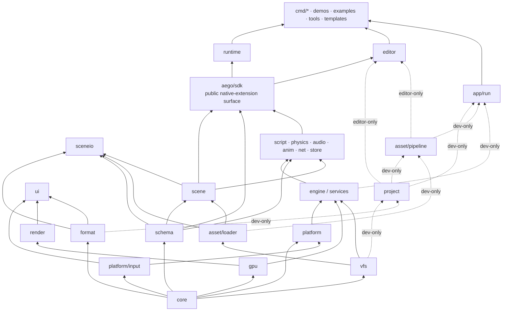

# Aego — Architecture

> **Status:** active architecture specification  
> **Language:** Go 1.27+  
> **Repository model:** monorepo, single root Go module `aego`  
> **Scope:** 2D-first engine with a planned 2.5D path, native desktop/mobile targets, built-in editor, custom scripting language, and compile-time native Go extensions.

---

## 1. Purpose

Aego is a 2D/2.5D game engine written in Go.

The engine is designed around five long-term goals:

1. **A real native engine, not a wrapper around another game engine.**
2. **A built-in editor** with a Unity/Godot-like workflow.
3. **A custom gameplay language** with hot reload and editor integration.
4. **Native Go extensions** for users who need to extend the engine itself.
5. **Portable runtime architecture** that can target desktop and mobile without making the renderer, scene system, editor, or gameplay code depend on a specific OS or graphics API.

Aego deliberately uses a small number of low-level external pieces where reimplementing platform plumbing provides little engine value:

- SDL3 for OS integration;
- generated OpenGL bindings;
- build-time tooling such as the font generator.

The engine itself owns scene management, rendering, batching, UI, assets, scripting, editor tooling, physics, audio mixing, networking, persistence, animation, materials, and export.

---

## 2. Architectural principles

### 2.1 Core rules

- No global engine singletons.
- Low-level packages never import high-level packages.
- Runtime code must not depend on editor/dev-only packages.
- Persistent identity is never represented by a runtime handle.
- Runtime handles are generational and never serialized.
- Source assets are not runtime assets.
- Source file paths are not asset identity.
- Scene data is text and Git-friendly.
- Export/runtime data is binary and optimized.
- Renderer does not know about scenes.
- Scene does not know about the editor.
- User Go code imports only `aego/sdk`.
- Native extensions are compiled into the project executable; they are not dynamically loaded with `plugin.Open`.
- Every stage ends in a runnable, testable result. Calendar deadlines do not define architectural completion.

### 2.2 Engine layers

This diagram shows **architectural ownership and the main dependency direction**, not every legal Go import.
The exact package rules are defined in [§4 Dependency rules](#4-dependency-rules) and enforced by `tools/depcheck`.



### Layer meaning

| Layer | Responsibility |
|---|---|
| **Foundation** | `core`: handles, math, IDs, clocks, logging, errors, statistics, deterministic utilities. |
| **Platform contracts** | `platform/input`, `platform`, `gpu`, `vfs`: OS/GPU/filesystem boundaries and their backend implementations. |
| **Metadata contracts** | `schema`, `format`: type metadata and serialization primitives. They remain independent from scene/editor code. |
| **Orchestration** | `engine`: lifecycle, worlds, phases, modules, services, main-thread work and frame execution. |
| **Presentation** | `render`, `ui`: scene-agnostic rendering and immediate-mode UI. |
| **Runtime content** | `asset/loader`, `scene`, `sceneio`: runtime assets, Node+Components world model and scene serialization. |
| **Gameplay systems** | `script`, `physics`, `audio`, `anim`, `net`, `store`: feature systems layered over the stable runtime model. |
| **Extension surface** | `aego/sdk`: the only supported API imported by user `native/` code. It is a facade, not an internal storage layer. |
| **Applications** | `runtime`, `editor`: executable-facing composition of the lower layers. |
| **Development-only** | `project`, `asset/pipeline`, `app/run`, CLI/tooling: source-project scanning, importing, rebuilding and supervision. These never enter exported runtime dependency graphs. |

The important boundary is not that every box imports only the box directly below it; the important boundary is that the graph remains a DAG and lower/runtime layers never acquire reverse dependencies on editor/dev-only code.

---

## 3. Decision registry

Decision IDs are stable references for design discussions, code reviews, migrations, and ADR-style changes.

### 3.1 Foundation and runtime

| ID | Decision |
|---|---|
| **D01** | Go 1.27+; the exact toolchain is pinned in `go.mod`. |
| **D02** | SDL3 is pinned and used only for windowing, GL context creation, events, timing, text input, clipboard, drag/drop, lifecycle and audio device output. `SDL_Renderer` and `SDL_GPU` are not used. |
| **D03** | OpenGL 3.3 Core is the first GPU backend. Public `gpu` APIs remain backend-neutral. |
| **D04** | No global engine singletons. Construction is `Builder → Engine`. |
| **D05** | All runtime resources use generational handles. Public engine APIs do not expose long-lived pointers to internal storage. |
| **D06** | Main thread owns platform, GPU and authoritative game/editor state. Workers compute and return results through queues. |
| **D07** | Headless is a first-class engine configuration, not a special build hack. |
| **D08** | 2D world: `+X` right, `+Y` down, radians internally, positive rotation clockwise, UV `(0,0)` top-left. |
| **D09** | One world unit is not defined as one pixel. Camera scale controls world-to-screen size. |
| **D10** | Shader math is linear; color textures and backbuffer use sRGB semantics. |
| **D11** | Fixed timestep uses an accumulator with interpolation and explicit `MaxFrameDelta` / `MaxSteps`. |
| **D12** | Logs are structured and channel-based. Errors are typed. `panic` is reserved for violated programming invariants. |
| **D13** | File-format versions are independent from engine versions. |
| **D14** | Dependency direction is strictly bottom-up. Low-level packages never import high-level packages. |
| **D15** | Stages close by acceptance criteria, not by a fixed calendar duration. |

### 3.2 Coordinates, targets and GPU

| ID | Decision |
|---|---|
| **D16** | Projection matrices in `mathx` use GL clip-space convention `z ∈ [-1,1]`. Backend differences are neutralized through `gpu.Capabilities.ClipZeroToOne` and a fixup in `render/view`, never in `mathx`. |
| **D17** | Offscreen targets render in native backend orientation. For GL, window viewport/scissor is flipped at the backend boundary; offscreen targets stay GL-native. `render/view` is the only place allowed to compensate target Y orientation. Render-target textures are exposed top-down with UV `(0,0)` top-left. |
| **D18** | Texture color is premultiplied once during upload. Runtime shaders do not multiply alpha again. Standard blending is `ONE / ONE_MINUS_SRC_ALPHA`. |
| **D19** | Transparent visual order is painter order: `layer → order → z → submission`. Batching only merges adjacent compatible draws and never reorders by texture/sampler/blend/clip. |
| **D20** | Sprite backend uses an instanced unit quad generated from `gl_VertexID`. This is an implementation detail of `render/sprite`, not public API. Sprite `z` exists only in sorting metadata. |
| **D21** | GL 3.3 buffer streaming uses orphaning (`BufferData(NULL)` + update). Persistent mapping is not part of the baseline. |
| **D22** | `SamplerDesc` is independent from `Texture`. Renderer caches samplers by descriptor. |
| **D23** | `TextureRegion` is the drawable texture unit: full texture, spritesheet frame, atlas cell or glyph. |
| **D24** | Renderer is an ordered list of `Pass` objects with `PassDesc{ID, Before, After}`. Pass order is topologically resolved and frozen once rendering starts. Built-ins initially include sprites and debug. |
| **D25** | `Camera2D.Zoom` means pixels per world unit. |
| **D26** | Screen/UI coordinates are Y-down logical pixels. `PushClip` is expressed in logical target pixels and never rotates with the camera. |
| **D27** | Stage 2 text is a built-in bitmap font mounted from `engine://`. Full editor text support arrives later. |
| **D28** | Golden rendering tests use exact comparison for nearest/pixel-stable scenes and tolerance comparison otherwise. Linux reference rendering uses Mesa llvmpipe with SDL offscreen video. |

### 3.3 Scene, schema and identity

| ID | Decision |
|---|---|
| **D29** | Scene model is **Node + Components**. Transform, hierarchy, name, enabled state and visibility layers are built into the node. Everything else is a component. |
| **D30** | Components use an independent sparse-set store per type. Aego does not use archetype ECS storage. |
| **D31** | A node can contain at most one component of a given type. |
| **D32** | A typed `*T` obtained from `ComponentStore[T]` is valid only for the current phase/query window. Adds enter a pending store and are visible through direct lookup immediately but not through active iteration until flush. Removes become logically invisible immediately and are physically compacted at flush. |
| **D33** | Structural mutations are deferred to phase flush. `Destroy` is logically immediate and idempotent; physical removal is deferred. |
| **D34** | `NodeID` is 128-bit persistent identity. `NodeHandle` is runtime-only and never serialized. |
| **D35** | Files store full type/field names. Runtime uses hashes. `FormerName` / `FormerFieldName` support schema renames. Hash collisions are build errors during `Freeze()`. |
| **D36** | Source formats use canonical **aetext** and contain no comments. Runtime/export artifacts use binary formats. |
| **D37** | Unknown components are preserved as parsed semantic blocks in `engine.Unknown` and survive load/save even when the defining extension is missing. |
| **D38** | Unresolved `NodeRef` / `AssetRef` preserve their persistent IDs and produce diagnostics; they do not silently become null. |
| **D39** | Nodes store `LocalEnabled`; `EffectiveEnabled` is derived during the hierarchy/transform pass. |
| **D40** | Node names are unique among siblings, interned, and indexed by `(parent, name)`. |
| **D41** | Visibility uses `Node.VisibilityLayers` and `Camera.Mask`. |
| **D48** | Built-in scene systems have stable IDs. `engine.transform` performs flush/hierarchy/transform/effective-enabled work. `engine.sprite_extract` extracts render commands. View construction belongs to Prepare rather than a separate camera phase. |
| **D49** | `FieldDescriptor` may use direct offset fast-path only for POD-like field kinds. Reference/GC-sensitive fields use typed accessors. |
| **D50** | Scenes are assets. `project.aego` references the main scene by `AssetID`. |

### 3.4 Assets, VFS and development pipeline

| ID | Decision |
|---|---|
| **D42** | Assets are split into runtime `asset/loader` and dev-only `asset/pipeline`. Scene depends only on `asset.Resolver`. |
| **D43** | Sidecars are named `<filename>.<ext>.meta`; moving source + sidecar preserves identity. |
| **D44** | Import cache is content-addressed by source bytes, settings, importer version, pipeline version and dependency artifact hashes. |
| **D45** | Hot reload is transactional: import → validate → runtime/GPU preparation → atomic swap. Failure preserves the previous working resource. |
| **D52** | Initial watcher is stdlib polling over `(path, size, mtime)` behind a `Watcher` interface. Known limitation: a same-size rewrite inside filesystem mtime granularity may be missed. |
| **D54** | Raw `os` filesystem access is allowed only in `vfs`, `platform`, `tools`, `cmd`, `project`, `asset/pipeline`, `engine/bootstrap` and `app/run`. Runtime-path packages (`engine`, `render`, `scene`, `sceneio`, `asset/loader`, `ui`, `sdk`) use VFS so the same code can run over `.aepak`. |

### 3.5 Native Go extensions and services

| ID | Decision |
|---|---|
| **D46** | `aego/sdk` is the only supported import surface for project-native Go code. `tools/depcheck` enforces this in examples. |
| **D47** | Native project builds use generated bootstrap code under `.aego/generated`. Build cache keys include engine/SDK/Go versions, target and native source state. |
| **D51** | Engine services are accessed through typed service registration keyed by stable string IDs. This allows upper layers to attach Scene, Renderer, Loader and editor services without reverse imports. |
| **D55** | `aego run` supervises the dev executable. Native source changes trigger a rebuild. Compile errors leave the current process alive. Successful rebuilds use a stdin restart protocol; the child serializes restart state and exits, then the new binary launches. |
| **D57** | `engine.World` is a service container. Systems declare scope in `{Play, Editor, Frame}`. `Engine.RunPhase(world, phase, scope)` executes a phase for a specific world. |

### 3.6 Editor

| ID | Decision |
|---|---|
| **D56** | Play mode clones the edit scene into a separate play world through scene serialization. Edit scene is immutable during Play. Stop destroys the play world. |
| **D58** | Editor UI fonts are pre-baked by `tools/genfont`; runtime TTF rasterization is not required for the Stage 4 editor. `render/text` exposes the common `Font` API (UTF-8 + kerning), `BitmapFont.Font()` adapts the Stage 2 debug font to that API, and editor font selection uses `text.FontSet.Closest(px, scale)`. |
| **D59** | Stage 4 uses one OS window. Docking exists entirely inside it. `DockTree` is serializable and does not know about native windows. |
| **D60** | Editor is a UI over scene/schema/assets/render. Nothing below `editor/` imports `editor/`. Runtime and `app/run` do not link editor code. |
| **D61** | All editor mutations go through history commands: property/transform/create/delete/reparent/rename/enabled/layers/component changes. A drag gesture is one transaction. Delete stores a serialized fragment preserving NodeIDs. |
| **D62** | Document dirty state is derived from History state vs saved History state. `Scene.Revision` exists only for cache invalidation/change tracking. |
| **D63** | Selection stores persistent `NodeID`, never `NodeHandle`. |
| **D64** | Scene editor camera is editor state, not a scene node. |
| **D65** | Scene View and Game View render into pooled render targets in 64-pixel buckets. Runner target/view overrides redirect extraction without changing scene ownership. |
| **D66** | Reparent preserves world transform by default. Non-invertible parent transform yields `SceneBadReparent`. Shear created by non-uniform parent scale is not preserved. |
| **D67** | Editor-only project Go code is compiled with build tag `aego_editor`. |
| **D68** | Local editor state lives under `.aego/user`, `.aego/session`, `.aego/recovery`, plus `.aego/editor.lock`; none is committed. |
| **D69** | Input routing order: modal → focused widget → hovered-panel shortcuts → global shortcuts → Scene View → Game View. Active widgets/gizmos own pointer capture. |
| **D70** | Text entry uses SDL text input/editing events. Text input starts on text-field focus and stops on blur. Enter/blur commit; Escape cancels. |
| **D71** | Editor extension callbacks are protected by `recover`. A panicking extension is disabled and reported instead of taking down the editor. |
| **D72** | Editor UI is not required to be allocation-free. Stage 4 idle budget is ≤64 KiB/frame and the target is 60 FPS with a 10k-node Hierarchy. `ui/draw.List` has independent base/popup/modal/top streams. |
| **D73** | `aego edit` с `native/`: supervisor собирает cmd из `.aego/build/editor/main.go` (`-tags aego_editor`), следит за `native/*.go`, `go.mod`, `go.sum`. Протокол через `.aego/session/`: `build.status`, `restart` (запрос), `handoff.aetext` + `scenes/` + `handoff.ready` (коммит-маркер). Редактор на restart пишет handoff и выходит с кодом 3; новый бинарник забирает handoff. Если новый бинарник падает в первые 10 с, supervisor запускает предыдущий. |
| **D74** | В Play редактор целиком переключается на play-мир: `Docs.Active()` возвращает play-вид документа (тот же ID/путь/вид, play-сцена, play-история, play-props). Save/Reload/recovery/dirty работают с реальными документами через `Docs.Get`/`Docs.Docs`. |
| **D75** | Правки в Play — в отдельной history в `ModePlay` (Dirty=false, MarkSaved no-op, лейблы с префиксом `[Play]`); история уничтожается на Stop вместе с play-видом. |
| **D76** | Inspector читает значения каждый кадр; поле, которое сейчас редактируется (active/focus/popup), показывает своё кэшированное значение до отпускания. |
| **D77** | Компоненты в Inspector группируются по категории; DisplayName + бейдж модуля; порядок внутри категории — порядок добавления. |
| **D78** | Шаблоны расширений — в подменю Create → `<module>`; встроенные — в корне. |
| **D79** | Default layout: слева Hierarchy над Assets, центр Scene/Game, низ Console/Profiler, справа Inspector.<br>Реализация: `dock.Columns(left, leftBottom, center, bottom, right)`; `window.reset_layout` удаляет `.aego/user/layout.aetext`. |
| **D80** | Верх редактора — MenuBar и Toolbar фиксированной высоты; имя документа и dirty — во вкладке и title окна.<br>Реализация: `theme.BarHeight`; меню из `command.Registry` (Category, Order, Label, Checked), разделитель при смене `Order/100`; Toolbar — инструменты, Grid/Snap/Zoom, Play/Pause/Step/Stop, Save; индикатор native — session `build.status` (building/ok/error). |
| **D81** | Иконки — атлас `engine/res/icons` через `tools/genicons`; `ui.Icon(id)` — единственный способ рисовать иконку.<br>Реализация: `render/icons.Set` загружается из `engine://icons/icons.json`; `widgets.IconAt` рисует иконку или placeholder; `tools/genicons -init` пишет placeholder SVG только для отсутствующих ID. |

## Stage 4.5 — 3D foundation

**D82 Space.** Node.Space ∈ {Space2D, Space3D}. Новый узел наследует пространство родителя; дети корня получают Scene.DefaultSpace. CreateIn задаёт пространство явно. SetSpace разрешён только листу без Space-locked компонентов.

**D83 Смешанное дерево.** 2D под 3D разрешено: world4 = nearest3D.World4 × Mat4Lift(world2D цепочки от первого 2D-потомка). 3D под 2D запрещено (кроме корня); Reparent и CreateIn возвращают SceneSpaceMismatch. Transform pass — один pre-order обход с тремя формулами.

**D84 Конвенции.** Правая система, Y вверх, камера смотрит в −Z. Lift отображает 2D (x, y) в 3D (x, −y, 0). QuatEuler(x, y, z) = Rz·Ry·Rx. Euler существует только в UI (градусы, EulerCache против скачков); в aetext Quat пишется как [x, y, z, w].

**D85 Depth.** gpu не знает о размерности. PassDesc.DepthTarget; FBO кешируется по паре (color, depth). rt.Pool.Acquire(w, h, depth) не смешивает цели с depth и без. Renderer очищает depth при первом использовании цели в кадре или при DoClear.

**D86 Спрайты в 3D.** 2D-спрайты с 3D-предком рисуются отдельным pipeline sprites3d (на инстанс Pos/Right/Down/UV/Color, depth test без записи, сортировка back-to-front). Чистый 2D-путь не меняется.

**D87 Меши.** Артефакт AEMS (magic, version, counts, AABB3, vertices, indices); импорт .obj. Примитивы Cube/Plane/Sphere/Cylinder — процедурные встроенные ассеты с зарезервированными AssetID (asset.Builtin*, Hi = 0xae90…); Loader резолвит их без pipeline, пикер ассетов показывает их отдельно. Instancing мешей отложен.

**D88 SpaceKind компонентов.** schema.Space(k) на TypeDescriptor: SpaceAny/Space2D/Space3D. AddComponent проверяет совместимость; inspector фильтрует Add Component; SetSpace запрещён при Space-locked компонентах. Camera переименована в Camera2D с FormerName("engine.Camera").

**D89 Обратимость.** Mat3.Inverse возвращает (Mat3, bool); тихий identity-fallback удалён. Вызывающие (view, gizmo, sceneview, templates, reparent) обрабатывают необратимый родитель явно.

**D90 Отложено.** gizmo.Registry для расширений работает только в 2D; 3D-гизмо модулей (DrawCtx3) проектируются вместе с extension-API Stage 5.

---

## Stage 5 — Aego Script Core v1

| ID | Decision |
|---|---|
| **D91** | Aego Script: статически типизированный язык с Go-подобным синтаксисом, компилируется в регистровый байткод. Файлы `*.aes`; пакет = каталог под корнем `scripts/` (тот же overlay `res://`). Путь пакета = `project.Module + "/" + относительный каталог`. Host-модули и скрипт-пакеты делят одно пространство имён, конфликт → AES4xxx; префикс `aego/` зарезервирован за stdlib, `module="aego"` — ошибка проекта. |
| **D92** | Нет указателей, unsafe, горутин, каналов, defer, исключений, замыканий, функций первого класса, наследования, интерфейсов, общих generics, map и перегрузки операторов. Аргументы типов принимаются парсером, но резолвятся только для зарегистрированных generic-интринсиков (`node.Get<T>()`). |
| **D93** | `int`=int64, `float`=float32, `bool`, `string` (неизменяемая, литералы интернированы). Engine value-типы: Vec2, Vec3, Color, Quat, Rect, Transform2D{Position Vec2, Rotation float, Scale Vec2}, Transform3D{Position Vec3, Rotation Quat, Scale Vec3}, NodeRef, AssetRef<T>, ComponentRef<T>. Пользовательские: struct (значение), enum, `[]T` (хип). Короткое имя компонента в `Get<T>` резолвится, если уникально среди компонентов Universe, иначе AES2xxx со списком кандидатов. |
| **D94** | Нет изменяемых глобалов пакета, только `const`. Состояние живёт в инстансах скриптов и компонентах. |
| **D95** | `script` — stateful-тип для прикрепления. Один ScriptComponent (`engine.Script`) на узел хранит attachments, не больше одного attachment каждого скрипт-типа. Attachment сохраняется собственным блоком `script "<FullName>" enabled=… { … }` по полному имени типа и паре имя/значение свойства, никогда по runtime-индексу. Авторские значения — `schema.PropertyBag`; неизвестные свойства и типы сохраняются как есть. |
| **D96** | Скрипт-типы — динамический слой внутри `schema.Registry`: нативный слой замораживается `Freeze()`, `SetDynamic` атомарно подменяет только динамический и отклоняет коллизии имён/хэшей с нативным слоем, не меняя ничего. `ByID/ByName/Field` видят оба слоя, `Components()` — только нативные, `Scripts()` — динамические. Поля скрипт-типов работают на `PropertyBag`. `scene.Types.Overlay` маршрутизирует Get/SetProperty для `TypeScript` в ScriptComponent; `scene ✗ script` сохраняется. Отдельного типа Universe нет. |
| **D97** | `vm.Value{A, B uint64}` — ровно 16 байт, без Kind. int/bool/enum в A; float в младших 32 битах A; Vec2 A=(x,y); Vec3 A=(x,y), B=(z,0); Color/Quat/Rect A=(x,y), B=(z,w); string/[]T — heap handle в A; NodeRef A=NodeHandle; AssetRef A,B=AssetID; ComponentRef A=NodeHandle, B=индекс таблицы компонентов линковки. struct = N подряд идущих Value (раскладка статическая, вложенные развёрнуты) в регистрах, полях инстанса и элементах слайса; копирование — MOVE. Хип — только `[]T` и string. GC mark-sweep только в safe point без активных фреймов; корни — поля инстансов (типы из дескриптора скрипт-типа), содержимое слайсов — по типу из заголовка heap-объекта. Слот 0 инстанса — `node`; поля скрипта начинаются со слота 1. Host-методы `NodeRef`/`AssetRef` импортируются из модулей `#NodeRef`/`#AssetRef` с получателем первым параметром; интринсики — `#NodeRef.Get<полное имя компонента>` и `Has<…>`. Окно `CALL`/`CALLH` всегда на вершине регистрового стека функции. |
| **D98** | Native-биндинги резолвятся один раз при линковке; байткод хранит символьные host-импорты с сигнатурами; BindingRegistry выдаёт ABI-хэш, который входит в ключ кэша компиляции. Без reflection в горячем пути VM. |
| **D99** | Байткод верифицируется до исполнения: границы, цели переходов, число регистров, сигнатуры host-импортов, ссылки на типы. Испорченные артефакты отклоняются и не исполняются. |
| **D100** | Faults изолированы на уровне инстанса (Running/Faulted/Disabled). Бюджет инструкций на коллбэк (dev по умолчанию 100k). Паники native-биндингов перехватываются и сообщаются как AES6002 NativeBindingPanic. |
| **D101** | Жизненный цикл v1: Ready, FixedUpdate(dt), Update(dt). Ready — после создания всех инстансов и резолва ссылок, в pre-order сцены. Update/FixedUpdate — в порядке создания инстансов. Системы `script.fixed` (PhasePrePhysics) и `script.update` (PhaseUpdate), обе только ScopePlay. |
| **D102** | Авторское состояние (`@export` в .aescene) и runtime-состояние (поля инстанса) разделены; Play никогда не пишет в edit-сцену. |
| **D103** | Компиляция транзакционна по пакету: неудача сохраняет last-good артефакт и помечает источник Invalid; Play заблокирован, пока есть Invalid-пакет. |
| **D104** | Компилятор (`source/token/lexer/diag/ast/parser/types/resolver/checker/asm/compiler`) и runtime (`abi/bytecode/verify/bind/vm/runtime`) — раздельные подграфы; экспортированный runtime линкует только runtime-сторону. Общий лист — `script/abi` (Signature, TypeRef, ValueKind, Surface); checker принимает `abi.Surface`; `bind.Ctx.Self` — `vm.InstanceID`. IR-слоя нет: v1 компилирует AST → байткод напрямую, `script/asm` — это ассемблер (буфер инструкций, пул констант, метки), а не промежуточное представление; IR появится, только если понадобятся оптимизации. |
| **D105** | Версии языка, байткода и ABI биндингов независимы и все записываются в артефакт. |
| **D106** | `yield signal coroutine await select go chan defer interface map` — зарезервированы с v1 (AES1004). |
| **D107** | Видимость по правилу Go (экспорт — с заглавной); `@export` — экспозиция в сцену и Inspector, с видимостью не связана. |
| **D108** | `@former` на скрипт-типах и полях повторяет FormerName/FormerField native-схемы; неизвестные свойства скрипта в сцене сохраняются и пересохраняются с предупреждением. Оси ввода — `input.AxisConfig` в `platform/input`; `project` парсит блок `input {}`, `app/run` и `app/edit` передают его в stdlib. |
| **D109** | Встроенная текстура `engine/textures/white` (AssetID `ae90…0010`) резолвится Loader без pipeline и нужна для прототипов: спрайты задаются `tint` и `size`. |
| **D110** | Скрипт-пакеты импортируются одной группой `scripts`: checker видит весь проект, кэш компиляции — по пакету через `compiler.CacheKey`. ID группы детерминирован от имени группы, поэтому last-good артефакт пакета переживает рестарт. Импортёр публикует структурированный снимок диагностик с ревизией; редактор выводит его в Console. |

---

## 4. Dependency rules

The import graph must remain acyclic. The layer diagram in §2.2 is intentionally conceptual; this section contains the rules that are actually enforced.

### 4.1 Global rules

- `core/...` is the lowest engine layer and uses only the standard library.
- `platform/input` is a leaf-style input model. `platform/...` may import it; `platform/input` never imports the platform backend.
- `render/...` does **not** import `platform`, `engine`, `ui`, `scene` or `editor`.
- `render/module` is the single integration package allowed to connect renderer registration with `engine`.
- `schema/...` depends only on `core/...`. Asset and node references are recognized through schema-facing interfaces, not by importing high-level packages.
- `scene/...` never imports `editor/...` or `asset/pipeline/...`.
- `scene/...` resolves assets only through `asset.Resolver` / runtime loader-facing contracts.
- `sceneio/...` owns scene source serialization and may use `scene`, `schema`, `format` and runtime asset-reference contracts; `scene` itself does not import `sceneio`.
- `asset/loader/...` is runtime-safe.
- `asset/pipeline/...` and `project/...` are development-only and never enter exported runtime dependency graphs.
- `script/...` may use `schema`, `scene` and stable runtime services, but never `editor/...`.
- User project `native/` code imports only `aego/sdk`.
- Nothing below `editor/...` imports `editor/...`.
- `core/stats` remains a leaf utility package; renderer-specific statistics remain in `render`.
- cgo and direct OS access are restricted to explicitly approved packages.

### 4.2 Stage 1–2 clarifications

- `core → platform/input → platform`; there is no reverse import from `platform/input` into `platform`.
- Event-to-state conversion is performed by `platform.ApplyInput`.
- `render` and its normal subpackages do not import `platform`, `engine` or `ui`.
- `render/module` is the only exception for engine integration.
- `ui/...` may import `render/...` and `platform/input`, but not the full `platform` backend and not `engine`.
- `engine/res` is mounted as `engine://` during `Build()`.
- `core/stats` does not absorb renderer counters; `render.Stats` remains owned by `render`.

### 4.3 Stage 3 clarifications

- `schema/...` depends only on `core/...`.
- Asset and node references are recognized through `schema.AssetRef` and `schema.NodeRef`-style contracts implemented by `asset` and `scene`.
- `scene/...` knows assets only through `asset.Resolver`; it never imports `asset/pipeline`.
- `asset/loader/...` never imports `asset/pipeline/...`.
- `project/...` owns source-project metadata (`project.aego`), project roots and native-build inputs; it is dev-only.
- `examples/**` represents user-facing SDK projects and may import only `aego/sdk` from the engine.
- `render` remains scene-agnostic; scene-to-render extraction lives in `scene/systems`.

### 4.4 Stage 4 clarifications

- `ui/...` may import `format/...` for serialization/deserialization of docking and UI layout state.
- `editor/...` may import the runtime/dev package families it composes: `core`, `platform/input`, `gpu`, `render`, `ui`, `schema`, `scene`, `asset/...`, `format`, `project` and `engine`. **No package imports `editor/...` from below.**
- `app/run`, `runtime/...`, and `examples/**` when built **without** the `aego_editor` tag are forbidden from importing `editor/...`; `tools/depcheck` treats this as an error.
- `render/text` exposes `Font` as the common text-facing abstraction with UTF-8 and kerning support. `BitmapFont.Font()` converts/adapts the Stage 2 built-in bitmap debug font to the same `Font` API.
- Editor-only project Go code is isolated by the `aego_editor` build tag.

### 4.5 Stage 5 clarifications

- `script/abi`, `script/diag`, `script/source`, `script/token` → `core`, `schema`.
- `script/{lexer,ast,parser,types,resolver,checker,asm,compiler,build}` → `core`, `schema`, `format/aetext`, остальной dev-слой `script/*` (dev-only).
- `script/{bytecode,verify,vm}` → `core`, `schema`, `script/{abi,diag,source}`.
- `script/bind` → `script/{abi,vm}`, `scene`, `engine`, `asset`, `platform/input`, `core`.
- `script/stdlib` → runtime-слой, `script/bind`, `scene/...`, `engine`, `asset`, `platform/input`.
- `script/runtime` → `script/{abi,bytecode,verify,bind,vm}`, `scene/...`, `asset/...`, `engine`, `platform/input`.
- `script/module` → `script/{bind,runtime,stdlib}`, `engine`, `scene`.
- `asset/importers/script` → dev-слой `script/*`, `asset`, `asset/pipeline`.
- `scene/components` → `format/aetext` (сырые свойства attachments); `scene/sceneio` → `scene/components`.
- `project` → `platform/input` (`input.AxisConfig`).
- `scene/...` ✗ `script/...`; `script/{bytecode,verify,vm,bind,stdlib,runtime,module}` ✗ `script/{lexer,parser,checker,asm,compiler,build,harness}`.
- `editor/...` ✗ `script/...`: редактор работает через `context.ScriptHost`, реализованный в `app/edit`.

### 4.6 Enforcement

`tools/depcheck` enforces at least:

- forbidden package-family edges;
- runtime → editor/dev-only imports;
- `app/run`, `runtime/...`, and non-editor `examples/**` importing `editor/...`;
- `examples/**` bypassing `aego/sdk`;
- `os.*` outside `vfs`, `platform`, `tools`, `cmd`, `project`, `asset/pipeline`, `engine/bootstrap`, and `app/run`;
- `import "C"` outside approved native bridges such as `platform/sdl` and `gpu/gl33/gl`;
- obvious mutable global engine/service singletons.

---

## 5. Repository layout

The number in parentheses is the stage where the package first becomes real. Empty placeholder packages are not created.

```text
aego/
├── go.mod
├── ARCHITECTURE.md
├── ROADMAP.md
├── Taskfile.yml
├── .github/workflows/ci.yml
│
├── core/                                  # stdlib-only
│   ├── handle/                            (1)
│   ├── mathx/                             (1)
│   ├── clock/                             (1)
│   ├── log/                               (1)
│   ├── errs/                              (1)
│   ├── stats/                             (1)
│   ├── bits/                              (2)
│   ├── ids/                               (3)
│   └── rng/                               (3)
│
├── engine/                                (1)
│   ├── res/                               (2) embedded engine:// resources
│   ├── bootstrap/                         (3) dev/native bootstrap integration
│   └── ...
│
├── platform/                              (1)
│   ├── input/
│   ├── sdl/
│   ├── headless/
│   └── android/                           (14)
│
├── gpu/                                   (1)
│   ├── gl33/
│   │   ├── gl/                            generated, DO NOT EDIT
│   │   └── internal/glstate/
│   ├── null/
│   ├── gles30/                            (14)
│   └── shaderc/                           (12)
│
├── vfs/                                   (1)
│   ├── osfs/
│   ├── pakfs/                             (13)
│   └── assetfs/                           (14)
│
├── render/                                (2)
│   ├── view/
│   ├── texture/
│   ├── sprite/
│   ├── culling/
│   ├── debug/
│   ├── text/                              (2 BitmapFont, 4 Font UTF-8+kerning / FontSet)
│   ├── gpuprof/
│   ├── module/
│   ├── material/                          (12)
│   ├── postfx/                            (12)
│   └── light/                             (12)
│
├── ui/                                    (2 core, 4 editor-complete)
│   ├── draw/
│   ├── core/
│   ├── widgets/
│   ├── overlay/
│   ├── layout/                            (3)
│   ├── textedit/                          (4)
│   ├── dock/                              (4)
│   └── theme/                             (4)
│
├── schema/                                (3)
│   └── reflectgo/
│
├── format/                                (3)
│   ├── aetext/                            source parser/writer + canonicalizer
│   ├── binary/                            import/export artifact primitives
│   └── pak/                               (13) .aepak index/container format
│
├── project/                               (3) project.aego, source project model, native build inputs
│
├── asset/                                 (3)
│   ├── loader/                            runtime AssetID → artifact/resource
│   ├── pipeline/                          dev-only scan/meta/import/watch/cache
│   ├── importer/
│   │   ├── png/
│   │   ├── atlas/
│   │   ├── script/                        (5) .aes packages → ArtScript
│   │   ├── font/                          (4)
│   │   ├── audio/                         (9)
│   │   └── shader/                        (12)
│   └── pak/                               (13)
│
├── scene/                                 (3)
│   ├── components/
│   ├── systems/
│   └── prefab/
│
├── sceneio/                               (3)
│
├── script/                                (5+)
│   ├── abi/                               shared leaf: Signature, TypeRef, Surface
│   ├── source/
│   ├── token/
│   ├── lexer/
│   ├── diag/
│   ├── ast/
│   ├── parser/
│   ├── types/
│   ├── resolver/
│   ├── checker/
│   ├── asm/
│   ├── compiler/
│   ├── bytecode/
│   ├── verify/
│   ├── bind/
│   ├── vm/
│   ├── runtime/
│   ├── stdlib/
│   ├── module/
│   ├── reload/                            (6)
│   └── docgen/                            (7)
│
├── physics/                               (8)
├── audio/                                 (9)
├── anim/                                  (11)
├── net/                                   (13)
├── store/                                 (13)
│
├── sdk/                                   (1 boundary, populated from 3)
│
├── editor/                                (4)
│   ├── app/
│   ├── project/
│   ├── document/
│   ├── command/
│   ├── history/
│   ├── selection/
│   ├── playmode/
│   ├── gizmo/
│   ├── ext/
│   ├── build/
│   └── panels/
│       ├── hierarchy/
│       ├── inspector/
│       ├── sceneview/
│       ├── gameview/
│       ├── assets/
│       ├── console/
│       ├── profiler/
│       ├── scripteditor/                  (6)
│       ├── physicsdebug/                  (8)
│       ├── audiomixer/                    (9)
│       ├── pixel/                         (10)
│       ├── spritesheet/                   (10)
│       ├── animation/                     (11)
│       ├── shader/                        (12)
│       ├── settings/
│       ├── export/                        (13)
│       └── help/                          (7)
│
├── runtime/                               (13)
│   └── app/
│
├── app/
│   └── run/                               (3) dev runner/supervisor; never imports editor
│
├── cmd/
│   ├── sandbox/                           (1)
│   ├── aego/                              (3)
│   ├── aego-editor/                       (4)
│   └── aego-runtime/                      (13)
│
├── tools/
│   ├── bootstrap-native.sh                (1)
│   ├── gen-gl.sh                          (1)
│   ├── depcheck/                          (1)
│   ├── genfont/                           (2, nested module)
│   ├── golden/                            (2)
│   ├── bench/                             (2)
│   └── docsite/                           (7)
│
├── templates/                             (13)
│   ├── project/
│   ├── desktop/
│   └── android/                           (14)
│
├── examples/                              (3) user-facing projects; engine imports only via aego/sdk
│
├── demos/
│   ├── basic input resize headless        (1)
│   ├── sprites camera layers text
│   │   offscreen stress                   (2)
│   ├── scene hotreload native             (3)
│   ├── editor                             (4)
│   ├── platformer                         (5+)
│   └── physics audio anim shaders net     later stages
│
├── tests/
│   ├── integration/
│   ├── gl/
│   ├── golden/
│   └── bench/
│
├── third_party/
│   └── sdl/version.txt
│
├── docs/                                  (7)
└── .cache/                                ignored
```

### 5.1 Important correction: source vs binary format

Source scene/material/animation/prefab/project files are **not** chunked binary containers.

```text
project.aego
*.aescene
*.aeprefab
*.aemat
*.aeanim
```

use canonical `aetext`.

Chunk tables such as string/reference/node/property tables belong only to runtime/export/import artifacts, primarily `.aepak` and binary cache formats.

---

## 6. User project layout

Created by:

```bash
aego new MyGame
```

```text
MyGame/
├── project.aego
├── res/                         mounted as res://
│   ├── scenes/
│   ├── scripts/
│   ├── sprites/
│   ├── audio/
│   └── shaders/
│
├── native/                      optional Go extensions
│   ├── module.go                imports only aego/sdk
│   └── editor_*.go              optional; `//go:build aego_editor`
│
├── .aego/                       ignored
│   ├── cache/
│   ├── generated/
│   ├── build/
│   ├── user/
│   ├── session/
│   └── recovery/
│
└── exports/
```

The engine treats `res://` as project content, not as a direct OS path.

---

## 7. File formats

| Extension | Purpose | Representation |
|---|---|---|
| `project.aego` | Project metadata and main scene reference | canonical aetext |
| `.aescene` | Scene source | canonical aetext |
| `.aeprefab` | Prefab source | canonical aetext |
| `.aemat` | Material source | canonical aetext |
| `.aeanim` | Animation source | canonical aetext |
| `.aes` | Aego gameplay script | text |
| `.aeshader` | User shader source | text |
| `.meta` | Source asset sidecar | canonical aetext |
| `.aepak` | Export package | binary |

Every format owns its own version.

Example:

```text
engine_version   = 0.8.0
native_sdk       = 3
scene_format     = 4
material_format  = 2
dsl_version      = 5
pak_format       = 2
```

These values are intentionally independent.

---

## 8. Handles and lifetime

### 8.1 Handle rules

```go
type Handle[T any] struct {
    Index uint32
    Gen   uint32
}
```

- Generation starts at `1`.
- Zero handle is always invalid.
- Reusing an index increments generation.
- Persistent data never stores a runtime handle.
- A pointer returned by an arena/store is a temporary fast-path view, not ownership.

### 8.2 Arena pointer lifetime

A pointer returned by `Arena.Get` is valid only until an operation that may grow/move the arena.

Callers that need stable identity keep the handle and re-resolve it.

### 8.3 GPU lifetime

- GPU destruction during a frame is deferred until a safe point at `EndFrame`.
- Backend state caches key resources by full `{Index, Gen}`, never raw index.
- Recreated resources with reused indices must invalidate cached backend bindings.

---

## 9. Scene model

### 9.1 Node contents

Every node owns:

```text
NodeID                 persistent 128-bit identity
Name                   interned StringID
LocalEnabled
EffectiveEnabled       derived
VisibilityLayers
Transform2D            local
WorldTransform         derived
Parent
FirstChild
NextSibling
PrevSibling
```

`Transform2D` is built into the node and cannot be removed.

### 9.2 Node templates are editor conveniences

Names such as:

```text
Sprite2D
Camera2D
AudioSource2D
```

are **editor creation templates**, not serialized node types.

For example:

```text
Sprite2D template
  → create Node
  → attach SpriteRenderer
```

The scene file stores only the node and its components.

### 9.3 Components

A component type has an independent sparse-set:

```text
denseNodes[]
denseData[]
sparse[]
```

The model intentionally avoids archetype/chunk ECS.

Rules:

- one component of each type per node;
- direct typed iteration for systems;
- schema metadata exists independently from hot-path storage;
- structural changes are deferred.

### 9.4 Structural mutation semantics

`Destroy(h)`:

1. marks the node logically dead immediately;
2. `IsAlive(h)` becomes false immediately;
3. queries skip it immediately;
4. physical component/tree removal happens during the structural flush;
5. repeated `Destroy(h)` is harmless.

Adds/removes follow D32 semantics so a system cannot accidentally iterate newly-added instances and loop over its own structural writes.

### 9.5 Hierarchy traversal

The scene stores a derived pre-order index list.

Structural flush rebuilds it only when hierarchy structure changes.

Transform/effective-enabled evaluation is a single linear pass where a parent always appears before its children.

No recursive transform traversal is required per frame.

---

## 10. Schema and reflection

`schema` is the single metadata source for:

- serialization;
- editor Inspector;
- undo/history;
- DSL bindings;
- native extension discovery;
- property validation;
- references;
- future replication metadata.

Conceptually:

```go
type TypeDescriptor struct {
    ID         TypeID
    FullName   string
    Version    uint32
    Fields     []FieldDescriptor
    FormerNames []string
}
```

```go
type FieldDescriptor struct {
    ID       FieldID
    Name     string
    Kind     FieldKind
    Flags    FieldFlags
    Offset   uintptr
    Size     uintptr
    FastPath bool
    FormerNames []string
}
```

Reflection may be used while registering Go types.

After `Registry.Freeze()`:

- full-name uniqueness is validated;
- type/field hash collisions are rejected;
- lookup tables are fixed;
- hot paths use IDs and precomputed descriptors rather than repeated `reflect` work.

POD-like fields may use offset-based fast access.

GC-sensitive/reference fields use typed accessors so the runtime does not bypass Go write barriers.

---

## 11. References and identity

### 11.1 Node reference

A serialized `NodeRef` stores `NodeID`.

Runtime may cache a `NodeHandle`, but that cache is derived.

Missing target:

```text
ID remains present
runtime handle is invalid
diagnostic is emitted
```

Saving the scene does not erase the unresolved reference.

### 11.2 Asset reference

`AssetRef[T]` follows the same model:

```text
persistent AssetID
+
derived runtime resource handle
```

Source file paths never appear in scene identity.

---

## 12. Asset architecture

### 12.1 Runtime loader

`asset/loader` exists in editor, dev run and exported games.

Responsibilities:

```text
AssetID
  ↓
artifact index
  ↓
runtime resource
  ↓
residency / hot swap
```

It knows nothing about:

- source `.png`;
- `.meta`;
- filesystem watcher;
- import settings editor;
- source folder scans.

### 12.2 Development pipeline

`asset/pipeline` exists only in editor/dev tools.

Responsibilities:

- source scan;
- sidecar management;
- source → AssetID mapping;
- importers;
- dependency graph;
- content-addressed cache;
- watcher;
- batched reimport;
- generation of runtime artifacts.

### 12.3 Sidecars

```text
player.png
player.png.meta
```

Moving both files preserves `AssetID`.

### 12.4 Import cache key

Conceptually:

```text
hash(
    source bytes,
    normalized import settings,
    importer version,
    pipeline version,
    dependency artifact hashes,
)
```

### 12.5 Transactional reload

```text
source changed
    ↓
debounced dirty set
    ↓
dependency closure
    ↓
import temporary artifact
    ↓
validate
    ↓
prepare runtime/GPU resource
    ↓
success?
    ├─ yes → atomic swap
    └─ no  → old resource stays active
```

Watcher events are coalesced before import, so editor saves and large operations such as `git checkout` do not trigger pathological reimport storms.

---

## 13. VFS

Engine-facing code uses URI-like schemes:

```text
res://
engine://
user://
cache://
```

Rules:

- `res://` and `engine://` support overlay mounts; latest mount wins reads.
- `user://` and `cache://` have exactly one writable mount.
- runtime code never assumes `res://` is an OS directory.
- `.aepak` later mounts into the same VFS surface.

Allowed raw OS filesystem users are limited to `vfs`, `platform`, `tools`, `cmd`, `project`, `asset/pipeline`, `engine/bootstrap`, and `app/run`.

---

## 14. Renderer architecture

### 14.1 Separation

```text
scene/systems
    ↓ extracts
ViewFrame / SpriteDraw
    ↓
render
    ↓
gpu
    ↓
backend
```

Renderer never receives Scene or Node types.

### 14.2 Sprite order

Visual order:

```text
layer
  ↓
order
  ↓
z
  ↓
submission
```

Batching is a post-order optimization only.

A texture/material/sampler change may split a batch but must never change visual order.

### 14.3 Texture semantics

CPU image decoding may begin as straight alpha.

Uploader converts to premultiplied representation.

Runtime blending expects premultiplied color.

### 14.4 Render targets

Window and offscreen targets share a common render target abstraction.

Backend orientation differences are contained by `render/view` and backend conversion rules.

`ReadPixels` always returns:

```text
RGBA8
top row first
no row padding
```

regardless of backend.

### 14.5 UI/editor rendering

Scene View and Game View render into pooled render targets.

Targets are bucketed to 64-pixel boundaries to avoid constant reallocation while splitters are dragged.

---

## 15. GPU contracts

### 15.1 Uniforms and samplers

Engine convention:

```text
UBO blocks: ub0 .. ub15
samplers:   tex0 .. tex14
texture unit 15 reserved for engine upload/internal work
```

Stage 12 shader tooling emits these conventions automatically.

### 15.2 GPU input memory

Data passed through cgo-backed GPU functions must live in pointer-free byte allocations when needed.

Do not pass a subfield whose containing Go object includes pointers and assume cgo checks only the field.

### 15.3 Queries

Only one active GPU query is allowed per device in the baseline implementation.

Nested query scopes are forbidden.

`EndQuery` must occur in the same render pass in which the query began.

---

## 16. Engine construction and modules

Construction:

```text
Builder
  ↓ register modules / systems / services
Build()
  ↓ initialize platform, VFS, workers, GPU
  ↓ freeze registries
ModuleIniter.Init(*Engine)
  ↓
Engine
```

Modules register systems during `Builder.Use`.

Runtime resource creation happens during module initialization after low-level backends are available.

### 16.1 Services

Services are stable-ID entries inside a world/service registry.

They allow high-level packages to attach:

- renderer;
- asset resolver/loader;
- scene;
- editor context;
- other world-local services;

without creating reverse package imports.

---

## 17. Worlds and execution scopes

A `World` is a set of world-local services and state.

System scopes:

```text
Play
Editor
Frame
```

Examples:

- transform system: Editor + Play;
- sprite extraction: Editor + Play;
- user gameplay AI: Play;
- editor maintenance system: Editor;
- platform/frame statistics: Frame.

The engine can run the same phase graph for different worlds without conflating edit state and play state.

---

## 18. Frame lifecycle

High-level order:

```text
FrameBegin
    drain OnMain
    stats.begin

PollEvents
    platform.PollEvents
    input.Apply
    resize / DPI metrics
    app event dispatch

Input

FixedBegin
    × zero or more fixed steps
    PrePhysics
    Physics
    app.fixed
    PostPhysics
FixedEnd

PreUpdate
app.update
PostUpdate

Animation

RenderPrepare
    structural flush as required
    transforms
    effective enabled
    views
    sprite extraction

Render
    gpu.BeginFrame
    renderer begin
    app.render
    render systems/passes

RenderUI
    UI / editor overlays
    renderer end

gpu.EndFrame
window swap

FrameEnd
    stats.end
```

Reserved system IDs include:

```text
app.fixed
app.update
app.render

engine.transform
engine.sprite_extract
```

Extension systems order themselves with stable `Before` / `After` IDs.

---

## 19. Input model

Input has separate concepts for:

- physical scan code;
- layout-dependent key code;
- Unicode text input;
- pointer state;
- recorded `InputFrame`.

Focus loss clears held button/key state.

Gameplay/editor code never synthesizes text by translating `KeyDown`.

Text fields use platform text/IME events.

Recorded `InputFrame` exists to support replay, tests and future networking/debugging.

---

## 20. Editor architecture

### 20.1 Editor is a client of the engine

Editor does not own a parallel scene/render/asset model.

It uses:

```text
scene
schema
asset/pipeline
asset/loader
render
ui
history
sdk extension registry
```

### 20.2 Documents

Open scene files are documents.

A scene document owns:

- loaded edit scene;
- history state;
- persistent selection;
- Scene View state;
- file path/AssetID;
- dirty state.

### 20.3 Play mode

```text
Edit Scene
    ↓ serialize/clone through sceneio
Play Scene / Play World
    ↓ mutable gameplay
Stop
    ↓ destroy Play World
```

The edit scene is not rolled back because it is never mutated by gameplay.

### 20.4 Undo/redo

Editor changes use commands rather than direct mutation.

Core command families:

```text
SetProperty
SetTransform
CreateNode
DeleteNode
ReparentNode
RenameNode
SetEnabled
SetLayers
AddComponent
RemoveComponent
AssignAsset
```

Continuous gestures begin one history transaction and commit once.

Delete stores a semantic serialized fragment with original `NodeID`s so undo restores references.

### 20.5 Selection

Selection stores persistent IDs.

It survives scene reload/native rebuild whenever the corresponding object still exists.

### 20.6 Docking

Stage 4 provides docking inside one OS window.

Dock tree is editor state and can later be extended toward multi-window support without changing panel identity.

### 20.7 Editor extensions

Project-native Go may add:

- panels;
- commands;
- inspectors;
- gizmos;
- creation templates;
- editor tools.

Editor-only code is compiled under `aego_editor`.

Extension callbacks are panic-isolated.

---

## 21. Native Go project extensions

A project may contain:

```text
native/
└── module.go
```

and import:

```go
import "aego/sdk"
```

only.

Native extensions may provide:

- components;
- systems;
- asset importers;
- native DSL bindings;
- renderer features through stable extension points;
- editor tools under `aego_editor`.

They are statically compiled into the project build.

Aego does **not** rely on Go dynamic plugins.

### 21.1 Dev rebuild

`aego run` acts as supervisor:

```text
watch native/*.go
    ↓
go build
    ↓
failure?
    ├─ yes → keep old process alive
    └─ no  → ask child to serialize restart state
              ↓
             child exits
              ↓
             start new binary
```

Stage 4 editor reuses the same idea but persists richer editor/session state.

---

## 22. UI architecture

UI is immediate-mode with retained internal state keyed by stable UI IDs.

State includes:

- focus;
- text-edit buffer;
- scroll;
- active item;
- pointer capture;
- dock tree;
- popup/modal state.

Input routing priority:

```text
modal
  ↓
focused widget
  ↓
hovered panel shortcuts
  ↓
global shortcuts
  ↓
Scene View
  ↓
Game View
```

Draw list streams:

```text
base
popup
modal
top
```

Each stream maintains its own clip balance.

---

## 23. Fonts and text

Stage 2 uses a built-in bitmap debug font.

`render/text` exposes a common `Font` abstraction. From Stage 4 that contract guarantees the text layer expected by the editor:

- UTF-8 decoding;
- glyph lookup;
- kerning;
- metrics needed for layout and cursor placement.

The Stage 2 `BitmapFont` remains usable through:

```go
font := bitmapFont.Font()
```

`BitmapFont.Font()` adapts the built-in debug font to the common `Font` API rather than creating a parallel text path.

Stage 4 editor fonts are pre-generated by `tools/genfont` and collected into `text.FontSet`; DPI-aware selection uses:

```go
font := fontSet.Closest(px, displayScale)
```

The editor requires:

- UTF-8;
- Cyrillic coverage;
- kerning;
- DPI-aware font selection;
- stable golden-test fonts.

Runtime TTF rasterization is intentionally not required by the Stage 4 architecture.

More advanced shaping can be introduced later without changing the `Font` abstraction.

---

## 24. Logging and errors

### 24.1 Logging

Structured example:

```text
channel = asset
level   = error
message = "texture import failed"
asset   = 0x...
path    = res://sprites/player.png
cause   = ...
```

Typical channels:

```text
engine
platform
gpu
render
asset
scene
script
physics
audio
network
editor
game
```

Logging/formatting in hot frame paths is prohibited.

### 24.2 Errors

Errors are typed through `errs.Error`.

Fatal termination is reserved for conditions where the application cannot continue, such as failing to initialize the required platform/graphics backend.

Shader compile, asset import, editor extension and scene load errors are recoverable diagnostics wherever possible.

---

## 25. Allocation and performance policy

### Runtime hot paths

Targets:

- zero steady-state engine allocations/frame where practical;
- no frame-path logging;
- no accidental slice growth in steady-state renderer/scene loops;
- explicit capacity overflow statistics rather than panics.

Bulk sprite submission uses slice APIs.

Single-item convenience APIs may copy values.

### Editor

Editor is allowed to allocate.

Stage 4 targets:

- ≤64 KiB/frame while idle;
- no unbounded per-frame garbage growth;
- 60 FPS with a 10k-node Hierarchy on the project baseline machine.

---

## 26. Build modes

### Normal native build

Includes SDL and graphics backend.

### `aego_nonative`

Build tag excludes SDL/OpenGL-native packages and is used for pure-Go CI/tests/tools.

This is distinct from runtime:

```go
Config.Headless = true
```

A normal native binary may still run headless.

### Hidden GPU window

`WindowDesc.Hidden` creates a GPU-capable hidden window/context for golden and benchmark runs.

---

## 27. SDL/native dependency policy

SDL version is pinned in:

```text
third_party/sdl/version.txt
```

Native bootstrap prepares per-target artifacts into cache/build locations.

SDL is not built implicitly as an opaque side-effect of ordinary package compilation.

Generated OpenGL bindings live under:

```text
gpu/gl33/gl
```

and are excluded from manual editing and selected static-analysis checks.

---

## 28. Testing strategy

### 28.1 Unit tests

Cover:

- handles/generation;
- math;
- fixed stepper;
- sparse sets;
- hierarchy ordering;
- schema registration/freeze;
- canonical serialization;
- VFS;
- asset dependency graph;
- editor history;
- UI layout/input state.

### 28.2 Contract tests

Real-GL tests verify the public GPU contract against the GL backend.

Headless/null-backend tests verify engine behavior without platform graphics.

### 28.3 Golden rendering

```text
tests/golden/
```

Examples:

- alpha blending;
- sprite rotation;
- nearest sampling;
- clipping;
- offscreen target orientation;
- sRGB behavior;
- camera transforms;
- editor gizmos/UI.

### 28.4 Scene/format tests

Required:

```text
load → save → canonical same representation
load → save → load semantic equivalence
format 0 → format 1 migration
unknown component survives round-trip
moved asset with same AssetID does not break scene
missing NodeRef keeps its NodeID
```

### 28.5 Performance tests

Stage 2 baseline:

```text
50k world sprites
~10k visible
one atlas/material
0 steady-state renderer allocations
minimal draw calls
```

Stage 3 baseline adds:

```text
50k nodes
sparse component stores
transform pass
sprite extraction
```

The scene layer must not materially destroy Stage 2 renderer behavior.

### 28.6 Dependency tests

`tools/depcheck` runs in CI.

---

## 29. CI expectations

The CI pipeline should eventually cover:

```text
go test ./...
go vet ./...
staticcheck
depcheck

aego_nonative build
native desktop builds

Linux GL contract tests
golden tests via llvmpipe
bench regression check
```

Generated bindings may have explicit static-analysis exclusions.

---

## 30. Naming conventions

### Packages

Prefer capability/domain names over implementation-role names.

Good:

```text
render/view
asset/loader
asset/pipeline
sceneio
platform/input
```

Avoid generic dumping grounds:

```text
utils
helpers
common
manager
misc
```

### Stable IDs

Engine-owned systems/services/passes use namespace-qualified IDs:

```text
engine.transform
engine.sprite_extract
render.sprites
render.debug
editor.save
editor.undo
```

Project extensions should use project/plugin namespaces.

---

## 31. Architecture invariants checklist

A code review changing engine architecture should be able to answer **yes** to all relevant items:

- [ ] Does runtime remain independent from editor/dev-only packages?
- [ ] Is persistent identity separated from runtime handles?
- [ ] Can the same code path work when `res://` comes from `.aepak`?
- [ ] Is backend-specific behavior confined to backend/view boundaries?
- [ ] Does render remain independent from scene?
- [ ] Are structural scene writes safe during iteration?
- [ ] Are unknown extension components preserved?
- [ ] Are native extensions using only `aego/sdk`?
- [ ] Does a failed hot reload keep the previous working state?
- [ ] Is the file/source representation canonical and versioned?
- [ ] Does an edit participate in history rather than mutate editor state invisibly?
- [ ] Can the feature run in headless/tests where appropriate?
- [ ] Is the public API not accidentally exposing backend/runtime-storage details?

---

## 32. Stage ownership summary

| Stage | Architectural ownership |
|---|---|
| **1** | Core, platform, SDL bridge, input, VFS, Builder/Engine, phases, handles, headless, GPU/RHI, logging/errors, worker/main-thread boundary |
| **2** | 2D renderer, camera/views, sprite batching, culling, targets, debug draw, GPU profiling, UI foundation, golden rendering |
| **3** | Schema, Node+Components scene model, sparse sets, `project`, asset loader/pipeline, aetext source formats, scene IO, native Go extensions, `app/run`, `aego run/build` |
| **4** | Editor v1, docking, hierarchy, inspector, Scene/Game views, gizmos, undo/redo, asset browser, play world, editor extensions |
| **5–7** | DSL core, editor integration/hot reload, docs/playground |
| **8–12** | Physics, audio, pixel/sprite tools, animation, materials/shaders/lighting |
| **13+** | Runtime packaging/export, networking/store, Android, 2.5D path |

---

## 33. Definition of architectural stability

The architecture is considered ready for feature growth after Stage 4 when all of the following are true:

1. A project can be created, run and edited through Aego tooling.
2. A scene can be built from nodes/components and saved canonically.
3. Assets survive moves through persistent IDs.
4. Native Go can add components/systems without changing engine source.
5. The editor automatically exposes registered schema.
6. Edit mode and Play mode are isolated worlds.
7. Renderer accepts extracted render data rather than scene objects.
8. Headless tests use the same core engine model.
9. Runtime packages remain independent from editor/import pipeline code.
10. Dependency and OS/cgo boundaries are machine-checked.
11. Hot reload failure is non-destructive.
12. Golden, serialization and performance regression tests are part of CI.

At that point later systems—DSL, physics, audio, animation, materials, networking and 2.5D—plug into established boundaries rather than redefining them.

---

## 34. Binary names

Development/tool binaries:

```text
aego
sandbox
aego-editor
aego-runtime
```

`aego` is the user-facing CLI.

Expected command family:

```text
aego new
aego edit
aego run
aego build
aego export
aego bootstrap
aego dump
aego test
aego bench
aego docs
```

Commands become functional at the stage that owns their implementation.

---

## 35. Final rule

When choosing between a locally convenient shortcut and preserving a boundary that later stages depend on, preserve the boundary.

Aego is deliberately structured so that:

```text
platform/GPU can change
without rewriting render,

render can change
without rewriting scene,

scene can change
without rewriting editor data ownership,

editor can evolve
without entering runtime,

and user projects can extend the engine
without forking the engine core.
```

That separation is the primary architectural constraint of the project.
