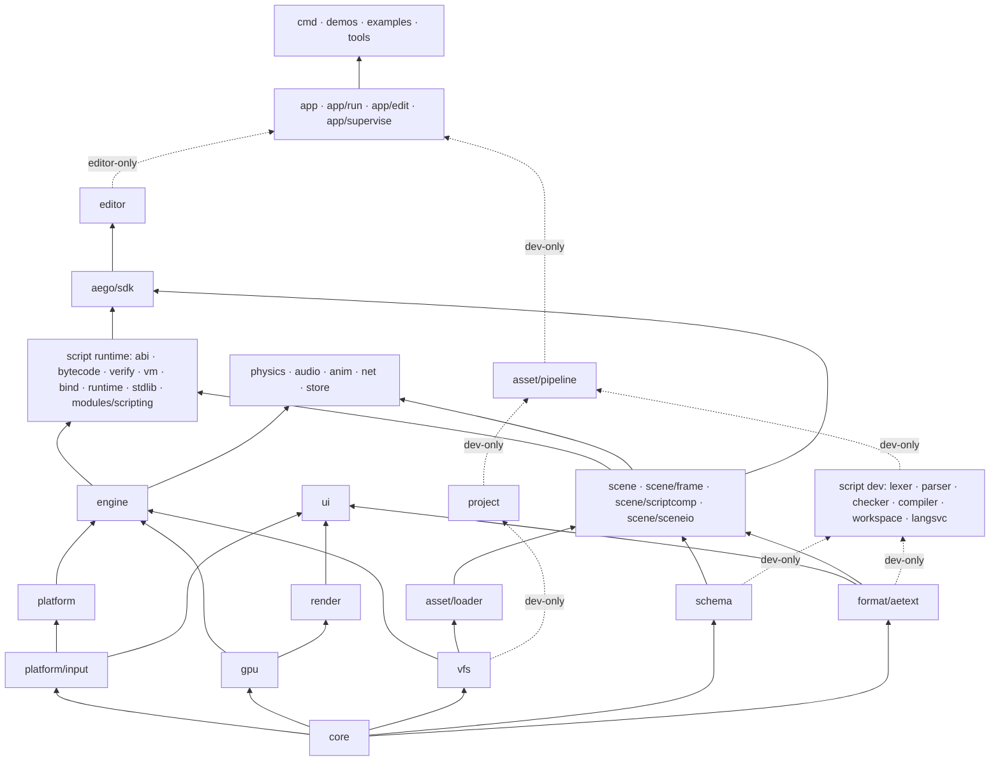

# Aego — Architecture

> **Status:** active architecture specification
> **Language:** Go 1.27+
> **Repository model:** monorepo, single root Go module `aego`
> **Scope:** 2D-first engine with a 3D foundation, native desktop targets (Android later), built-in editor, custom scripting language, compile-time native Go extensions.

---

## 1. Purpose

Aego is a game engine written in Go. It is built around five long-term goals:

1. A real native engine, not a wrapper around another engine.
2. A built-in editor with a Unity/Godot-like workflow.
3. A custom gameplay language with editor integration and hot reload.
4. Native Go extensions for projects that need to extend the engine itself.
5. A portable runtime where renderer, scene, editor and gameplay code never depend on a specific OS or graphics API.

Aego uses a small number of low-level external pieces where reimplementing platform plumbing adds no engine value: SDL3 for OS integration, generated OpenGL bindings, and build-time tools (font and icon generators in nested modules). Everything else — scene model, rendering, batching, UI, assets, scripting language and VM, editor, physics, audio mixing, networking, persistence, animation, materials, export — is owned by the engine. The root `go.mod` has no external Go dependencies.

---

## 2. Architectural principles

### 2.1 Core rules

- No global engine singletons; construction is `Builder → Engine`.
- Low-level packages never import high-level packages. The import graph is a DAG enforced by `tools/depcheck`.
- Runtime code never depends on editor or dev-only packages.
- Persistent identity is never a runtime handle; runtime handles are generational and never serialized.
- Source assets are not runtime assets; source file paths are not asset identity.
- Source files are canonical text; export and cache artifacts are binary.
- The renderer does not know about scenes; the scene does not know about the editor.
- User Go code imports only `aego/sdk`; native extensions are compiled into the project executable, never loaded with `plugin.Open`.
- Every stage ends in a runnable, testable result; stages close on acceptance criteria, not calendar dates.

### 2.2 Layers



| Layer | Responsibility |
|---|---|
| Foundation | `core`: handles, math, IDs, clock, logging, errors, stats, RNG, interning. |
| Platform contracts | `platform/input`, `platform`, `gpu`, `vfs`: OS/GPU/filesystem boundaries and backends. |
| Metadata contracts | `schema`, `format/aetext`: type metadata and source serialization. Independent of scene and editor. |
| Orchestration | `engine`: builder, worlds, phases, systems, services, jobs, frame loop. |
| Presentation | `render`, `ui`: scene-agnostic rendering and immediate-mode UI. |
| Runtime content | `asset/loader`, `scene`: runtime assets and the Node + Components world. |
| Gameplay systems | `script` runtime, `physics`, `audio`, `anim`, `net`, `store`. |
| Extension surface | `aego/sdk`: the only import for user `native/` code; a facade, not a storage layer. |
| Applications | `editor`, `runtime`. |
| Development-only | `app` (`Build`), `project`, `asset/pipeline`, the script compiler and workspace, `app/*`, CLI and tools. Never part of exported runtime graphs. |

---

## 3. Decision registry

Decision IDs are stable references for reviews, migrations and ADR-style changes. Superseded decisions are rewritten in place and noted.

### 3.1 Stage 1 — Foundation

| ID | Decision |
|---|---|
| D01 | Go 1.27+; the toolchain is pinned in `go.mod`. Generic methods on concrete types are used in registry APIs. |
| D02 | SDL3 is pinned and used only for windowing, GL context, events, timing, text input, clipboard, drag/drop, lifecycle and audio device output. `SDL_Renderer` and `SDL_GPU` are not used. The cgo bridge is hand-written and limited to the calls the engine needs. |
| D03 | OpenGL 3.3 Core is the first GPU backend; public `gpu` APIs are backend-neutral. GL bindings are generated (`tools/gen-gl.sh`) into `gpu/gl33/gl`. |
| D04 | No global singletons. Construction is `Builder → Engine`. |
| D05 | All runtime resources use generational handles; public APIs never expose long-lived pointers into internal storage. |
| D06 | The main thread owns platform, GPU and authoritative game/editor state. Workers compute and return results through `Jobs.OnMain`. |
| D07 | Headless is a first-class engine configuration (`Config.Headless`), distinct from the `aego_nonative` build tag. |
| D08 | 2D world: `+X` right, `+Y` down, radians internally, positive rotation clockwise, UV `(0,0)` top-left. |
| D09 | One world unit is not one pixel; camera scale controls world-to-screen size. |
| D10 | Shader math is linear; color textures and the backbuffer use sRGB semantics. |
| D11 | Fixed timestep with accumulator and interpolation, explicit `MaxFrameDelta` and `MaxSteps`. |
| D12 | Logs are structured and channel-based; errors are typed (`errs.Error`); `panic` is reserved for violated programming invariants. |
| D13 | File-format versions are independent from the engine version. |
| D14 | Dependency direction is strictly bottom-up. |
| D15 | Stages close by acceptance criteria, never by duration. |

### 3.2 Stage 2 — Renderer

| ID | Decision |
|---|---|
| D16 | Projection matrices in `mathx` use GL clip space (`z ∈ [-1,1]`). Backend differences are neutralized through `gpu.Capabilities.ClipZeroToOne` and a fixup in `render/view`, never in `mathx`. |
| D17 | Offscreen targets render in native backend orientation. For GL the window viewport/scissor is flipped at the backend boundary; offscreen targets stay GL-native and `render/view` compensates Y. Render-target textures are exposed top-down with UV `(0,0)` top-left. |
| D18 | Texture color is premultiplied once at upload; shaders do not multiply alpha again. Standard blending is `ONE / ONE_MINUS_SRC_ALPHA`. |
| D19 | Transparent visual order is painter order `layer → order → z → submission`. Batching merges only adjacent compatible draws and never reorders by texture, sampler, blend or clip. |
| D20 | Sprites are drawn as an instanced unit quad generated from `gl_VertexID`; this is private to `render/sprite`. Sprite `z` exists only in sort metadata in the pure 2D path. |
| D21 | GL 3.3 buffer streaming uses orphaning; persistent mapping is not part of the baseline. |
| D22 | `SamplerDesc` is independent from `Texture`; the renderer caches samplers by descriptor. |
| D23 | `TextureRegion` is the drawable texture unit: whole texture, spritesheet frame, atlas cell or glyph. |
| D24 | The renderer is an ordered list of `Pass` objects (`PassDesc{ID, Before, After}`), topologically resolved and frozen when rendering starts. |
| D25 | `Camera2D.Zoom` means pixels per world unit. |
| D26 | Screen/UI coordinates are Y-down logical pixels. `PushClip` is expressed in logical target pixels and never rotates with the camera. |
| D27 | The built-in bitmap debug font is mounted from `engine://`; the editor font layer arrives in Stage 4. |
| D28 | Golden rendering tests use exact comparison for pixel-stable scenes and tolerance comparison otherwise; the Linux reference is Mesa llvmpipe with SDL offscreen video. |

### 3.3 Stage 3 — Scene, schema, assets, native extensions

| ID | Decision |
|---|---|
| D29 | The scene model is Node + Components. Transform, hierarchy, name, enabled state and visibility layers are built into the node; everything else is a component. Typed node names (`Sprite2D`, `Camera2D`) are editor creation templates, never serialized types. |
| D30 | Components use an independent sparse-set store per type. Aego does not use archetype ECS storage. |
| D31 | A node holds at most one component of a given type. |
| D32 | A `*T` from `ComponentStore[T]` is valid only within the current phase. Adds go to a pending chunked buffer and are visible through direct lookup immediately but not through iteration until flush; removes become invisible immediately and are compacted at flush. |
| D33 | Structural mutations are deferred to the phase flush. `Destroy` is logically immediate and idempotent; physical removal is deferred. |
| D34 | `NodeID` is 128-bit persistent identity; `NodeHandle` is runtime-only and never serialized. |
| D35 | Files store full type and field names; runtime uses hashes. `FormerName` / `FormerField` support renames. Hash collisions are `Freeze()` errors. |
| D36 | Source formats (`project.aego`, `.aescene`, `.aeprefab`, `.aemat`, `.aeanim`, `.meta`) are canonical aetext without comments. Export and cache artifacts are binary. Chunked containers exist only in `.aepak` and caches. |
| D37 | Unknown components are preserved as parsed semantic blocks (`engine.Unknown`) and survive load/save when the defining extension is missing. |
| D38 | Unresolved `NodeRef` / `AssetRef` keep their persistent IDs and produce diagnostics; they never silently become null. |
| D39 | Nodes store `LocalEnabled`; `EffectiveEnabled` is derived in the hierarchy pass. |
| D40 | Node names are unique among siblings, interned, and indexed by `(parent, name)` in the scene. |
| D41 | Visibility uses `Node.VisibilityLayers` and `Camera.Mask`. |
| D42 | Assets are split into runtime `asset/loader` and dev-only `asset/pipeline`. Scene depends only on `asset.Resolver`. |
| D43 | Sidecars are `<file>.<ext>.meta`; moving source and sidecar together preserves identity. |
| D44 | The import cache is content-addressed by source bytes, settings, importer version, pipeline version and dependency artifact hashes. |
| D45 | Asset hot reload is transactional: import → validate → GPU preparation → atomic swap. Failure keeps the previous resource. |
| D46 | `aego/sdk` is the only supported import for project-native Go; `tools/depcheck` enforces it for `examples/**`. |
| D47 | Native project builds use generated bootstrap code under `.aego/generated`; cache keys include engine/SDK/Go versions, target and native source state. |
| D48 | Built-in scene systems have stable IDs: `engine.transform` (flush, hierarchy, transforms, effective enabled), `engine.sprite_extract`, `engine.mesh_extract`. View construction belongs to `RenderPrepare`. Extract IDs superseded by D145–D146. |
| D49 | `FieldDescriptor` offset fast paths apply only to POD-like kinds; reference and GC-sensitive fields use typed accessors. |
| D50 | Scenes are assets; `project.aego` references the main scene by `AssetID`. |
| D51 | Engine services are typed registrations keyed by stable string IDs (`engine.Service[T]`), so upper layers attach Scene, Renderer, Loader and editor services without reverse imports. |
| D52 | The asset watcher is stdlib polling over `(path, size, mtime)` behind a `Watcher` interface. A same-size rewrite inside filesystem mtime granularity may be missed. |
| D53 | Group importers (`atlas`, `script`) finalize per-group artifacts; `Produced.Kind` is set by the importer, the pipeline is kind-agnostic. |
| D54 | Raw OS filesystem access is allowed only in `vfs`, `platform`, `tools`, `cmd`, `project`, `asset/pipeline`, `app` and `app/*` (including `app/bootstrap`), `script/workspace`, the editor packages that own files on disk (`editor/core/{assetops,document,session,state}`, `editor/panels/{assets,scripteditor,welcome}`, `editor/shell/launcher`) and `demos/asset-hot-reload`. Runtime packages use VFS so the same code runs over `.aepak`. The list is `fsAllowed` in `tools/depcheck`. |
| D55 | `aego run` is a supervisor. Native source changes trigger `go build`; compile errors keep the current process alive; successful builds use a restart protocol where the child serializes state and exits. |
| D56 | Builtin assets use reserved `AssetID`s with `Hi = 0xae90…` (`asset.BuiltinCube`, `BuiltinWhite`, …), generated by providers in `asset/builtin` and resolved by the loader without a pipeline. |
| D57 | `engine.World` is a service container. Systems declare scope `{Play, Editor, Frame}`; `Engine.RunPhase(world, phase, scope)` runs a phase for one world. |

### 3.4 Stage 4 — Editor

| ID | Decision |
|---|---|
| D58 | Play mode clones the edit scene into a separate play world through `sceneio`. The edit scene is immutable during Play; Stop destroys the play world. |
| D59 | Editor UI fonts are pre-baked by `tools/genfont` (nested module, OFL font). `render/text.Font` is the common UTF-8 + kerning API; `BitmapFont.Font()` adapts the debug font; `FontSet.Closest(px, scale)` selects by DPI. Runtime TTF rasterization is not required. |
| D60 | One OS window; docking lives inside it. `DockTree` is serializable and does not know about native windows. |
| D61 | The editor is a UI over scene/schema/assets/render. Nothing below `editor/` imports it; runtime and `app/run` never link it. |
| D62 | All editor mutations go through history commands; a drag gesture is one transaction; delete stores a serialized fragment preserving `NodeID`s. |
| D63 | Document dirty state is derived from History position vs saved position. `Scene.Revision` exists only for cache invalidation. |
| D64 | Selection stores persistent `NodeID`, never `NodeHandle`. |
| D65 | The scene editor camera is editor state, not a scene node. |
| D66 | Scene View and Game View render into pooled render targets bucketed to 64 px. |
| D67 | Reparent preserves world transform by default; a non-invertible parent yields `SceneBadReparent`. Shear from non-uniform parent scale is not preserved. |
| D68 | Editor-only project Go code is compiled with the `aego_editor` build tag. |
| D69 | Local editor state lives in `.aego/user`, `.aego/session`, `.aego/recovery` and `.aego/editor.lock`; none is committed. |
| D70 | Input routing: modal → focused widget → hovered-panel shortcuts → global shortcuts → Scene View → Game View. Active widgets and gizmos own pointer capture. |
| D71 | Text entry uses SDL text input/editing events; text input starts on focus and stops on blur. |
| D72 | Editor extension callbacks are protected by `recover`; a panicking extension is disabled and reported. |
| D73 | Editor UI is not allocation-free. Idle budget ≤ 64 KiB/frame, target 60 FPS with a 10k-node Hierarchy. `ui/draw.List` has base/popup/modal/top streams. |
| D74 | `aego edit` with `native/`: the supervisor builds the editor from `.aego/build/editor/main.go` with `-tags aego_editor`, watches `native/*.go`, `go.mod`, `go.sum`, and exchanges `build.status`, `restart`, `handoff.aetext` + `handoff.ready` through `.aego/session/`. The editor exits with code 3 on restart; a new binary that crashes within 10 s is replaced by the previous one. |
| D75 | During Play the editor switches entirely to the play world: `Docs.Active()` returns the play view of the document (same ID/path, play scene, play history, play props). Save/Reload/recovery use the real documents. |
| D76 | Play-mode edits go to a separate history in `ModePlay` (never dirty, labels prefixed `[Play]`), destroyed on Stop. |
| D77 | The Inspector re-reads values every frame; a field being edited shows its cached value until released. |
| D78 | Inspector components are grouped by category with `DisplayName` and a module badge; order within a category is attachment order. |
| D79 | Extension creation templates live under `Create → <module>`; built-ins at the root. |
| D80 | Default layout: Hierarchy over Assets on the left, Scene/Game center, Console/Profiler bottom, Inspector right. `window.reset_layout` removes `.aego/user/layout.aetext`. |
| D81 | The top of the editor is a fixed-height MenuBar and Toolbar built from `command.Registry`; the document name and dirty marker live in the tab and window title; the native build indicator reads `build.status`. |
| D82 | Icons are an atlas in `engine/res/icons` generated by `tools/genicons`; `ui.Icon(id)` is the only way to draw one; missing IDs render a placeholder. |

### 3.5 Stage 4.5 — 3D foundation

| ID | Decision |
|---|---|
| D83 | `Node.Space ∈ {Space2D, Space3D}`. A new node inherits its parent's space; children of the root get `Scene.DefaultSpace`; `CreateIn` sets space explicitly; `SetSpace` is allowed only on a leaf without space-locked components. |
| D84 | Mixed trees: 2D under 3D is allowed (`world4 = nearest3D.World4 × Mat4Lift(2D chain)`); 3D under 2D is rejected (`SceneSpaceMismatch`). The transform pass is one pre-order traversal with three formulas. |
| D85 | 3D conventions: right-handed, Y up, camera looks down −Z. `Lift` maps 2D `(x, y)` to `(x, −y, 0)`. `QuatEuler(x, y, z) = Rz·Ry·Rx`; Euler angles exist only in UI; aetext stores `Quat` as `[x, y, z, w]`. |
| D86 | `gpu` is dimension-agnostic. `PassDesc.DepthTarget`; FBOs are cached by `(color, depth)`; `rt.Pool.Acquire(w, h, depth)` never mixes depth and non-depth targets. |
| D87 | 2D sprites with a 3D ancestor use a separate `sprites3d` pipeline (per-instance position/basis, depth test without write, back-to-front). The pure 2D path is unchanged. |
| D88 | Meshes are `AEMS` artifacts (header, counts, AABB3, vertices, indices); `.obj` import; builtin primitives Cube/Plane/Sphere/Cylinder per D56. Mesh instancing is deferred. |
| D89 | `schema.Space(k)` on `TypeDescriptor`: `SpaceAny/Space2D/Space3D`. `AddComponent` and the Inspector check compatibility. `Camera` is renamed `Camera2D` with `FormerName("engine.Camera")`. |
| D90 | `Mat3.Inverse` returns `(Mat3, bool)`; silent identity fallbacks are removed. Extension gizmos work only in 2D until the 3D gizmo API is designed. |

### 3.6 Stage 5 — Aego Script Core

| ID | Decision |
|---|---|
| D91 | Aego Script is a statically typed, Go-like language compiled to register bytecode. Files are `*.aes`; a package is a directory under `scripts/` (overlaid into `res://`); package path = `project.Module + "/" + relative directory`. Host modules and script packages share one namespace (conflict → `AES4xxx`); `aego/` is reserved for stdlib; package name must equal its directory name. Module paths contain no dots. |
| D92 | No pointers, unsafe, goroutines, channels, defer, exceptions, closures, first-class functions, inheritance, interfaces, general generics, maps or operator overloading. Type arguments are parsed everywhere but resolved only for registered intrinsics (`node.Get<T>()`, `Has<T>()`). |
| D93 | `int` = int64, `float` = float32, `bool`, `string` (immutable, literals interned, `len` in bytes). Engine value types: `Vec2 Vec3 Color Quat Rect Transform2D Transform3D`, references `NodeRef AssetRef<T> ComponentRef<T>`. User types: `struct` (value), `enum`, `[]T` (heap). Vector values are constructed with composite literals only. A short component name in `Get<T>` resolves if unique, otherwise `AES2xxx` with candidates. |
| D94 | No mutable package globals; only `const`. State lives in script instances and components. |
| D95 | `script` is a stateful attachable type. One `ScriptComponent` (`engine.Script`) per node holds attachments, at most one per script type. Attachments are stored as `script "<FullName>" enabled=… { … }` blocks keyed by full type name and property name, never by runtime index; authoring values are a `schema.PropertyBag`; unknown properties and types are preserved. |
| D96 | Script types form a dynamic layer inside `schema.Registry`: the native layer is frozen by `Freeze()`, `SetDynamic` atomically replaces only the dynamic layer and rejects name/hash collisions with the native layer. `ByID/ByName/Field` see both layers; `Components()` returns native types, `Scripts()` dynamic ones. `scene.Types.Overlay` routes Get/SetProperty for script types into `ScriptComponent`; `scene` never imports `script`. |
| D97 | `vm.Value{A, B uint64}` is exactly 16 bytes with no kind tag. int/bool/enum in `A`; float in the low 32 bits of `A`; `Vec2` A=(x,y); `Vec3` A=(x,y) B=(z,0); `Color/Quat/Rect` A=(x,y) B=(z,w); strings and slices are heap handles in `A`; `NodeRef` A=NodeHandle; `AssetRef` A,B=AssetID; `ComponentRef` A=NodeHandle, B=link-time component index. Unused bits are always zero (equality compares both words). Structs are N consecutive `Value`s with a static layout (nested structs flattened); copies are `MOVE`. The heap holds only `[]T` and `string`; GC is mark-sweep at safe points with no active frames; roots are instance fields and heap-object element masks. Instance slot 0 is `node`; script fields start at slot 1. Host methods of `NodeRef`/`AssetRef` are imported from pseudo-modules `#NodeRef`/`#AssetRef` with the receiver first; intrinsics are `#NodeRef.Get<full component name>` and `Has<…>`. Call windows are at the top of the function's register range. Cross-script access goes through `vm.Scripts` (`Find(node, script)` → `ScriptRef` value A=NodeHandle, B=InstanceID; `Instance(ref, script)` → self slice) and `vm.Signals` (`Emit/Connect/Disconnect/Connected`), both implemented by `script/runtime`. Bytecode v3 adds four tables resolved by name in `vm.Link`: `ScriptRefs` (script full names), `XFields` (ref, name, type, slots), `XMethods` (ref, name, arity), `Connects` (source, signal, target, handler); a stale layout or a lifecycle/coroutine target is a link error. `SELFREF` builds the `ScriptRef` of the running instance. |
| D98 | Native bindings resolve once at link; bytecode stores symbolic host imports with signatures; `bind.Registry.ABIHash` is part of the compile cache key. No reflection in the VM hot path; adapters are generated once from Go function types. Host signatures may not contain structs or slices. |
| D99 | Bytecode is verified before execution: bounds, jump targets, register counts, call windows, host import signatures, type references, field layout, name uniqueness, code length ≤ 32768. Corrupt artifacts are rejected. Runtime-only checks (slice element width, component field index, extern arity) are documented in `bytecode/doc.go`. |
| D100 | Faults are isolated per script instance (`Running/Faulted/Disabled`). Instruction budget per callback (default 1M, playground 2M), `MaxCallDepth` 256. Native binding panics become `AES6002`. `float→int` conversion is saturating and NaN-safe for cross-platform determinism. |
| D101 | Lifecycle v1: `Ready`, `FixedUpdate(dt)`, `Update(dt)`. `Ready` runs after all instances exist and references resolve, in scene pre-order. `Update`/`FixedUpdate` run in instance creation order. Systems `script.fixed` (`PhasePrePhysics`) and `script.update` (`PhaseUpdate`) are `ScopePlay`. Instances are created only from the runtime flush, never during a VM call. |
| D102 | Authoring state (`@export` in `.aescene`) and runtime state (instance fields) are separate; Play never writes to the edit scene. |
| D103 | Compilation is transactional per package: a failure keeps the last-good artifact and marks the source `Invalid`; Play is blocked while any package is invalid. |
| D104 | The compiler (`source token lexer diag ast parser types resolver checker asm compiler workspace langsvc harness`) and the runtime (`abi bytecode verify bind vm runtime stdlib module`) are separate subgraphs; exported runtimes link only the runtime side. `script/abi` is the shared leaf (`Signature`, `TypeRef`, `Surface`); the checker consumes `abi.Surface`. There is no IR: v1 compiles AST → bytecode directly; `script/asm` is an assembler. |
| D105 | Language version, bytecode version and binding ABI version are independent and all recorded in artifacts. |
| D106 | `await select go chan defer interface map` are reserved (`AES1004`). `yield signal coroutine` are keywords from language version 2; `start` is a contextual keyword before `Name(`; `wait frames fixed` are special only after `yield`. |
| D107 | Visibility follows the Go rule (uppercase = exported); `@export` is scene/Inspector exposure and unrelated to visibility. |
| D108 | `@former` on script types and fields mirrors `FormerName`/`FormerField`; unknown script properties are preserved and re-saved with a warning. Input axes are `input.AxisConfig` in `platform/input`; `project` parses the `input {}` block and `app/run`/`app/edit` pass it to stdlib. |
| D109 | The builtin texture `engine/textures/white` (`AssetID ae90…0010`) is resolved by the loader without a pipeline; prototype sprites use `tint` and `size`. |
| D110 | Script packages are imported as a single `scripts` group so the checker sees the whole project; the compile cache is per package via `compiler.CacheKey`; the group ID is deterministic so last-good artifacts survive restarts. The importer publishes a structured diagnostics snapshot with a revision that the editor shows in Console. |

### 3.7 Stage 6 — Script Development Loop

The Stage 6 specification numbered its decisions D109–D128; D109 and D110 were already taken by Stage 5, so they are recorded here as D111–D130.

| ID | Decision |
|---|---|
| D111 | `script/workspace` is the single project model for the language service, `aego check/test/dump`, the script importer and hot reload; no other compiler path exists. |
| D112 | Unsaved overlays take part only in `Snapshot`; `Build` and committed generations use saved files only. A `FileID` is stable per path for the lifetime of the workspace. |
| D113 | CLI native bindings come from a manifest (`script/bind/manifest`) written by a helper generated in `.aego/generated/manifest`, built with `aego_nonative`, that only calls `Register`; no engine, SDL or GPU is created. Cache: `.aego/cache/script-bindings/<key>.aetext`, key = `bootstrap.CacheKey` (native sources, go.mod/go.sum, local replaces, engine version). |
| D114 | `Register` is declarative: types, systems, bindings, importers, metadata. Resources, windows, network and scenes belong to `Init`. |
| D115 | `aego check` is strict: broken native code is exit 2, script errors exit 1. Only the editor keeps a last-good API (the previous build's binary) and shows "Native API is stale". |
| D116 | A committed `workspace.Generation` (ID, modules, build hashes) is the unit of hot reload; hosts convert it to a `reload.Program`, so `modules/scripting` and runtime binaries never depend on the compiler. |
| D117 | The swap runs in `script.swap` (`PhaseFrameBegin`, `ScopePlay`) through `Runtime.Defer`, when the VM has no active frames; `play.Controller.Tick` runs FrameBegin for the play world even while paused. |
| D118 | Apply is a transaction: `BeginSwap → LoadModules → Migrate → Commit → CallReloaded`. All modules of the new program load into the same `vm.Machine`; `Commit` calls `SetDynamic` first. Any failure aborts and the previous generation keeps running. |
| D119 | Instance fields migrate by name or `@former`, never by slot: same type kept, new field default, removed field dropped, incompatible type reset with a warning, enums by member name, structs field by field, slices element by element, references kept. |
| D120 | Instances keep `InstanceID`, node and heap objects across a swap. Faulted instances of changed scripts resume; instances of removed scripts stop. |
| D121 | `func Reloaded()` runs after the swap for every instance whose script or a dependency's interface changed, after signal rebinding; `Ready` does not run again. |
| D122 | Coroutines of changed scripts are cancelled by a reload; coroutines of unchanged scripts are untouched. A `Coroutine` field keeps the old, no longer running handle. |
| D123 | Signal connections are rebound by signal name, parameter types and handler name; a connection whose signal or handler is gone or changed its signature is removed. |
| D124 | A script is changed when its package build hash differs: sources, interface hashes of its transitive dependencies, ABI hash. |
| D125 | A save that does not compile never produces a generation; the package is marked invalid and Play cannot start while any package is invalid (D103). |
| D126 | Each reload prints one Console line `Hot reload N → M: X migrated, Y reset, Z coroutines canceled, W handlers disconnected, T ms`; the counters are the values the runtime acted on. |
| D127 | Changes in `native/` are never swapped in-process; the supervisor rebuilds and restarts (D55, D74). |
| D128 | Language service requests carry a generation token (`Invalidate`); results of stale requests never reach the UI. |
| D129 | The built-in editor calls the language service directly; no LSP is introduced. |
| D130 | `editor/core/code` is a separate subsystem (piece table, line index, line-state lexer), not an extension of `ui/textedit`. |
| D131 | Coroutines: `func Name(params) coroutine` on script methods without a result; lifecycle methods cannot be coroutines (`AES2056`). `start Name(args)` runs to the first `yield` and returns a `Coroutine`. Forms: `yield`, `yield wait(s)`, `yield frames(n)`, `yield fixed(n)`, `yield c`. |
| D132 | A coroutine is a VM frame suspended at `YIELD` with its registers kept in `vm.Machine`; `Resume(h, self)` continues it against the owning instance's current self slice, so arena moves during a reload cannot break it. Each resume has its own instruction budget. A coroutine is owned by an instance and cancelled when the instance stops, faults, is disabled or its node is destroyed. |
| D133 | `script/coroutine.Scheduler` keeps indexed min-heaps for frame counts, game time and fixed steps, plus await lists with a reverse index. A due coroutine is found without scanning sleeping ones; `Cancel` removes the entry at once. Due coroutines resume in start order in `script.coroutines`, after `script.update`; fixed waits resume after `script.fixed`. Paused Play does not advance game time. |
| D134 | Signals: `signal Name(params)` inside a script. `Emit` is allowed only in the declaring script (`AES2055`); handlers run synchronously in connection order. Connections added or removed during an `Emit` take effect after it returns. A nested emit counts towards call depth (`AES6003`). |
| D135 | `Connect` returns a generational `Connection`. When the source instance stops, all its connections are removed; when a handler's owner stops, its connections are skipped and removed. `Connected()` turns false in both cases. |
| D136 | `ScriptRef<T>` (`node.GetScript<T>()`) is a value A=NodeHandle, B=InstanceID, revalidated on every access (`AES6004`). It reaches fields, plain methods and signals of `T`; lifecycle methods and coroutines are not reachable (`AES2059`). |
| D137 | Bytecode v3 adds four tables resolved by name in `vm.Link`: `ScriptRefs`, `XFields`, `XMethods`, `Connects`. A stale field layout, or a lifecycle or coroutine target, is a link error. GC roots of struct fields are checked locally by the verifier and across modules in `vm.Link`. |
| D138 | `CONNECT a bx` uses the window `R[a]` result, `R[a+1]` source `ScriptRef`, `R[a+2]` target `ScriptRef`; `SELFREF` builds the running instance's ref; `EMIT a bx` passes the signal's slots starting at `R[a]`. |
| D139 | Cross-script access goes through `vm.Scripts` (`Find`, `Instance`) and `vm.Signals` (`Emit`, `Connect`, `Disconnect`, `Connected`), both implemented by `script/runtime`; the VM never sees scenes. |
| D140 | Language version 2, bytecode version 3. Artifacts of other versions are rejected at decode and reimported. |
| D141 | `aego test`, `aego dump script` and `aego check` run on `script/workspace`; `script/build` is removed. `*_test.aes` files compile only in test builds. `aego test` supports `-run -v -budget -seed`; a test that exceeds its budget fails with `AES6001` and the next test runs. |
| D142 | Fault codes: a host binding that returns `*vm.Fault` keeps its code; `Ctx.Fail` and plain Go errors are `AES6010`. Nil or dead references (nil `NodeRef` in intrinsics, a `ComponentRef` to a destroyed node or removed component, a dead `ScriptRef`) are `AES6004`. Runtime codes live in `script/diag` next to the compiler codes; `vm` re-exports them. |
| D147 | Script autosave (File → Autosave Scripts, on by default): a dirty script is saved one second after the last edit, when the window loses focus and before Play starts. Read-only and conflicting documents are skipped. Recorded after Stage 6.5. |
| D148 | Project templates are embedded files under `engine/res/templates/<id>/` (`empty 2d 2.5d 3d`) with the placeholders `{{module}} {{template}} {{white}} {{cube}} {{plane}}`. `app/projects.Create` is the only creation path: `aego new`, the launcher and Getting Started call it. Scene sidecars and `mainScene` are generated at creation; the project name comes from the directory. `--example` copies `examples/<name>` with the module renamed and `replace aego` pointing at the engine tree. A new project is verified with the same document and script checks as `aego check`. |
| D149 | `aego edit` without a project opens `editor/launcher`. Recent projects live in `os.UserConfigDir()/aego/recent` (aetext, 20 entries) and are updated whenever the editor opens a project. The launcher runs on its own engine and hands the chosen root back to `aego edit` in the same process. |
| D150 | `view.Ortho3D` is a 3D projection beside `Perspective3D`; code that branches on 3D asks `View.Is3D()`. `Camera3D.Orthographic` selects it with `OrthoSize` as half of the vertical extent. The 2.5d template is a 3D root with an orthographic camera and 2D sprites under it (D84, D87). The Scene View orbit camera has its own ortho toggle, stored per scene in editor state, with `size = distance·tan(fov/2)` so switching keeps the framing. |
| D151 | Inspector reference fields derive one state per value (`None`, alive, engine builtin, `Missing`, `no T`) through `nodeState`/`assetState`; widgets draw by state, never by label text. `ids.*.String()` stays the canonical hex used by serialization; `Short()` is the display form and returns `nil` for the zero ID. |
| D152 | `sceneio` keeps a table from file node IDs to created nodes. Values containing node references (fields, lists, structs, script properties) are applied after all nodes exist and are rewritten through that table, so prefabs and other fragments loaded without `KeepIDs` point at their own instances; references outside the fragment keep their ID and are reported as unresolved when they do not exist. |
| D153 | An exported `ComponentRef<T>` is a `KindNodeRef` property with `FieldDescriptor.Component = T`; it is serialized as `node(…)`. At instantiation the runtime builds the reference from the node and the linked index of `T`; a node without `T` starts the field as `nil` with a warning. The Inspector shows a node without `T` as `name · no T` and filters the picker to nodes that have `T`. |

Build incrementality: a package key is its sources, the `InterfaceHash` of every package in its transitive dependency closure and the ABI hash. A generation never mixes a package with a new interface and a dependent compiled against the old one: a package that compiled is held back with `AES2030` when a broken package with a committed module depends on it, or when it depends on that broken package, and the interface changed.

Hot reload (D116–D127): `script/reload.Plan` is built from two `reload.Program`s (package → module, package → build hash). `Apply` = `Runtime.BeginSwap` → `LoadModules` (all modules of the new program into the same `vm.Machine`, `schema.CheckDynamic`) → `Migrate` (new arenas, conversion by names via bytecode `Structs`/`Enums`) → `Commit` (`SetDynamic` first, then the instance, arena and schedule switch) → cancel coroutines of changed types → rebind signals → `CallReloaded`. Bytecode v2 added `Module.Structs` and `ScriptDef.Reloaded`.

Editor code (D129–D130): `editor/core/code` (piece table, line index, document with grouped history, search, line-local lexical highlight) has no UI and no script dependency other than `script/token`. `editor/panels/scripteditor` is the only editor package allowed to use `script/langsvc` and `script/workspace`. Panels are registered per document (`script:<path>`) and docked next to the Scene view; open and close are queued to the end of the frame, so the dock tree never changes while drawing.


### 3.8 Stage 6.5 — Module system

| ID | Decision |
|---|---|
| D143 | `engine/module.Registry` is the one registration path for engine subsystems and project native code. `sdk.Registry` is a struct over it; user modules keep `Register(*sdk.Registry) error` and are adapted with `sdk.Adapt`. `engine` never imports `engine/module`: `Manifest.Engine()` adapts collected systems and wrapped `engine.Module`s into one `engine.Module`. `Init` runs once per engine after assets mount. `Attach` runs per scene: once for the main scene of `aego run`, once per open scene document in the editor, once per Play world; detach runs in reverse order. Acceptance form: a component is added with one file in the module plus one line in its `Register`, with no edits outside the module. `app.Build` is the single construction path for `aego run` and the editor. |
| D144 | Everything about a component is declared through `ComponentBuilder[T]` and stored in `schema.TypeDescriptor`: display name, category, icon, owner, builtin flag, default, required components, scene uniqueness, creation template, script fields and methods, custom inspector. Types the descriptor cannot name without a cycle are held as `any` and checked by their consumer (`editor/core/templates`, `editor/ext/inspect`, `modules/scripting`), with the owning module in the error. `ScriptFields == nil` exposes every `FlagScript` field. `Template("", setup)` names the template after the type. Component script methods are typed adapters (`Method0..2`, `Proc0..2`) called on the component reference (D196). `ScriptMethod(any)` is a development-only reflection fallback: it logs a warning and fails `Build` under `aego_runtime`. Ref fields whose type is a single ID at offset 0 are read and written by offset; other layouts go through `Get/Set`. At most 255 script fields per component. |
| D145 | A subsystem is a package tree with `Module()`: `render2d`, `render3d`, `script/engine` now; `physics`, `audio`, `anim`, `particles` follow the same shape. `scene`, `scene/frame`, `scene/scriptcomp`, `schema`, `render`, `engine` are core. Subsystems never import each other; shared render buckets live in `scene/frame`. Dev-only registration (importers) is a dev hook compiled under `!aego_runtime`; editor parts of built-in modules live in `<module>/editor` and are attached by `editor/builtins`, project editor code uses `sdk.EditorHook` under `aego_editor`. Built-in modules hide the Inspector badge. Package paths and the `editor/builtins` attachment are superseded by D201 and D205. |
| D146 | `engine/builtin.Modules()` lists built-in modules in dependency order; `Build` resolves `Info.Requires` topologically (ties keep `Add` order) and fails on missing or cyclic requirements, system ids without the module prefix, reserved phases for non-builtin modules, unknown icons, unknown required components, duplicate template ids and bad template setups. Create-menu order is module order, then registration order. Module icons are PNG files `<id>@<size>x<scale>.png`; built-in SVG sources are listed by `builtin.IconSources()` for `tools/genicons`. `module.Audit` runs the same registration and icon checks without failing on icon problems and lists every difference (missing, unused, badly named, empty source); `aego icons` prints it and exits 1 on any entry, building a helper under `aego_nonative` for native projects. `engine/builtin` is superseded by the `app/assembly` catalog (D205). |

### 3.9 Stage 8A — Physics core

The Stage 8 specification numbered these decisions D153, D155, D158, D159, D168–D173 and D179; D153 was already taken by Stage 6, so the whole Stage 8 range is shifted by one.

| ID | Decision |
|---|---|
| D154 | Host structs: `bind.Struct[T]` registers a Go struct whose fields are bools, integers, floats, `Vec2/Vec3/Color/Rect/Quat`, `NodeHandle`, `asset.Ref[*]`, registered enums or other host structs; strings and slices are rejected so a host struct never holds VM heap values. At most 32 value slots. `abi.Table` keeps `StructDef`s, its hash covers every field, and the manifest (version 3) stores them. The compiler copies every host struct a module touches into `bytecode.Module.Structs`, so the verifier, call windows (`Module.Window`) and hot-reload migration use one layout source. Structs cross the host boundary by value through typed field encoders, zero allocations per call. Bytecode version 4. D98 is amended: host signatures may contain host structs and `[]T` of plain elements as parameters. |
| D156 | `bind.Out[T]` is the only slice a host function sees: it writes into the existing elements of a script `[]T`, `Cap()` is the slice length, a nil slice has `Cap() == 0`. The host returns how many elements it wrote. Scripts size the buffer with `append` once. |
| D159 | Engine script events: a module declares `module.Registry.ScriptEvent(Event)` in `Register` and gets a stable `EventID`. `script/engine` adds them to the bindings in a finalizer before the registry freezes, so `aego check` sees them. A script method with an event name is an event handler: exact signature (`AES2060`), never called directly (`AES2061`), never a coroutine (`AES2056`), unreachable through `ScriptRef` and `Connect`. Event names are exported, unique and never lifecycle names; parameters are plain values. `ScriptDef.Events` maps names to functions. |
| D160 | `contracts/*` are interface packages between subsystems and scripts: `contracts/scriptevents` (`Sink`, `EventID`, service `script.events` attached per world) and `contracts/physics2d` (`Queries`, `QueryFilter`, `RayHit` over nodes). Contracts import only `core`, `scene` and the script value layer; nothing in `contracts` imports a subsystem. |
| D169 | `physics/world` depends only on `core`. It uses its own handles, `UserData uint64` for owners, float32 world units and validated definitions; every `Create/Add/Set/Apply` returns an error instead of accepting NaN, infinities or degenerate geometry. Removed bodies and shapes keep their slots for one step so event handles stay meaningful. |
| D170 | Broadphase: a dynamic AABB tree with fat boxes (margin `2·ContactOffset`), bullet boxes swept along their velocity, a move buffer, candidate pairs sorted by `(shape, child)` and an open-addressing pair table. No Go map is iterated during a step. Pairs pass when both bodies are not static/kinematic-only, layers and masks accept each other and no joint forbids them; static-static and trigger-trigger never pair. |
| D171 | Narrowphase follows Box2D v3: every convex shape is a polygon with a radius (circle 1 vertex, capsule and chain segment 2), SAT plus reference-face clipping with byte feature ids, manifold normal from A to B. Parallel reference and incident edges that overlap by more than the slop are always clipped, never reduced to a vertex contact. Chains are always shape A; ghost vertices drop or snap vertex contacts at flat and concave joints; one-sided chains ignore shapes behind them. Manifolds persist per pair and warm-start by feature id. |
| D172 | Solver: one collision pass per step, then `Substeps` solver substeps (Box2D v3 soft step, 4 by default). Each substep integrates velocities, warm starts, runs `VelocityIterations` soft passes (contact spring of `min(ContactHertz, substep rate/4)` Hz with `ContactDampingRatio`, twice as stiff against static bodies, push-out capped at `ContactPushVelocity`), integrates positions with the current separation rebuilt from body deltas and contact anchors, runs `RelaxIterations` relax passes without bias and one joint position pass. Restitution is a separate pass after the substeps. Defaults are Box2D v3's 30 Hz / 4 substeps / 1 velocity / 1 relax pass: at the cap itself (60 Hz at a 60 Hz step) one pass per substep cannot damp the spring and large stacks never come to rest. The stiff profile 60 Hz / 8 substeps holds tall free columns at about 1.8× the step cost. Substeps and both iteration counts are 1..64; zero takes the default, as for every `Config` field, so a relax pass can never be switched off. Islands are found by depth-first search from a sorted list of awake bodies; narrowphase visits only contacts of awake bodies; a sleeping world costs no per-body work. Islands sleep after `SleepTime` below `SleepLinear/SleepAngular`. |
| D173 | Contact events are counted per shape pair and buffered per step: End during collision and removal, Begin after the solver so it carries the first impulse. Event normals point from B to A. Removal between steps reports End in the next step. There is no stay event; callers ask `Contacts`. Event `NormalImpulse` is the impulse summed over the substeps of the step. |
| D174 | Joints: `DistanceJoint` (rigid when `Min == Max`, soft spring with `Stiffness/Damping`, optional limits) and `RevoluteJoint` (limit, motor with `MaxTorque`), Box2D v2.4 formulation. Destroying a body destroys its joints. |
| D180 | Determinism profile: one binary, one CPU, the same call order give bit-identical `Snapshot()` bytes. `Snapshot/Restore` copy pools with generations and free lists, the tree, the pair tables, manifolds with impulses, joints and sleep timers. |

### 3.10 Stage 8B — Physics integration

| ID | Decision |
|---|---|
| D181 | `physics` is a built-in module without requirements. It creates a `systems.Sim` only for worlds attached with `AttachContext.Play` (`aego run`, editor Play); edit worlds get no simulation, the editor checks geometry with `systems.Checker`. A play world carries the services `physics.sim` and `physics2d.queries`. Settings reach the module through the engine service `physics.settings` and apply at the next Play. |
| D182 | Physics works in world units and never reads `render.pixelsPerUnit`; that value only sets the default size of imported sprites, the default `Camera2D.Zoom` and Snap to Sprite. |
| D183 | A collider belongs to the nearest node at or above it with `Body2D`; without one it gets an implicit static body on its own node. Its pose relative to the body (translation, rotation, uniform scale; non-uniform scale for boxes and polygons) is baked into the shape at sync. Non-uniform scale on circles and capsules is PHY001, nodes under a 3D parent are excluded (PHY005), reparenting a moving body recreates it with world pose and velocity (PHY006). |
| D184 | Presentation pose: `scene` keeps a sparse presentation local per node (`SetPresentationLocal`, `PresentationLocal`, `ClearPresentation`). `UpdateTransforms` computes `RenderWorld` in the same pass; nodes without a presented ancestor share `World` without a copy. Render extract reads `RenderWorld`, everything else reads `World`. `physics.present` runs in `PhaseRenderPrepare` before `engine.transform` and interpolates with `Context.Alpha`. |
| D185 | Schedule: `physics.sync`, `physics.step`, `physics.writeback`, `physics.events` in `PhasePhysics`, so the events reach the sink before `script.events_fixed` in `PhasePostPhysics` without a cross-module ordering reference; `physics.present` per D184. Writeback remembers the local it wrote; sync treats any other value of a moving body's `Transform2D` as a teleport that keeps the velocity. A difference first seen by `present` was written in Update: PHY007 once per body, applied at the next step. Static and kinematic bodies follow their node every step. |
| D186 | Layers: `project.aego` `physics { layers=[…] collide { A=[…] } }`, at most 32 names. The matrix is symmetric, a missing `collide` means all pairs, an unknown layer is a load error. `Body2D.Layer` stores the index, `Mask` the accepted layers; a pair collides when both masks and the matrix allow it. |
| D187 | Destroy, disable, component changes, reparent, hot reload, native rebuild and Stop follow the lifecycle table in the physics documentation (`physics/lifecycle`). Exit events are generated for everything except Stop. |
| D188 | Script events `OnCollisionEnter/Stay/Exit(other NodeRef, c physics.Contact)` and `OnTriggerEnter/Exit(other NodeRef)` reach both participants, on the body node and on the collider node (once when they are the same). `Contact.Normal` points from the other body into the receiver. Stay is emitted only when `scriptevents.Listener` reports a running handler on either side. Removals inside handlers are applied after dispatch. |
| D189 | Script API: `Body2D` methods (`Apply*`, `Set*Velocity`, `MoveTo`, `Teleport`, `WakeUp`, `Sleep`, `Mass`) and `aego/physics` functions. Queries ignore the caller's body and skip triggers; filtering by layer goes through `Linecast`'s mask and `Layer/LayerMask`. Scripts have no `QueryFilter`; Go keeps it in `contracts/physics2d`. Runtime body state is read through the read-only fields `Velocity`, `AngularVelocity`, `Awake`. |
| D190 | Project Settings is the panel `editor/panels/projectsettings` with built-in pages (Project, Render, Input) and pages from `extension.SettingsPage`. It writes `project.aego` after confirmation, outside History. The physics page validates through `world.Config.Validate`; zero means default and shows the default greyed out. |
| D191 | Overlays are read-only renderers on `shape.Registry`. They are scene-only unless registered with `extension.GameOverlay`. `OverlayCtx` carries `Scene`, `World` and `Game`, so no overlay looks worlds up through documents. The Game View draws game overlays after the game's own views, in one `ViewFrame` per active 2D play camera with that camera's view, never inside the game's frame; when its toggle is off no overlay is called. |
| D192 | Vectors overlay: layers from `extension.Vectors`; Fields from schema gizmo tags (`vector`, `point`, `radius`; `local` or `world`) and `@export(gizmo=…)`; drags go through History. Force recording (`world.Config.DebugVectors`) is on only while the Forces layer is visible. Off means zero calls and zero allocations. |
| D193 | Profiler: Frame is always shown; Game and Scripts only while Play runs; extension sections declare whether they are play-only. Sections reach the play world through `Editor.PlayWorld()`, never through the active document. |
| D194 | Physics diagnostics PHY001–PHY007 appear in Problems under the `physics` category with node locations; PHY002 (invalid geometry) blocks Play. |
| D195 | `examples/platformer` runs entirely on physics; `examples/physics-sandbox` is the integration test of the module; `demos/physics2d` stays on the bare world. |
| D196 | Component script methods are called on the component reference: `body := node.Get<Body2D>(); body.SetVelocity(v)`. They live in the pseudo-module `#<FullName>` with `ComponentRef<T>` as the receiver, are kept in `abi.Table` as component methods (`AddComponentMethod`, part of the ABI hash) and in the bindings manifest as `cmethod` blocks (manifest version 4). They are not a module and cannot be imported. The checker resolves `ComponentRef<T>.Name(...)` through `Surface.ComponentMethod`; the compiler emits `CALLH` with the reference as the first argument; the typed adapter faults with `AES6004` on a nil reference, a destroyed node or a removed component. Stubs, hover, go-to-definition and parameter hints list the methods inside the component. D144 is amended accordingly. |
| D197 | A field initializer is a constant when it is a constant scalar or a composite literal of `Vec2`, `Vec3`, `Color`, `Quat` or `Rect` whose components are numeric constants. It folds into `types.CLanes` and is stored as `bytecode.LanesK` (lanes 0–1 in `A`, 2–3 in `B`); `@export` publishes it as the schema default, so the Inspector shows it and an omitted scene property starts with it. Any other initializer is `AES3006`. |
| D198 | Loading a component starts from its registered `Default()` and overlays the fields present in the file; `AddComponent` does the same. A field missing from a hand-written scene therefore never falls back to the Go zero value. Script properties already fall back to the script initializer. |
| D199 | `ComponentBuilder.OnAdd(func(AddContext, *T))` runs when the editor adds the component through the Inspector, Paste or Create, never on load or at runtime. `AddContext.Visual` reports the node's visual rectangle in node space from the editor shape registry, so a module can fit itself to a sprite without importing `render2d`. The first `Do` of the add command runs the hook and records every field, so undo and redo replay the same values. Box, circle and capsule colliders fit the sprite; without one they keep their defaults. |
| D200 | Performance checks compare with a baseline of the machine they run on (`make bench-baseline`, files under `.cache/bench`, ignored by git); the gate itself is D213. `tests/bench/baseline.json` holds reference numbers of the reference machine and is not a pass criterion. Wall-clock limits under `-race` are scaled by 4. Dev-only packages such as `engine/docs` are excluded from `aego_runtime` builds by build tag. |

### 3.11 Stage 8C — Module layout

| ID | Decision |
|---|---|
| D201 | Built-in modules live in `modules/<name>` (`render2d`, `render3d`, `scripting`, `physics`) with their editor side in `modules/<name>/editor`. Core packages never import `modules/...`; `sdk` is a composition facade above the modules and may import them, modules never import `sdk`. `render/host` (former `render/module`) is installed by the host before the modules and is not a catalog entry. `engine/base` holds the core module `engine` and `NewTypes`. |
| D202 | The editor is split by role: `editor/core` (state, documents, history, shared helpers such as `assetops` and `fuzzy`), `editor/ext` (extension points; `ext/inspect` for custom inspectors), `editor/panels/<name>` (panels never import each other), `editor/shell` (application, dock, menus, launcher). |
| D203 | The script library is split by imports. `script/stdlib` keeps `math`, `log`, `rand`, `time`, `testing`; they reach the engine only through the `bind.Ctx` fields (`Random`, `Log`, `Dt`, `Fixed`, `Elapsed`, `Frame`) that `script/runtime` fills per call, which is the runtime contract. `aego/scene` and `aego/input` import the scene and the engine and live in `modules/scripting/stdlib`, whose `Install` keeps the historic registration order. |
| D204 | Modules depend on each other only through `Info.Requires`; ordering constraints never name systems of another module. `physics.events` runs in `PhasePhysics` after `physics.writeback`. `physics` and `scripting` each build an engine with the core module alone (`TestBuildWithoutScripting`, `TestBuildWithoutPhysics`). |
| D205 | The built-in module catalog lives in `app/assembly`. An `Entry` is `{ID, Requires, New(Options), Editor}`; `Requires` must equal the module's `Info().Requires`. `Options{Seed, Testing, Input}` are constructor parameters of entries, so `stdlib.Options` no longer leaks into the catalog API. Profiles are packages, not files, because the playground graph must not see `render3d` or `physics`: `app/assembly/builtin` (`Default`, `Headless`), `app/assembly/playground`. Editor hooks of built-in modules are attached by `app/assembly/editors.With`, imported only by `app/edit`, so `app/run` never links the editor; the hook is registered through `module.Registry.Editor` inside the module's `Register`. Order is topological by `Requires`, ties keep catalog order; a cycle error names the chain. Systems registered by nested engine modules (`Registry.Use`) must carry the owning module's prefix. `engine/builtin`, `engine/builtin/playground`, `editor/builtins` and `app/modules.go` are removed. |
| D206 | Module lifecycle is Register → Freeze → Init → AttachWorld → DetachWorld → Shutdown. `Shutdown` runs in reverse Init order; a failing `Init` shuts down the modules initialized before it. `Manifest.Attach` calls `DetachWorld` on every module whose `AttachWorld` was called, including the failing one, so `DetachWorld` must tolerate a partial attach. Per-world module state lives only in world services. |
| D207 | Project settings sections: `module.Registry.ProjectSection(SectionDesc[T])` with `Decode`, `Encode`, `Validate`, `Migrate(from, to)`, `Version` and `Former` heads. `project` keeps every block except `window` and `input` as AST; after `Build`, `Manifest.LoadSections` decodes registered sections (defaults, migration on a clone, validation) and leaves unknown blocks untouched. A section whose type is registered with `module.Struct` gets a schema codec and an automatic Project Settings page. `InitContext.Section(id)` gives the live value; editors work on drafts (`Sections.Draft`) and commit with `Sections.Set` after `project.aego` is written. `physics {}` and `render2d {}` (former `render {}`) are sections; `project.PhysicsSettings`, `RenderSettings` and `modules/physics/dev` are removed. |
| D208 | Inspector hints live in the schema: `ChoicesFrom(field, section, list)` and `Bitset(field, section, list)` draw an integer field as a choice or a mask over a named list that the project section returns from `SectionDesc.Names`; a mask with every listed bit set is stored as -1. `Runtime(fields...)` shows a field only during Play and makes it read-only. The Inspector orders component groups by module order from the manifest and never switches on module or component names. |
| D209 | Component hooks: `OnAdd`, `OnRemoving` (old value, before the store frees it, from the editor remove and undo-of-add paths), `OnChanged(*ChangeSet)` after every committed transaction, Undo and Redo (fields deduplicated, add and remove in one batch cancel), and `Validate(ctx) []problems.Diagnostic`. Hooks make no structural changes outside pending. Runtime keeps the D185 comparison; there is no `MarkDirty`. |
| D210 | `engine/problems` is the diagnostics service: `Diagnostic{Owner, Code, Severity, Message, Subject(Node, Field, Asset, Setting, File), BlocksPlay}` with a stable key; sources carry a revision and the service rebuilds only on change. The editor validates open edit scenes through `module.ValidateScene`; modules publish runtime diagnostics from `AttachWorld`. The Problems panel only displays them with the owner as category; the Play controller asks the service for blocking problems. |
| D211 | Resources and SDK: module icons are named `<owner>.*` or `cat.<owner>` and a duplicate ID is a build error; icon sources come from `IconDir()` of the catalog modules. Built-in editor hooks come from the catalog (`app/assembly/editors`), project hooks from `module.Registry.Editor` under `aego_editor`; vector layer commands are created when the layer is registered; `module.mk` files add module targets to the Makefile. The SDK exposes project sections, diagnostics and the hook contexts; a component changed after the schema freezes reports `EngineFrozen`; module IDs are dotted lowercase and `engine` is reserved. 8C.4 is one commit instead of one per item: the items share files (`modules/physics/module.go` carries items 2, 3, 6 and 7) and the intermediate trees do not build; Appendix A maps every backlog row to the substage and files. |
| D212 | `tools/depcheck/exceptions.txt` is the only place where a dependency or literal rule is waived: `from -> to, variant, reason`, one edge per line, file-level `from` allowed (`sdk/editor.go`). An empty reason, an unknown variant or an exception that matches nothing fails depcheck, so the file only shrinks. Entries that 8C.4 removes say so. |
| D213 | Benchmarks. **CI** (`make bench-allocs`, part of `make ci`) checks allocations only: `allocs/op` and allocations per frame must equal the saved baseline of the machine, with `count=1`, since allocation counts do not depend on the CPU clock; modules add their checks through `MODULE_BENCH_ALLOCS` in `modules/*/module.mk`. Allocations do not depend on the renderer: without a baseline of the same `demo|renderer`, `-time=false` takes the baseline of the same demo, and `bench-allocs` runs the frame demos under `GL_ENV` (xvfb or offscreen llvmpipe); time is compared only for the same renderer. **Time** is gated only by `make bench-compare`, which builds the base and head test binaries and runs them interleaved, base and head in turn, pinned to one CPU (`taskset`), `BENCH_COUNT` rounds; a regression is a Mann-Whitney U test with p < 0.05 and a median more than 10 % slower (`tools/benchgate`, `tools/bench/stat`). Time against the saved baseline (`make bench`, `make bench-scripts`, `make bench-physics`) is a manual reference and never part of CI: consecutive samples on a machine without a fixed clock are correlated, and the U test takes clock drift between `bench-baseline` and the check for a regression. Recommended for `bench-compare`: the `performance` governor and turbo off. Without a baseline every gate warns and passes. `TestStepBudget` is a smoke run without a threshold. Lint runs a pinned staticcheck (`STATICCHECK_VERSION`). |
| D214 | Fake module proof (8C.5): `tests/modulecheck/fakephys` is a second module that uses every boundary-bearing extension point: project section with names, inspector hints (`ChoicesFrom`, `Bitset`, `Runtime`), system, template, script event, component hooks (`OnAdd`, `OnRemoving`, `OnChanged`, `Validate`), world attach, and in the editor a settings page, panel, custom inspector, gizmo, bounds, scene and game overlays, a vector layer, a profiler section and a command. Icons, docs and asset drops are resources registered by owner and are covered by `engine/module` tests. The editor runs with the catalog "built-in minus physics plus fakephys" (`assembly.Catalog.Without`, `edit.Config.Catalog`), and no file outside `tests/modulecheck` names it. The editor frame on `physics-sandbox` (Edit, Play, overlays and vectors on) is a permanent `bench-compare` scenario, added by `modules/physics/module.mk` through `MODULE_BENCH_COMPARE`, not part of `bench-allocs`. |
| D215 | Profiler 2.0 (8C.6): `core/trace` records hierarchical zones of the main thread into a ring of preallocated frames (default 240 frames × 1024 events, allocated on first enable, zero allocations per frame, nesting up to 32, overflow counted as `Dropped`). The engine opens zones for phases, systems (including play worlds via `RunPhase`), polling and swap; the renderer for passes; the workspace for panels; modules get them for free and open sub-zones through `sdk.TracerOf`. GC cycles per frame come from `runtime/metrics`. The Profiler panel shows a frame strip with the 16.6 ms budget and a flame graph of the selected frame; Export writes Chrome trace JSON to `.aego/user/traces` (editor, tracing always on) or `aego run --trace file` (runtime, the last 239 frames on exit). Go pprof stays separate (`--cpuprofile`). |
| D216 | Narrow editor services (8C.7b). A panel implements `workspace.Panel`: `Draw(f *services.Frame, r mathx.Rect)`; `Frame` carries `UI`, `DnD`, `Now` and `Focused`. Code under `editor/panels/*` never holds or receives `*context.Editor`; `tests/modulecheck/panels_test.go` enforces this. Services live in `editor/core/services`: the interfaces `Notices`, `Navigation`, `Problems`, `Selection`, `Documents`, `SceneOps`, `AssetOps` and the dependency struct `Viewport`. `*context.Editor` implements the interfaces and stays the shell's composition root; it is not passed to panels. Every panel takes a `Deps` struct in its constructor that lists exactly the services it uses; the shell builds these structs, and there is no service locator. Navigation is one call, `Open(Location)`: `Location.Target` (`Docs`, `Problems`, `Settings`, `Asset`) and `Location.Symbol` replace direct calls to `ShowDocs`, `ShowProblems`, `ShowSettings`, `RevealPath` and `OpenScript`, which remain on `Editor` only as shell wiring. `editor/core/sceneops.Ops` and `editor/core/assetfiles.Files` are facades: core types bound to `Editor` that expose operations without `ctx`. This is an accepted form of a service; narrowing `editor/core/assetops` itself to a non-`Editor` environment is out of scope for Stage 8. `clipboard.Env` narrows component and value clipboard operations to `Clip`, `Types`, `Res` and `OnAdd`; the `ctx` wrappers remain for the shell and tests. Module extension callbacks (custom inspectors, settings pages, profiler sections, gizmos, overlays, vector layers) keep their `*context.Editor` API; `editor/ext` binds `Editor` at registration (`inspect.Registry.SetEditor`, closures in `ext`), so panels see only bound functions. `workspace.Panel` has a single `Draw(f *services.Frame, r)`; the transitional `LegacyPanel` path was removed at the end of 8C.7b. Extension panels capture what they need at registration through `EditorRegistry.Editor()`. |
| D217 | Panel descriptors (8C.7c). A panel is registered with `workspace.Desc`: `Panel`, `Slot` (column of the default layout: Left, Browser, Center, Bottom, Right, or None), `Near` (the panel it opens next to when it has no slot), `Order` (default-layout order inside a slot and Window menu order) and `Hidden` (not in the Window menu; script file panels). The default layout, the Window menu and `Workspace.Show` all derive from the registered descriptors; `ShowNear` is gone. The built-in catalog is the explicit list `editor/shell/panels.go`; extensions register descriptors through `EditorRegistry.Panel` (`sdk.PanelDesc`), ordered after the built-ins unless they set `Order`. The descriptor holds the panel instance, not a factory: panels are built by the shell with their `Deps` (D216), which already state the services they use. Panel IDs stay in `editor/core/workspace` as the shared vocabulary of `Near` and `Show`; moving them into panel packages would make panels import panels, which depcheck forbids (`panel-imports-panel`, D212). |

### 3.12 Stage 8D — Prefabs

| ID | Decision |
|---|---|
| D218 | `scene/prefab` (model, `Expand`, `Diff`, `Normalize` inputs) is kernel; `scene/prefab/author` (`Normalize`, `Rebase`, conflicts) is dev-only and outside the runtime graph. `Diff` stays in the kernel because `sceneio.Save` recomputes overrides. Stage 13 exports expanded scenes into `.aepak` and removes both from the runtime graph. |
| D219 | Identity inside an instance is a `Key`: the chain of local ids of nested instance nodes plus the node's own local id (`a/b/c`). The root of a nested instance takes the key of the instance node. `Key.ID()` is the local id for one segment and a sha256-derived id otherwise; node references inside the model are stored in key-id space. The instance keeps a table `Key → SceneNodeID`; missing entries get fresh ids and are written on the next save. |
| D220 | Overrides are normalized: properties by key and `Owner.Field` (`node.*`, `transform.*`, component full name, `script/<full>.Field`, `#enabled`), added and removed components, added nodes as model subtrees, removed nodes, child order. The transform of the instance root is always an override and is never applied to the prefab. Values compare by kind; float32 compares as float32 and colors by their 8-bit sRGB form, so a round trip never creates an override. Entries whose target is gone are orphans for properties, added components and added nodes: kept, flagged `orphan=true`, never applied. Entries for unknown types are kept as written. |
| D221 | Instance format: `node "<scene id>" prefab=asset(…) { id "<key>" node=node(…) {} · override "<key>" prop="Owner.Field" value=… {} · addComponent "<key>" { component … \| script … } · removeComponent "<key>" owner="…" {} · addNode "<parent key>" { node … } · remove "<key>" {} · order "<key>" children=[…] {} }`. A variant is an `.aeprefab` whose root is an instance. Prefab documents are written with the head `prefab` (`SavePrefab`); the importer also accepts `scene` heads from 7.0 files. There is nothing else to migrate from 7.0: no earlier code path wrote linked instances. |
| D222 | The hidden component `engine.PrefabInstance` links scene nodes to prefabs: the owner of the overrides (root of an authoring instance: keys, orphans, raw entries, original block), nested roots and runtime copies (`instanceOf=asset(…)` in files). A missing prefab or a cycle loads an empty placeholder that saves its block unchanged and reports PFB001; unused overrides report PFB002. |
| D223 | The runtime template is the expanded prefab written as a flat fragment with key ids, compiled on first use and cached in the loader through `asset.Decoder`; the cache is cleared on `Swap`, `Drop` and `Mount`. `scene.Instantiate` loads it with fresh ids, and internal references follow the copy (D152). Scripts see `IsPrefabInstance` and `PrefabRoot` only. The template becomes an `.aepak` artifact at Stage 13. |
| D224 | `editor/core/prefabs` is the prefab service. Apply bakes the selected overrides into the prefab model: a key inside a nested instance goes either into the nested prefab file (nearest) or into the outer prefab as an override of that nested instance (root), with references re-keyed. A change to prefab files is one transaction: write with temp+rename, synchronous reimport, rebuild every affected outermost instance in every open document from its current overrides; the source instance uses before/after snapshots. One shared command sits in the history of each affected document, the first `Do`/`Undo` does the work and the others are no-ops, so undo from any of them restores the files and all documents. A failure restores files and rebuilt instances. Saving a prefab document is the same transaction. |
| D225 | Inside an instance, nodes owned by the prefab keep their parent; order can change. Revert, Unpack and Create Prefab are single-document `Replace` commands over the instance subtree. Unpack promotes direct nested instances to owners; Unpack Completely flattens everything. |
| D226 | Known limits: applying to the nearest prefab a node that was added by overrides inside a nested instance is refused; unpacking a variant drops its link to the base; undo of an Apply whose source instance lies inside the added part of another affected instance rebuilds the outer one from its current overrides. |
| D227 | Prefab mode: a prefab document opened from a scene context (Open Prefab, Inspector Open, a nested prefab) records its origin; one opened from Assets records only the previously active document for Back. Breadcrumbs follow the origin chain. Play in prefab mode runs the scene at the start of the chain and returns to the prefab afterwards; without an origin Play is unavailable with a hint. Back (button, Esc in a focused Scene View with nothing selected) closes a clean prefab and keeps a dirty one open; while a dirty prefab points back to the active scene, the crumb bar stays visible there with the dirty dot. Closing a document re-points origin and back links to its own target. |

### 3.13 Stage 9.1 — Time and debug

| ID | Decision |
|---|---|
| D228 | `.meta` reconcile. The pipeline runs in `MetaEnsure` (edit, run, import: a missing sidecar is written with a new id) or `MetaReadOnly` (a missing sidecar gets an id derived from its path in memory and is reported). Duplicate ids are never fixed silently: the path the index does not name keeps a derived id in memory. Reports go to `engine/problems` with owner `assets`: META001 missing, META002 orphan sidecar, META003 duplicate id, META004 index entry without a source. `Repair` writes or deletes sidecars and drops index entries, only after confirmation, directly in the pipeline; these are sidecar operations, not document mutations. Move and Rename move the sidecar and keep the id. `.aego/cache/index.lock` gives the index to one process; another process opens the pipeline shared, with read-only sidecars and no index writes. `aego check` audits without opening the cache; `--ensure-meta` writes missing sidecars. |
| D229 | Time domains live in `core/clock.Time`, one per `World`: Real (platform time cut to `MaxFrameDelta`, cut time counted), Game (Real × Scale, 0..8, zero while paused), Fixed (constant step fed by Game, at most `MaxFixedSteps` per frame, extra steps dropped and counted, remainder below one step), Editor and Audio (equal to Real; Audio is the interface for the audio clock). Alpha is remainder / step after the fixed phases and is what `physics.present` reads. `WorldID` (process-unique), `FrameID` and `FixedTickID` (monotonic per world) come only from the clock; they are in `engine.Context`, in every trace frame (`World`, `FrameID`, `FirstTick`, `LastTick`), and later in recorder events and input snapshots. Defaults 0.1 s and 4 steps apply to every project; the core section `engine {}` overrides `fixedHz`, `maxFrameDelta`, `maxFixedSteps`. D11 is amended accordingly. The clock is in `core/clock`, next to the stepper, because it needs only `math`. |
| D230 | Pause and step. Pause stops Game and Fixed and never accumulates time, so Resume cannot spiral. Step Fixed runs exactly one fixed tick and no variable phase; Step Frame runs one variable frame with the Game delta of the last unpaused frame and zero or one tick by the accumulator. `SystemDesc.Pause` (`Normal`, `Always`, `WhenPaused`) applies to FixedBegin..Animation; FrameBegin, input, rendering and FrameEnd always run. `physics.present` is `Always`, so a stepped Game View shows the new pose. `Engine.TickWorld(world, scope, real)` is the only way to advance a world; the main loop and the editor play controller both use it. `aego/time` adds `Unscaled`, `UnscaledElapsed`, `Scale`, `SetScale`, `Tick`, `IsPaused`, `SetPaused`. |
| D231 | Debug draw. `contracts/debugdraw.Draw` is the world service `debugdraw`: lines, arrows, rays, circles, rectangles, polygons, crosses, points and text with color, thickness in logical pixels, drawn as one-pixel lines stepped along the minor axis (up to 8), circles as rings stepped by 1/√2 px (up to 12), lifetime (one frame, N frames, seconds of Game or Unscaled time, persistent), channel, world or screen space, layer and fade. `modules/debug` implements it with preallocated buffers (16384 primitives, 4096 per channel, extra ones dropped and counted, zero allocations per frame), expires primitives in FrameBegin (one-frame and frame-counted primitives survive a paused frame) and draws 2D views in `debug.draw` after `engine.views_submit`, so primitives show in the Game View and in `aego run`; the editor adds a Scene View overlay and the Debug Draw panel with channel toggles and presets. Channels are visible unless shown or hidden explicitly or matched by a default-hidden prefix. `debug { enabled=false }` turns every call into a no-op. Physics draws shapes, contacts, AABBs, joints, islands and the broadphase tree as persistent `physics.*` channels, cleared and redrawn every tick, hidden by default; the Physics menu sets their visibility. Scripts use `aego/debug` with a per-instance pen (`Pen`, `PenUnscaled`) for channel and lifetime. 3D views and edit-world drawing are not covered yet. |
| D232 | Event recorder. `engine/recorder` is a ring of records `{World, Frame, Tick, Kind, Owner, Subject, Name, Detail}` with per-kind counters; `World.Recorder` is created for play worlds and the `aego run` main world, and the engine stamps it at frame start and before every fixed tick. Sources: signal emits, engine events (recorded for nodes with a handler or under the node filter, counted otherwise), script faults, spawn and despawn through `frame.Record`, scene changes; input and animation kinds are reserved for 9.2 and Stage 11. Names and details are static strings, formatting happens only when shown, recording and counting allocate nothing. `World.Break` is checked after every fixed tick and after the variable phases; a hit pauses the clock at once, so the rest of the frame does not run. The Event Monitor filters by kind, text, selected nodes and frame (the profiler strip navigates to it) and breaks on a kind and text; Watch reads `Node.Component.Field[.lane]` through schema access, script fields through `ScriptHost.Watch`, and `time.*`, and breaks on a numeric comparison, edge-triggered. |
| D233 | Crash bundles. Protected boundaries (workspace panels, extension callbacks, native script bindings `AES6002`, the play world) recover, write `.aego/crash/<time>/` and disable the culprit or stop Play; a panic in editor code outside panels or in a worker writes the bundle and is re-raised. A bundle holds `info.aetext`, `go.stack`, `script.stack`, `trace.json`, `events.log`, `scene.aescene` (`engine.crashScene`) and the last 500 log lines, with the home directory written as `~` and no environment. The recovery journal is flushed when a bundle is written. `engine.spikeMs` writes a spike bundle in the editor, at most once per 10 s. The profiler adds a Memory section (Go heap, goal, process, goroutines, GC, script heap), optional allocations by phase from `runtime/metrics` and a frame-budget notice naming the slowest zone. GPU resource and asset cache counters are not shown yet. |

---

## 4. Dependency rules

The import graph is acyclic. The rules below are enforced by `tools/depcheck`.

### 4.1 Groups

Every package belongs to one group by its path prefix (`tools/depcheck/groups.go`); a new package is covered by the rules of its group without a new entry. A path with no group prefix is a violation.

| Group | Prefixes |
|---|---|
| low | `core` `platform` `gpu` `format` `vfs` |
| kernel | `schema` `scene` `render` `asset` `engine` `script` `ui` `project` `contracts` |
| module X | `modules/X/...` except `modules/X/editor/...` |
| module editor X | `modules/X/editor/...` |
| editor | `editor/core/...`, `editor/ext/...`, `editor/panels/<P>/...` (panel P), `editor/shell/...` |
| sdk, app, cmd | `sdk`, `app/...`, `cmd/...` |
| dev-only | `asset/pipeline`, `asset/importers/...`, `engine/docs`, `project`, the script compiler (`script/{token,lexer,ast,parser,types,resolver,checker,asm,compiler,harness,workspace,langsvc}`), `app/...`, `cmd/...`, `tools/...`, `demos/...`, `tests/...`, `examples/...`, `modules/*/editor/...`, `modules/*/dev/...` |

### 4.2 Group rules

- low, kernel ✗ modules, editor, `sdk`, `app`. This includes `contracts/...`.
- module X ✗ module Y and module editor Y (X ≠ Y); module X ✗ module editor X; module editor X → module X is allowed.
- module X ✗ editor; module editor X → `editor/core`, `editor/ext` only; modules ✗ `sdk`, `app`.
- `editor/panels/P` ✗ `editor/panels/Q` (P ≠ Q), ✗ `editor/shell`; `editor/ext` ✗ panels, shell; `editor/core` ✗ panels, `editor/ext`, shell.
- editor ✗ modules, except `editor/shell` (composition).
- `sdk` → modules is allowed (composition facade, D201); `sdk` ✗ module editors; `sdk` ✗ editor except the file `sdk/editor.go`.
- Runtime graph (`aego_runtime`, every package minus dev-only): no package reaches a dev-only package, transitively.
- `scene/prefab/author` is dev-only; the runtime graph keeps `scene/prefab` until Stage 13 (D218).
- Playground graph (`js/wasm`, `cmd/aego-playground`): only low and kernel packages without `gpu/gl33`, `platform/sdl`, `asset/pipeline`, `asset/importers`, plus `modules/render2d`, `modules/scripting/...`, `app/assembly`, `app/assembly/playground`, `app/playground`.
- Literals: kernel, editor (`core`, `ext`, `panels`), `sdk` and `project` contain no string literal that names a built-in module: its ID, `<ID>.*`, a component or script module it owns, or a diagnostic code prefix it declares (`PHY001`). The names come from the module catalog.
- Test imports (`TestImports`, `XTestImports`) follow the same group rules as a separate graph per build variant.

Exceptions live only in `tools/depcheck/exceptions.txt` (D212).

### 4.3 Layer rules

Inside low and kernel the fine-grained rules still hold:

- `core/...` uses only the standard library.
- `platform/input` is a leaf input model; `platform` imports it, never the reverse. `platform.ApplyInput` converts events to state.
- `render/...` never imports `platform`, `engine`, `ui`, `scene` or `editor`; `render/host` is the only engine-integration package.
- `ui/...` may import `render`, `platform/input` and `format/aetext`, not the platform backend or `engine`.
- `schema/...` depends only on `core`; references are recognized through schema-facing contracts.
- `scene/...` never imports `editor`, `asset/pipeline` or `script`; it resolves assets only through `asset.Resolver`. `scene/sceneio` owns source serialization; `scene` does not import it.
- `asset/loader` is runtime-safe and never imports `asset/pipeline`.
- `script/...` may use `schema`, `scene` and engine services, never `editor`. The editor reaches the script toolchain only from `editor/panels/scripteditor` (`script/{langsvc,workspace,source,diag}`, D129) and `editor/core/code` (`script/token`); everything else works through `context.ScriptHost` implemented in `app/edit`.
- User `native/` code imports only `aego/sdk`.
- `core/stats` is a leaf; renderer counters stay in `render.Stats`.
- cgo and raw OS access are restricted to approved packages (D54; `import "C"` only in `platform/sdl` and `gpu/gl33/gl`).
- `engine/module` imports `engine`, `schema`, `scene`, `script/bind`, never `editor`, `app` or dev-only packages; `scene/...` and `schema` never import `engine/module`.
- `app` is development-only: it owns `Build`, which wires types, bindings, modules, importers, pipeline and loader for `aego run` and the editor.
- `modules/physics/world` imports only `core/...`; `modules/physics/components` only `core`, `schema`, `scene`; `modules/physics/systems` adds `world`, `components`, `contracts`, `engine`; `modules/physics/stdlib` adds `systems` and `script/{abi,bind,vm}`, `engine/module`.
- `contracts/...` import `core`, `scene`, `script/abi`, `script/vm`.

### 4.4 Script subgraphs

```
script/{abi,diag,source,token}                         → core, schema
script/{lexer,ast,parser,types,resolver,checker,asm,compiler,harness}
                                                       → core, schema, format/aetext, script dev-layer       (dev-only)
script/{bytecode,verify,vm}                            → core, schema, script/{abi,diag,source}
script/bind                                            → script/{abi,vm}, scene, engine, asset, platform/input, core
script/stdlib                                          → script/bind, core, platform/input (math, log, rand, time, testing)
script/runtime                                         → script/{abi,bytecode,verify,bind,vm}, scene, asset, engine, platform/input
modules/scripting/systems                              → script/{bind,runtime,stdlib}, modules/scripting/stdlib, engine, scene
modules/scripting/stdlib                               → script/{bind,stdlib}, scene, engine, asset, platform/input
asset/importers/script                                 → script dev-layer, asset, asset/pipeline
script/{bytecode,verify,vm,bind,stdlib,runtime}, modules/scripting/... ✗ script/{lexer,parser,checker,asm,compiler,harness,workspace,langsvc}
```

Stage 6:

- `script/bind/manifest` → the runtime layer of `script/*`, `format/aetext`; `app/assembly/builtin` → `script/bind/manifest`.
- `script/workspace` → the dev layer of `script/*`, `script/bind/manifest`; `script/langsvc` → `script/workspace`.
- `asset/importers/script` → `script/workspace` (no compilation of its own).
- `script/{bytecode,verify,vm,bind,stdlib,runtime}`, `modules/scripting/...` ✗ `script/{workspace,langsvc}`.

### 4.5 Enforcement

`make depcheck` runs `tools/depcheck` and its tests. depcheck lists the graph with `go list -deps` for the variants `default`, `aego_editor`, `aego_nonative`, `aego_runtime` (the runtime package set) and `js/wasm` (`cmd/aego-playground`), plus the test imports of the default and editor builds; a `go list` error fails depcheck. On every graph it applies the group rules, the layer rules, the runtime and playground reachability rules, then the literal pass, then the source checks (`os.*` outside approved packages, `import "C"` outside native bridges, mutable global service singletons). Violations name the rule, the file and the variants. The negative tests in `tools/depcheck/testdata` reproduce each rule on a small tree, so a rule that stops firing fails the tests.

The runtime package set is not listed by hand: `go run -tags aego_nonative ./tools/depcheck -runtime-pkgs .` prints every package minus the dev-only ones, and `make test-runtime` builds and tests exactly that set. depcheck runs with `aego_nonative` because it reads the module catalog (`app/assembly/builtin`) and must not need the native libraries.

---

## 5. Repository layout

Numbers are the stage in which the package becomes real. Placeholder packages are not created.

```text
aego/
├── go.mod  Makefile  ARCHITECTURE.md  docs/
├── core/            handle mathx clock log errs stats ids rng strs bits        (1–3)
├── platform/        platform.go event.go ext.go  input/ sdl/ headless/          (1)   android/ (14)
├── gpu/             device.go gpu.go  gl33/ (gl/ generated, internal/glstate)  null/ (1)   gles30/ shaderc/ (12–14)
├── vfs/             vfs.go  osfs/                                                (1)   pakfs/ assetfs/ (13–14)
├── engine/          engine registry world service config loop jobs app          (1)
│                    res/ (2, engine://)  module/ (6.5)  base/ problems/ (8C)
├── render/          render pass viewframe pass3d viewframe3d  view/ texture/ sprite/ culling/ debug/ text/
│                    gpuprof/ rt/ mesh/ icons/ host/                              (2, 4.5)   material/ postfx/ light/ (12)
├── ui/              core/ draw/ widgets/ overlay/ layout/ textedit/ dock/ theme/ dnd/ icon.go  (2–4)   scenedebug/ (dev)
├── schema/          registry descriptor dynamic bag access refs kind options space tag hash methods  (3, 5)
├── format/aetext/   lex parse write value                                        (3)
├── project/         project.aego model, roots, native build inputs              (3, dev-only)
├── asset/           artifact id index resolver builtin  loader/  pipeline/
│                    importers/{texture,atlas,obj,scenefile,script}               (3, 4.5, 5)
├── scene/           scene node store query names space transform events overlay register
│                    sceneio/ (3, 4.5, 5)  frame/ scriptcomp/ (6.5)  prefab/ prefab/author/ (8D)
├── script/          abi source token lexer diag ast parser types resolver checker asm compiler harness
│                    bytecode verify bind vm runtime stdlib                       (5)
│                    workspace langsvc reload coroutine signal                     (6)   docgen (7)
├── sdk/             sdk.go dev.go editor.go input.go script.go spatial.go      (3+, 6.5)
├── contracts/       scriptevents physics2d                                         (8A)
├── modules/         built-in modules, one package tree each                      (8C)
│   ├── render2d/    module components systems  editor/                           (6.5)
│   ├── render3d/    module components systems dev  editor/                       (6.5)
│   ├── scripting/   module events methods  systems/ stdlib/ (scene, input)        (6.5, 8C)
│   └── physics/     world/ components/ systems/ stdlib/ settings/ editor/ res/ module.mk  (8A, 8B, 8C)
├── editor/
│   ├── core/        command context services document history props selection shape state session workspace
│                    code clipboard templates gizmo vectors play fieldgizmo assetops assetfiles sceneops prefabs fuzzy   (4–8D)
│   ├── ext/         extension points for module editors and sdk; inspect/        (4, 8C)
│   ├── panels/      assets console docs gameview help hierarchy inspector problems profiler
│                    projectsettings sceneview scripteditor search welcome        (4–8C)
│   └── shell/       editor application, menus, modals, panel catalog; launcher/  (4, 6.5, 8C)
├── app/             build.go importers.go  run/ edit/ supervise/ bootstrap/   (3–4, 6.5 build; dev-only)
│                    assembly/{builtin,playground,editors}/  module catalog and profiles (8C)
├── cmd/             sandbox/ aego/ aego-editor/                                  (1, 3, 4)   aego-runtime/ (13)
├── audio/ (9)  anim/ (11)  net/ store/ (13)  runtime/ (13)  templates/ (13)
├── examples/        native-rotator native-editor platformer physics-sandbox scriptreload  (3–5, 8B; sdk-only)
├── demos/           basic input resize headless sprites camera layers text offscreen stress
│                    scene-load asset-hot-reload hierarchy stress-scene mesh mixed stress-mesh  (1–4.5)
│                    physics2d                                                    (8A)
├── tests/           integration/ gl/ golden/ bench/ scenes/ scripts/
├── tools/           bootstrap-native.sh gen-gl.sh depcheck/ bench/ genfont/ genicons/ (nested modules)
└── third_party/     sdl/version.txt fonts/
```

---

## 6. User project layout

Created by `aego new MyGame [--template empty|2d|2.5d|3d] [--module name] [--native] [--example name]`.

```text
MyGame/
├── project.aego           name, module, mainScene (AssetID), defaultSpace, window, input axes, native flag
├── assets/                mounted into res://
├── scenes/                mounted into res://; scenes are assets with .meta
├── scripts/               mounted into res://; one Aego Script package per directory
├── native/                optional Go extensions; imports only aego/sdk
│   ├── module.go
│   └── editor_*.go        //go:build aego_editor
├── go.mod                 only when native/ exists
├── .aego/                 ignored: cache/ generated/ build/ user/ session/ recovery/ editor.lock
└── exports/
```

The engine treats `res://` as project content, never as a direct OS path. Project templates (`2d`, `3d`, `2.5d`, `empty`) are starting contents, not editor modes: the editor is one binary for all of them.

---

## 7. File formats

| Extension | Purpose | Representation |
|---|---|---|
| `project.aego` | Project metadata | canonical aetext |
| `.aescene` / `.aeprefab` | Scene / prefab source; instances are `prefab=` blocks with overrides (D221) | canonical aetext |
| `.aemat` / `.aeanim` | Material / animation source (12, 11) | canonical aetext |
| `.meta` | Source asset sidecar | canonical aetext |
| `.aes` | Aego Script source | text, UTF-8, comments allowed |
| `.aeshader` | User shader (12) | text |
| `AETX` / `AEMS` / `AESB` | Texture / mesh / script bytecode artifacts | binary |
| `.aepak` | Export package (13) | binary |

Every format owns its own version (`scene_format`, `bytecode_version`, `lang_version`, `pak_format`, …); they are independent from the engine version.

---

## 8. Handles and lifetime

```go
type Handle[T any] struct {
	Index uint32
	Gen   uint32
}
```

Generation starts at 1; the zero handle is invalid; reusing an index increments the generation. Persistent data never stores a handle. A pointer returned by an arena or store is a temporary view valid until the next operation that may grow or compact the storage; callers that need stability keep the handle. GPU destruction is deferred to `EndFrame`; backend caches key resources by `{Index, Gen}`.

---

## 9. Scene model

Every node owns: `NodeID`, interned `Name`, `LocalEnabled` and derived `EffectiveEnabled`, `VisibilityLayers`, `Space`, a local transform (`Transform2D` with `Mat3` world, or `Transform3D` with `Mat4` world), and `Parent/FirstChild/NextSibling/PrevSibling` links. Component stores are sparse sets (`denseNodes`, `denseData`, `sparse`) with pending/tombstone semantics per D32–D33. The scene keeps a derived pre-order index rebuilt only on structural change; the transform pass is one linear traversal with parents before children, handling 2D×2D, 3D×3D and 3D-parent×2D-child per D84.

`Destroy(h)` marks the node dead immediately (`IsAlive` false, queries skip it); physical removal, child-name index updates and pre-order rebuild happen at flush.

---

## 10. Schema

`schema` is the single metadata source for serialization, Inspector, undo, script bindings, native extension discovery, validation, references and future replication. `TypeDescriptor{ID, FullName, Former, Version, Kind, Space, Fields, Hints}` and `FieldDescriptor{ID, Name, Former, Kind, Flags, Offset, Size, Fast, Get, Set, Min/Max, Hints}` are built once from struct tags (`aego:"name,min=,max=,former=,asset=,transient,readonly"`) via reflection at registration. After `Freeze()` lookups use IDs; POD fields may use offset fast paths; reference fields use typed accessors. Script types are a dynamic layer replaced atomically (D96) whose fields operate on a `PropertyBag`.

---

## 11. References

`NodeRef` serializes `NodeID`; `AssetRef[T]` serializes `AssetID`. Runtime handles are derived caches. A missing target keeps its ID, yields an invalid handle and a diagnostic, and is saved back unchanged.

---

## 12. Assets

`asset/loader` (editor, dev run and exported games): `AssetID → artifact index → runtime resource → residency/hot swap`; builtin providers for reserved IDs. It knows nothing about sources, sidecars, watchers or importers.

`asset/pipeline` (dev only): source scan, sidecars, `AssetID` mapping, importers and group importers, dependency graph, content-addressed cache (D44), polling watcher with coalesced batches, transactional reimport feeding `Loader.Swap`.

---

## 13. VFS

Schemes `res://`, `engine://`, `user://`, `cache://`. `res://` and `engine://` support overlay mounts (latest wins reads); `user://` and `cache://` have exactly one writable mount. Runtime code never assumes `res://` is a directory; `.aepak` mounts into the same surface.

---

## 14. Renderer

```text
scene/frame (views, buckets) ←extract— render2d · render3d ;  scene/frame —submit→ ViewFrame → render → gpu → backend
```

The renderer never receives scene or node types. Pass order per View: mesh opaque → mesh blend → sprites → sprites3d → debug → UI. Sprite visual order is painter order (D19); batching is a post-order optimization. Textures are premultiplied at upload (D18). Window and offscreen targets share one abstraction; `ReadPixels` returns RGBA8 with no padding, rows in memory order; render targets are stored top-down (D17), so row 0 is the top of anything drawn through the renderer, on every backend. Editor views render into pooled targets (D66).

Render extract (`render2d`, `render3d`) reads `RenderWorld`, which differs from `World` only under a presentation pose (D184).

---

## 15. GPU contracts

- UBO blocks `ub0..ub15`, samplers `tex0..tex14`; texture unit 15 is reserved for uploads. Stage 12 shader tooling emits these automatically.
- Data passed through cgo must live in pointer-free allocations.
- One active GPU timer query per device; nested queries are forbidden; `EndQuery` in the same pass.
- `PassDesc.DepthTarget`; FBOs cached by `(color, depth)`.

---

## 16. Engine construction, worlds, services

```text
Builder.Use(modules) → Build(): platform, VFS, workers, GPU → Freeze registries → Module.Init(*Engine) → Engine
```

Services are typed registrations keyed by stable string IDs on the engine or on a `World`. A `World` is a service container plus scene state; system scope `{Play, Editor, Frame}` selects which systems run per world (`Engine.RunPhase`). The editor runs `RenderPrepare` for the edit world with `ScopeEditor` while the play world runs all phases with `ScopePlay`.

---

## 17. Frame lifecycle

```text
FrameBegin      world clock Begin (Real, Game, Fixed, FrameID), recorder stamp, drain OnMain, debug.expire, script.swap
PollEvents      platform events, input.Apply, metrics
Input
FixedBegin      × fixed steps (≤ maxFixedSteps; FixedTickID, recorder stamp; World.Break after each): PrePhysics (script.fixed) · Physics (app.fixed, physics.sync, physics.step, physics.writeback, physics.events) · PostPhysics (script.events_fixed, physics.debug)
FixedEnd
PreUpdate · Update (app.update, script.update, script.coroutines) · PostUpdate
Animation
RenderPrepare   structural flush, physics.present, engine.transform, render2d.cameras, render3d.cameras
Render          render2d.extract, render3d.extract, engine.views_submit, app.render, passes
RenderUI        UI / editor overlays
gpu.EndFrame, swap
FrameEnd        stats.end
```

Reserved system IDs: `app.fixed app.update app.render engine.transform engine.views_submit script.fixed script.events_fixed script.update script.coroutines script.events script.swap`; every module system id starts with its module id. Extensions order themselves with `Before`/`After` by ID.

---

## 18. Input

Separate concepts: physical scancode, layout key code, Unicode text input, pointer state, recorded `InputFrame`. Focus loss clears held state. Text fields use platform text/IME events. Axis mappings are `input.AxisConfig` from `project.aego`.

---

## 19. Editor

The editor is a client of the engine: it composes `scene`, `schema`, `asset/pipeline`, `asset/loader`, `render`, `ui`, history and the module catalog. Open files are documents (edit scene, history, selection, view state, path/AssetID, dirty). Play clones the edit scene into a play world (D58); during Play the editor operates on the play world with a throwaway history (D75–D76). Mutations are history commands (D62); selection is persistent IDs; docking is inside one window. `aego edit` is supervised like `aego run` with session handoff (D74).

The editor is split by role (D202):

- `editor/core`: documents, history, selection, commands, play, shapes, gizmos, the code model (`core/code`), the services of D216 (`core/services`: `Frame`, `Notices`, `Navigation`, `Problems`, `Selection`, `Documents`, `SceneOps`, `AssetOps`, `Viewport`) and the facades `sceneops` and `assetfiles`. `context.Editor` implements the services and is the composition root; only the shell, `editor/ext` and core helpers hold it.
- `editor/ext`: the extension registry for module editors and project code (panels, inspectors, commands, gizmos, bounds, overlays, asset drops, settings pages, profiler sections, vector layers). Every callback is panic-isolated (D72) and gets `Editor` bound at registration.
- `editor/panels/<name>`: one package per panel. A panel draws through `Draw(f *services.Frame, r)`, takes its services in a `Deps` constructor, and never imports another panel, the shell or `context.Editor` (D216, depcheck `panel-imports-panel`, `tests/modulecheck/panels_test.go`).
- `editor/shell`: application loop, menus, toolbar, modals, the panel catalog `panels.go` and the wiring of every `Deps`. Panels are registered with descriptors; the default layout, the Window menu and `Show` derive from them (D217).

Scripts are edited in `editor/panels/scripteditor` over `editor/core/code`; it is the only editor package that uses `script/langsvc` and `script/workspace` (D129–D130).

---

## 20. Native Go extensions

A project's `native/module.go` implements `sdk.Module` (`Register(*sdk.Registry)`). It declares components with `sdk.Component[T]` (category, icon, defaults, script exposure and methods, templates), systems, script modules, templates and importers; editor tools are attached with `sdk.EditorHook` from files tagged `aego_editor`. Engine subsystems register through the same registry (D143–D146). Generated bootstrap `main.go` under `.aego/generated` links the module statically for `run`, `editor`, `runtime` and `manifest` (`builtin.Manifest`). Rebuilds are supervised; compile errors never kill the running process.

---

## 21. UI

Immediate-mode with retained state keyed by stable IDs: focus, text buffers, scroll, active item, pointer capture, dock tree, popups. Input routing per D70. Draw streams `base/popup/modal/top` with independent clip balance. Editor fonts are pre-baked atlases (D59); icons are an atlas (D82).

---

## 22. Scripting

**Language.** Go-like syntax, static typing, no implicit numeric conversion, structs by value, enums, slices, `script` types with `@export` fields and lifecycle methods, `node` as an implicit `NodeRef`, composite-literal constructors for engine value types. Coroutines (`coroutine`, `start`, `yield`) and signals (`signal`, `Emit`, `Connect`) are part of language version 2 (D131–D135).

**Compiler.** `lexer → parser (error recovery, Bad* nodes) → resolver (package graph, cycles) → checker (types, attributes, exhaustiveness, Analysis with symbols and references) → compiler (register allocation, typed opcodes, constant folding, assembler with labels and line tables)`. Diagnostics carry codes `AES1xxx–AES6xxx`, spans and notes. Golden tests cover AST, diagnostics and disassembly.

**Bytecode and VM.** Register machine (`op a b c` / `bx` / `sbx` in 32 bits), typed arithmetic and comparisons, `CALL/CALLX/CALLH`, instance fields `GETSF/SETSF`, component fields `GETCF/SETCF`, slices `NEWSLICE/ENSURE/INDEX/SETINDEX/APPEND/LEN`, vector lanes `VEC2/3/4 GETL SETL VADD…`. The verifier rejects malformed modules; the interpreter enforces budget, call depth and runtime bounds; the heap is generational with mark-sweep at safe points.

**Bindings.** `abi` describes signatures symbolically; `bind` builds adapters once per Go function; stdlib (`math log rand time input scene testing`) and project modules register the same way; components are exposed from schema with field tables; intrinsics `Get<T>/Has<T>` resolve by name at load.

**Runtime.** Instances live in per-type arenas (slot 0 = node), schedules contain only types that define a callback, references resolve at instantiate, faults stop one instance, `PropertyBag` authoring values convert at spawn. Integration is `modules/scripting` (systems + services); the editor never imports the script runtime.

**Coroutines and signals.** A coroutine is a VM frame suspended at `YIELD`, kept with its registers in `vm.Machine` and resumed by `script/coroutine.Scheduler` (frames/fixed counters, a heap keyed by game time, await lists); it is owned by an instance and resumed against the instance's current self slice, so arena moves during a reload cannot break it. A due coroutine is found without scanning sleeping ones. Signals are a per-runtime registry of connections keyed by source instance and signal index; `Emit` delivers synchronously through `Machine.Invoke`, connection changes during emit apply after it, and a reload rebinds connections by signal name, signature and handler name before `Reloaded` runs.

**Tooling.** `aego test` (headless script tests from a test build of the workspace), `aego dump script` (disassembly of the committed generation with source lines), `aego check` (whole-project diagnostics against the bindings manifest).

---

## 23. Logging and errors

Structured channel logs (`engine platform gpu render asset scene script physics audio network editor game`), no logging in frame paths. `errs.Error` with codes; fatal only when the platform/graphics backend cannot initialize. Shader, import, extension, scene-load and script errors are recoverable diagnostics.

---

## 24. Performance policy

Runtime hot paths: zero steady-state allocations per frame, no frame-path logging, preallocated buffers with overflow counters instead of panics, VM execution without Go allocations unless the script allocates. Editor: ≤ 64 KiB/frame idle, 60 FPS with 10k nodes. Allocations are gated in CI against the machine's own baseline; time is gated only by the interleaved `bench-compare` (D213). `tests/bench/baseline.json` holds reference numbers, not a pass criterion.

---

## 25. Build modes and native dependencies

- Normal native build: SDL3 + GL backend.
- `aego_nonative`: excludes SDL/GL packages for pure-Go CI, tests and tools; the whole script stack builds under it.
- `Config.Headless`: a native binary without window/GPU (null backend).
- `WindowDesc.Hidden`: GPU-capable hidden window for golden and benchmark runs.

SDL is pinned in `third_party/sdl/version.txt` and built by `tools/bootstrap-native.sh` into the cache; it is never built as a side effect of `go build`. GL bindings in `gpu/gl33/gl` are generated and excluded from manual edits and lint.

---

## 26. Testing and CI

Unit (handles, math, stepper, sparse sets, hierarchy, schema freeze, aetext canonical form, VFS, dependency graph, history, UI state, lexer/parser/checker goldens, VM conformance, verifier), fuzz (lexer, bytecode decode, verifier), contract (real GL vs null backend), golden rendering and golden editor screenshots (llvmpipe, pinned fonts), scene/format round-trips and migrations, performance baselines, `depcheck`. CI runs `go test ./...`, `go vet`, staticcheck, depcheck, `aego_nonative` and native desktop builds, GL contract and golden tests, bench regression.

Module golden files (`tests/integration/testdata/create_menu.txt`, `inspector.txt`, `bindings.aetext`) are the reference as of commit 7bcf79f. `bindings.aetext` was generated from the pre-module code of 08f0b15 and matches the module build byte for byte (apart from source locations); the Create menu and Inspector goldens were checked against the template and inspector registration code of 08f0b15, which has no module system to run the same test against.

Open before Stage 7 adds load to the same paths:
- Script runtime benchmarks are +18% (`Update2k`) and +29% (`Schedule10k`) against 08f0b15; the cost arrived with Stage 6 (the 6.5 verification work left them unchanged and made `Coroutines2k` 18% faster). This is known and not yet accepted as a baseline.
- Rendering golden references (`tests/golden/testdata`) were first written after Stage 6.5, once the harness rendered on the thread that owns the GL context and `ReadPixels` stopped flipping rows (D17 already stores render targets top-down). They were checked by eye once; there is no older reference to compare against.
- The manual editor checklist for 6.5 (Create → module templates, Inspector sections and badges, Add Component requirements, save and reload, component script methods during Play, the one-file component check) has not been run.

Physics (Stage 8A, `make bench-physics`, defaults 30 Hz / 4 substeps / 1 / 1), reference numbers. i7-1260P: 1k active boxes (100 stacks of 10) + 2k static = 1.79 ms/step, 0 allocs/step after warmup; raycast through the stacks 3.0 µs, 0 allocs; 10k sleeping = 0.36 µs/step, 0 allocs. Second development machine: 2.45–2.57 ms/step for the same scene, the same on the commit before Stage 8B. Pass criterion: the benchmark gate (D213). `demos/physics2d` (bonded 513-brick wall, 15-row pyramid): the wall sleeps after 5 s, the pyramid after 10 s, nothing moves out of place.

Open after Stage 8A:
- Tall unbonded columns: soft contacts are springs of at most `min(ContactHertz, substep rate/4)` Hz. On the defaults a free column of one-unit boxes stands up to 13 boxes, leans at 14 and falls from 15 (`TestTallColumnStands` checks 12). The stiff profile `ContactHertz` 60 + `Substeps` 8 holds 20 (`TestTallColumnStandsStiff`) at 2.9 ms/step for 1k active boxes. Games that need tall free columns use the stiff profile, bond the layers like bricks, or build the column as one body.
- Not blocking: Box2D v3 at 30 Hz usually holds columns taller than 13. The difference is in the relax pass, in warm starting across substeps or in the manifold anchor points. Compare both solvers on an identical scene during the physics performance pass; if the cause is found the default stays at 30 Hz and the column limit rises for free.

Stage 8B (`make bench-physics`): the platformer scene runs at 0 Go allocations per steady frame (`TestPlatformerSteadyFrameAllocs`); `BenchmarkPlatformerFrame` = 0.026 ms/frame, 0 allocs. `examples/physics-sandbox` settles within 600 frames with every dynamic body asleep. Editor: with Game View overlays on, 300 frames of Play keep body positions bit-identical to a run without them (`TestGameOverlayKeepsSimulation`); goldens `editor_profiler_play.png` and `gameview_physics_overlay.png`.

---

## 27. Naming

Packages are named by capability (`render/view`, `asset/loader`, `scene/sceneio`), never `utils`/`common`/`manager`. Engine-owned IDs are namespace-qualified (`engine.transform`, `render.sprites`, `script.update`, `editor.save`); project extensions use their own namespace. Dimension-dependent types carry a suffix (`Camera2D/Camera3D`, `AABB2/AABB3`, `SpriteRenderer/MeshRenderer`).

---

## 28. Architecture invariants checklist

- Does runtime remain independent from editor/dev-only packages?
- Is persistent identity separated from runtime handles?
- Does the code path work when `res://` comes from `.aepak`?
- Is backend-specific behavior confined to backend/view boundaries?
- Does render remain independent from scene, and scene from script?
- Are structural scene writes safe during iteration?
- Are unknown components and properties preserved?
- Do native extensions use only `aego/sdk`?
- Does a failed hot reload (asset or script) keep the previous working state?
- Is every source representation canonical and versioned?
- Does every edit participate in history?
- Can the feature run headless and under `aego_nonative`?
- Does the VM hot path stay free of reflection and Go allocations?

---

## 29. Stage ownership

| Stage | Ownership |
|---|---|
| 1 | Core, platform, SDL bridge, input, VFS, Builder/Engine, phases, handles, headless, GPU/RHI, logging, worker boundary |
| 2 | 2D renderer, views, batching, culling, targets, debug draw, GPU profiling, UI foundation, golden rendering |
| 3 | Schema, Node + Components, sparse sets, `project`, asset loader/pipeline, aetext, scene IO, native Go extensions, `aego run/build` |
| 4 / 4.1 | Editor v1, docking, hierarchy, inspector, views, gizmos, undo, assets, play world, extensions, supervised `aego edit`, play-mode editing |
| 4.5 | 3D foundation: spaces, Transform3D, meshes, depth, sprites3d, 3D scene view and gizmos |
| 5 | Aego Script core: language, compiler, VM, bindings, runtime, scene/editor integration, CLI |
| 6 | Script development loop: manifest and `aego check`, workspace, language service, code editor, hot reload, coroutines, signals |
| 6.5 | Module system: `engine/module`, built-in modules (`render2d`, `render3d`, `script/engine`), `sdk.Registry`, `app.Build`, editor extensions, icon sources |
| 7 | Documentation, help, playground; project templates, `aego new/bootstrap/icons`, launcher (7 E) |
| 8A | Physics core: `physics/world`, host structs and `Out` in bindings, script events contract, physics contracts, `demos/physics2d` |
| 8B | Physics integration: `physics` module, components, sync/step/writeback/events/present, presentation pose, layers and matrix, script events and `aego/physics`, collider and joint handles, debug and Vectors overlays in Scene and Game View, Project Settings, Problems and Profiler sections, platformer on physics, `examples/physics-sandbox` |
| 8C | Module boundaries: `modules/` layout, `app/assembly` catalog and profiles, module API v2 (lifecycle, project sections, diagnostics, component hooks, inspector hints, resources), depcheck groups, literal pass and exceptions, fake module proof, benchmark gate, Profiler 2.0, editor services and panel descriptors |
| 8D | Prefabs: `scene/prefab` model and `author`, instance format, `engine.PrefabInstance`, missing and orphaned overrides, runtime templates and `scene.Instantiate`, `IsPrefabInstance`/`PrefabRoot`, editor prefab service with multi-document Apply/Revert/Unpack/Variant, Hierarchy/Inspector/Assets integration, platformer Enemy and FastEnemy, sandbox crate |
| 9.1 | Time and debug: `.meta` reconcile, world clocks with time domains, pause, step and scale, frame and tick ids, debug draw service and module, event recorder, Event Monitor and Watch, crash bundles, memory and resource profiler sections |
| 9.2–12 | Audio, pixel/sprite tools, animation, materials/shaders/lighting. Optional: in-context prefab editing — prefab mode draws the origin scene dimmed around the prefab, read-only, with the prefab subtree placed at the instance it was opened from. |
| 13+ | Export/pak, networking/store, Android |

---

## 30. Binaries and CLI

`aego` CLI:
- `new <dir> [--template empty|2d|2.5d|3d] [--module m] [--example name] [--native]` creates a project (D148) and verifies it;
- `edit [dir]` opens the editor, or the launcher when no project is found (D149);
- `run build check test dump import` as before;
- `test [dir]` runs script tests; `make check-all` runs it for `examples/platformer` and `examples/physics-sandbox`;
- `bootstrap [dir]` regenerates `.aego/generated` for the native module without building;
- `icons [dir]` checks module icon files against the icons the module declares, exit 1 on any difference;
- `docs export|check|build|serve` serves the documentation registry and playground.

Later: `export bench`. Native SDL is bootstrapped with `make bootstrap`. Binaries: `aego-editor`, `sandbox`, later `aego-runtime`.

---

## 31. Final rule

When choosing between a locally convenient shortcut and preserving a boundary that later stages depend on, preserve the boundary. Platform/GPU can change without rewriting render; render without rewriting scene; scene without rewriting editor data ownership; the editor can evolve without entering runtime; the language can evolve without touching the scene; user projects can extend the engine without forking it.

## Appendix A. 8C.4 backlog audit

Rows of the 8B backlog (8C.3 inventory, §6). "keep" rows were already extension points or kernel features; the stage column names the substage that closed a row; `git log -S` or `git blame` on the files finds the commit.

| # | Closed by | Stage | Files |
|---|---|---|---|
| 1 | project section instead of the `physics.settings` service; `InitContext.Section` | 8C.4 | `engine/module/sections.go`, `modules/physics/settings/`, `app/build.go` |
| 2 | physics editor hook attached by the catalog, not `editor/builtins` | 8C.4 | `app/assembly/editors/editors.go`, `app/assembly/hooked.go` |
| 3 | `physics.New()` in the catalog | 8C.4 | `app/assembly/builtin/builtin.go` |
| 4 | keep; the missing-requirement check moved with the catalog | 8C.4 | `app/assembly/assembly_test.go`, `engine/module/registry_test.go` |
| 5 | keep: `app/edit` is the composition layer and may import modules (D205) | 8C.4 | `app/edit/*_test.go` |
| 6–7 | physics block moved to the module; `project` keeps unknown blocks as AST; Project Settings checks the draft before writing | 8C.4 | `project/project.go`, `modules/physics/settings/settings.go`, `editor/panels/projectsettings/panel.go` |
| 8 | `aetext.Node.Clone`, deep clone of `Extra`; physics text removed | 8C.4 | `format/aetext/value.go`, `editor/panels/projectsettings/panel.go` |
| 9 | Render page built from the `render2d.Settings` schema | 8C.4 | `modules/render2d/settings.go`, `editor/panels/projectsettings/auto.go`, `pages.go` |
| 10 | `engine/problems`; `ProblemPhysics` removed; physics publishes a source | 8C.4 | `engine/problems/`, `editor/core/context/editor.go`, `modules/physics/module.go` |
| 11 | play hint built from registered profiler sections | 8C.4 | `editor/panels/profiler/profiler.go` |
| 12 | overlay tooltip without module names | 8C.4 | `editor/panels/gameview/gameview.go` |
| 13 | depcheck catalog from `app/assembly/builtin`; `editor-builtins` group removed | 8C.4 | `tools/depcheck/catalog.go`, `groups.go`, `layers.go` |
| 14 | `modules/physics/module.mk` through `MODULE_CI`, `MODULE_BENCH_ALLOCS`, `MODULE_BENCH_BASELINE` | 8C.4 | `Makefile`, `modules/physics/module.mk` |
| 15 | keep: fixtures at the composition level | — | `tests/golden`, `tests/integration` |
| 16 | keep; `Render.PixelsPerUnit` is the `render2d` section | 8C.4 | `modules/render2d/settings.go`, `modules/render2d/editor/editor.go` |
| 17 | `SettingsPage(section, draw)` on drafts (D207) | 8C.4 | `editor/ext/extras.go`, `editor/core/context/extras.go` |
| 18 | replaced by `engine/problems` (D210) | 8C.4 | `editor/ext/extras.go`, `editor/panels/problems/` |
| 19–20 | keep (`Profiler`, `GameOverlay`, `Overlay`) | — | `editor/ext/extras.go` |
| 21 | vector layer command created when the layer is registered | 8C.4 | `editor/ext/extras.go`, `editor/core/vectors/vectors.go` |
| 22 | guard tests with `fakephys`; frame phase names allowed | 8C.4 | `tests/modulecheck/` |
| 23 | keep `OnAdd`; added `OnRemoving`, `OnChanged`, `Validate` (D209) | 8C.4 | `engine/module/onadd.go`, `changes.go`, `validate.go`, `editor/core/history/` |
| 24–26 | keep | — | — |
| 27 | Play asks `Problems.Blocking` | 8C.4 | `editor/core/play/play.go` |
| 28 | `AttachWorld`/`DetachWorld` with the Play flag; `script.events` only in play worlds (D206) | 8C.4 | `engine/module/module.go`, `manifest.go`, `modules/scripting/module.go` |
| 29–32 | keep | — | — |
| 33–34, 40–41 | keep; docs integration tests moved to `tests/docs` | 8C.4 | `engine/docs/docs_test.go`, `tests/docs/` |
| 35 | keep: frame phases are kernel | — | `engine/registry.go` |
| 36 | keep: contract (D160) | — | `contracts/physics2d` |
| 37 | `cat.physics.svg` in the module; genicons skips placeholders found in any source | 8C.4 | `modules/physics/res/icons/src/`, `engine/module/icons.go`, `tools/genicons/main.go` |
| 38 | SDK facades for sections, diagnostics, hooks, hints, `VectorSink`; `examples/native-settings` | 8C.4 | `sdk/settings.go`, `sdk/editor.go`, `sdk/sdk.go`, `examples/native-settings/` |
| 39 | script events tested in the module; checker fixture renamed to `aego/probe` | 8C.4 | `modules/scripting/events_test.go`, `script/checker/*_test.go` |
| 42 | `physics.events` in PhasePhysics after `physics.writeback` (D204) | 8C.1 | `modules/physics/module.go` |
