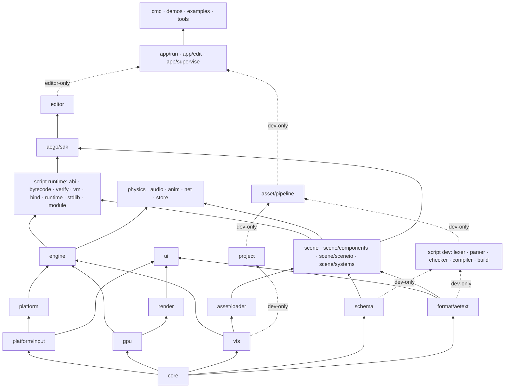

# Aego — Architecture

> **Status:** active architecture specification
> **Language:** Go 1.27+
> **Repository model:** monorepo, single root Go module `aego`
> **Scope:** 2D-first engine with a 3D foundation, native desktop targets (Android later), built-in editor, custom scripting language, compile-time native Go extensions.

---

## 1. Purpose

Aego is a game engine written in Go. It is built around five long-term goals:

1. A real native engine, not a wrapper around another engine.
2. A built-in editor with a Unity/Godot-like workflow.
3. A custom gameplay language with editor integration and hot reload.
4. Native Go extensions for projects that need to extend the engine itself.
5. A portable runtime where renderer, scene, editor and gameplay code never depend on a specific OS or graphics API.

Aego uses a small number of low-level external pieces where reimplementing platform plumbing adds no engine value: SDL3 for OS integration, generated OpenGL bindings, and build-time tools (font and icon generators in nested modules). Everything else — scene model, rendering, batching, UI, assets, scripting language and VM, editor, physics, audio mixing, networking, persistence, animation, materials, export — is owned by the engine. The root `go.mod` has no external Go dependencies.

---

## 2. Architectural principles

### 2.1 Core rules

- No global engine singletons; construction is `Builder → Engine`.
- Low-level packages never import high-level packages. The import graph is a DAG enforced by `tools/depcheck`.
- Runtime code never depends on editor or dev-only packages.
- Persistent identity is never a runtime handle; runtime handles are generational and never serialized.
- Source assets are not runtime assets; source file paths are not asset identity.
- Source files are canonical text; export and cache artifacts are binary.
- The renderer does not know about scenes; the scene does not know about the editor.
- User Go code imports only `aego/sdk`; native extensions are compiled into the project executable, never loaded with `plugin.Open`.
- Every stage ends in a runnable, testable result; stages close on acceptance criteria, not calendar dates.

### 2.2 Layers



| Layer | Responsibility |
|---|---|
| Foundation | `core`: handles, math, IDs, clock, logging, errors, stats, RNG, interning. |
| Platform contracts | `platform/input`, `platform`, `gpu`, `vfs`: OS/GPU/filesystem boundaries and backends. |
| Metadata contracts | `schema`, `format/aetext`: type metadata and source serialization. Independent of scene and editor. |
| Orchestration | `engine`: builder, worlds, phases, systems, services, jobs, frame loop. |
| Presentation | `render`, `ui`: scene-agnostic rendering and immediate-mode UI. |
| Runtime content | `asset/loader`, `scene`: runtime assets and the Node + Components world. |
| Gameplay systems | `script` runtime, `physics`, `audio`, `anim`, `net`, `store`. |
| Extension surface | `aego/sdk`: the only import for user `native/` code; a facade, not a storage layer. |
| Applications | `editor`, `runtime`. |
| Development-only | `project`, `asset/pipeline`, the script compiler, `app/*`, CLI and tools. Never part of exported runtime graphs. |

---

## 3. Decision registry

Decision IDs are stable references for reviews, migrations and ADR-style changes. Superseded decisions are rewritten in place and noted.

### 3.1 Stage 1 — Foundation

| ID | Decision |
|---|---|
| D01 | Go 1.27+; the toolchain is pinned in `go.mod`. Generic methods on concrete types are used in registry APIs. |
| D02 | SDL3 is pinned and used only for windowing, GL context, events, timing, text input, clipboard, drag/drop, lifecycle and audio device output. `SDL_Renderer` and `SDL_GPU` are not used. The cgo bridge is hand-written and limited to the calls the engine needs. |
| D03 | OpenGL 3.3 Core is the first GPU backend; public `gpu` APIs are backend-neutral. GL bindings are generated (`tools/gen-gl.sh`) into `gpu/gl33/gl`. |
| D04 | No global singletons. Construction is `Builder → Engine`. |
| D05 | All runtime resources use generational handles; public APIs never expose long-lived pointers into internal storage. |
| D06 | The main thread owns platform, GPU and authoritative game/editor state. Workers compute and return results through `Jobs.OnMain`. |
| D07 | Headless is a first-class engine configuration (`Config.Headless`), distinct from the `aego_nonative` build tag. |
| D08 | 2D world: `+X` right, `+Y` down, radians internally, positive rotation clockwise, UV `(0,0)` top-left. |
| D09 | One world unit is not one pixel; camera scale controls world-to-screen size. |
| D10 | Shader math is linear; color textures and the backbuffer use sRGB semantics. |
| D11 | Fixed timestep with accumulator and interpolation, explicit `MaxFrameDelta` and `MaxSteps`. |
| D12 | Logs are structured and channel-based; errors are typed (`errs.Error`); `panic` is reserved for violated programming invariants. |
| D13 | File-format versions are independent from the engine version. |
| D14 | Dependency direction is strictly bottom-up. |
| D15 | Stages close by acceptance criteria, never by duration. |

### 3.2 Stage 2 — Renderer

| ID | Decision |
|---|---|
| D16 | Projection matrices in `mathx` use GL clip space (`z ∈ [-1,1]`). Backend differences are neutralized through `gpu.Capabilities.ClipZeroToOne` and a fixup in `render/view`, never in `mathx`. |
| D17 | Offscreen targets render in native backend orientation. For GL the window viewport/scissor is flipped at the backend boundary; offscreen targets stay GL-native and `render/view` compensates Y. Render-target textures are exposed top-down with UV `(0,0)` top-left. |
| D18 | Texture color is premultiplied once at upload; shaders do not multiply alpha again. Standard blending is `ONE / ONE_MINUS_SRC_ALPHA`. |
| D19 | Transparent visual order is painter order `layer → order → z → submission`. Batching merges only adjacent compatible draws and never reorders by texture, sampler, blend or clip. |
| D20 | Sprites are drawn as an instanced unit quad generated from `gl_VertexID`; this is private to `render/sprite`. Sprite `z` exists only in sort metadata in the pure 2D path. |
| D21 | GL 3.3 buffer streaming uses orphaning; persistent mapping is not part of the baseline. |
| D22 | `SamplerDesc` is independent from `Texture`; the renderer caches samplers by descriptor. |
| D23 | `TextureRegion` is the drawable texture unit: whole texture, spritesheet frame, atlas cell or glyph. |
| D24 | The renderer is an ordered list of `Pass` objects (`PassDesc{ID, Before, After}`), topologically resolved and frozen when rendering starts. |
| D25 | `Camera2D.Zoom` means pixels per world unit. |
| D26 | Screen/UI coordinates are Y-down logical pixels. `PushClip` is expressed in logical target pixels and never rotates with the camera. |
| D27 | The built-in bitmap debug font is mounted from `engine://`; the editor font layer arrives in Stage 4. |
| D28 | Golden rendering tests use exact comparison for pixel-stable scenes and tolerance comparison otherwise; the Linux reference is Mesa llvmpipe with SDL offscreen video. |

### 3.3 Stage 3 — Scene, schema, assets, native extensions

| ID | Decision |
|---|---|
| D29 | The scene model is Node + Components. Transform, hierarchy, name, enabled state and visibility layers are built into the node; everything else is a component. Typed node names (`Sprite2D`, `Camera2D`) are editor creation templates, never serialized types. |
| D30 | Components use an independent sparse-set store per type. Aego does not use archetype ECS storage. |
| D31 | A node holds at most one component of a given type. |
| D32 | A `*T` from `ComponentStore[T]` is valid only within the current phase. Adds go to a pending chunked buffer and are visible through direct lookup immediately but not through iteration until flush; removes become invisible immediately and are compacted at flush. |
| D33 | Structural mutations are deferred to the phase flush. `Destroy` is logically immediate and idempotent; physical removal is deferred. |
| D34 | `NodeID` is 128-bit persistent identity; `NodeHandle` is runtime-only and never serialized. |
| D35 | Files store full type and field names; runtime uses hashes. `FormerName` / `FormerField` support renames. Hash collisions are `Freeze()` errors. |
| D36 | Source formats (`project.aego`, `.aescene`, `.aeprefab`, `.aemat`, `.aeanim`, `.meta`) are canonical aetext without comments. Export and cache artifacts are binary. Chunked containers exist only in `.aepak` and caches. |
| D37 | Unknown components are preserved as parsed semantic blocks (`engine.Unknown`) and survive load/save when the defining extension is missing. |
| D38 | Unresolved `NodeRef` / `AssetRef` keep their persistent IDs and produce diagnostics; they never silently become null. |
| D39 | Nodes store `LocalEnabled`; `EffectiveEnabled` is derived in the hierarchy pass. |
| D40 | Node names are unique among siblings, interned, and indexed by `(parent, name)` in the scene. |
| D41 | Visibility uses `Node.VisibilityLayers` and `Camera.Mask`. |
| D42 | Assets are split into runtime `asset/loader` and dev-only `asset/pipeline`. Scene depends only on `asset.Resolver`. |
| D43 | Sidecars are `<file>.<ext>.meta`; moving source and sidecar together preserves identity. |
| D44 | The import cache is content-addressed by source bytes, settings, importer version, pipeline version and dependency artifact hashes. |
| D45 | Asset hot reload is transactional: import → validate → GPU preparation → atomic swap. Failure keeps the previous resource. |
| D46 | `aego/sdk` is the only supported import for project-native Go; `tools/depcheck` enforces it for `examples/**`. |
| D47 | Native project builds use generated bootstrap code under `.aego/generated`; cache keys include engine/SDK/Go versions, target and native source state. |
| D48 | Built-in scene systems have stable IDs: `engine.transform` (flush, hierarchy, transforms, effective enabled), `engine.sprite_extract`, `engine.mesh_extract`. View construction belongs to `RenderPrepare`. |
| D49 | `FieldDescriptor` offset fast paths apply only to POD-like kinds; reference and GC-sensitive fields use typed accessors. |
| D50 | Scenes are assets; `project.aego` references the main scene by `AssetID`. |
| D51 | Engine services are typed registrations keyed by stable string IDs (`engine.Service[T]`), so upper layers attach Scene, Renderer, Loader and editor services without reverse imports. |
| D52 | The asset watcher is stdlib polling over `(path, size, mtime)` behind a `Watcher` interface. A same-size rewrite inside filesystem mtime granularity may be missed. |
| D53 | Group importers (`atlas`, `script`) finalize per-group artifacts; `Produced.Kind` is set by the importer, the pipeline is kind-agnostic. |
| D54 | Raw OS filesystem access is allowed only in `vfs`, `platform`, `tools`, `cmd`, `project`, `asset/pipeline`, `engine/bootstrap`, `app/*`. Runtime packages use VFS so the same code runs over `.aepak`. |
| D55 | `aego run` is a supervisor. Native source changes trigger `go build`; compile errors keep the current process alive; successful builds use a restart protocol where the child serializes state and exits. |
| D56 | Builtin assets use reserved `AssetID`s with `Hi = 0xae90…` (`asset.BuiltinCube`, `BuiltinWhite`, …), generated by providers in `asset/builtin` and resolved by the loader without a pipeline. |
| D57 | `engine.World` is a service container. Systems declare scope `{Play, Editor, Frame}`; `Engine.RunPhase(world, phase, scope)` runs a phase for one world. |

### 3.4 Stage 4 — Editor

| ID | Decision |
|---|---|
| D58 | Play mode clones the edit scene into a separate play world through `sceneio`. The edit scene is immutable during Play; Stop destroys the play world. |
| D59 | Editor UI fonts are pre-baked by `tools/genfont` (nested module, OFL font). `render/text.Font` is the common UTF-8 + kerning API; `BitmapFont.Font()` adapts the debug font; `FontSet.Closest(px, scale)` selects by DPI. Runtime TTF rasterization is not required. |
| D60 | One OS window; docking lives inside it. `DockTree` is serializable and does not know about native windows. |
| D61 | The editor is a UI over scene/schema/assets/render. Nothing below `editor/` imports it; runtime and `app/run` never link it. |
| D62 | All editor mutations go through history commands; a drag gesture is one transaction; delete stores a serialized fragment preserving `NodeID`s. |
| D63 | Document dirty state is derived from History position vs saved position. `Scene.Revision` exists only for cache invalidation. |
| D64 | Selection stores persistent `NodeID`, never `NodeHandle`. |
| D65 | The scene editor camera is editor state, not a scene node. |
| D66 | Scene View and Game View render into pooled render targets bucketed to 64 px. |
| D67 | Reparent preserves world transform by default; a non-invertible parent yields `SceneBadReparent`. Shear from non-uniform parent scale is not preserved. |
| D68 | Editor-only project Go code is compiled with the `aego_editor` build tag. |
| D69 | Local editor state lives in `.aego/user`, `.aego/session`, `.aego/recovery` and `.aego/editor.lock`; none is committed. |
| D70 | Input routing: modal → focused widget → hovered-panel shortcuts → global shortcuts → Scene View → Game View. Active widgets and gizmos own pointer capture. |
| D71 | Text entry uses SDL text input/editing events; text input starts on focus and stops on blur. |
| D72 | Editor extension callbacks are protected by `recover`; a panicking extension is disabled and reported. |
| D73 | Editor UI is not allocation-free. Idle budget ≤ 64 KiB/frame, target 60 FPS with a 10k-node Hierarchy. `ui/draw.List` has base/popup/modal/top streams. |
| D74 | `aego edit` with `native/`: the supervisor builds the editor from `.aego/build/editor/main.go` with `-tags aego_editor`, watches `native/*.go`, `go.mod`, `go.sum`, and exchanges `build.status`, `restart`, `handoff.aetext` + `handoff.ready` through `.aego/session/`. The editor exits with code 3 on restart; a new binary that crashes within 10 s is replaced by the previous one. |
| D75 | During Play the editor switches entirely to the play world: `Docs.Active()` returns the play view of the document (same ID/path, play scene, play history, play props). Save/Reload/recovery use the real documents. |
| D76 | Play-mode edits go to a separate history in `ModePlay` (never dirty, labels prefixed `[Play]`), destroyed on Stop. |
| D77 | The Inspector re-reads values every frame; a field being edited shows its cached value until released. |
| D78 | Inspector components are grouped by category with `DisplayName` and a module badge; order within a category is attachment order. |
| D79 | Extension creation templates live under `Create → <module>`; built-ins at the root. |
| D80 | Default layout: Hierarchy over Assets on the left, Scene/Game center, Console/Profiler bottom, Inspector right. `window.reset_layout` removes `.aego/user/layout.aetext`. |
| D81 | The top of the editor is a fixed-height MenuBar and Toolbar built from `command.Registry`; the document name and dirty marker live in the tab and window title; the native build indicator reads `build.status`. |
| D82 | Icons are an atlas in `engine/res/icons` generated by `tools/genicons`; `ui.Icon(id)` is the only way to draw one; missing IDs render a placeholder. |

### 3.5 Stage 4.5 — 3D foundation

| ID | Decision |
|---|---|
| D83 | `Node.Space ∈ {Space2D, Space3D}`. A new node inherits its parent's space; children of the root get `Scene.DefaultSpace`; `CreateIn` sets space explicitly; `SetSpace` is allowed only on a leaf without space-locked components. |
| D84 | Mixed trees: 2D under 3D is allowed (`world4 = nearest3D.World4 × Mat4Lift(2D chain)`); 3D under 2D is rejected (`SceneSpaceMismatch`). The transform pass is one pre-order traversal with three formulas. |
| D85 | 3D conventions: right-handed, Y up, camera looks down −Z. `Lift` maps 2D `(x, y)` to `(x, −y, 0)`. `QuatEuler(x, y, z) = Rz·Ry·Rx`; Euler angles exist only in UI; aetext stores `Quat` as `[x, y, z, w]`. |
| D86 | `gpu` is dimension-agnostic. `PassDesc.DepthTarget`; FBOs are cached by `(color, depth)`; `rt.Pool.Acquire(w, h, depth)` never mixes depth and non-depth targets. |
| D87 | 2D sprites with a 3D ancestor use a separate `sprites3d` pipeline (per-instance position/basis, depth test without write, back-to-front). The pure 2D path is unchanged. |
| D88 | Meshes are `AEMS` artifacts (header, counts, AABB3, vertices, indices); `.obj` import; builtin primitives Cube/Plane/Sphere/Cylinder per D56. Mesh instancing is deferred. |
| D89 | `schema.Space(k)` on `TypeDescriptor`: `SpaceAny/Space2D/Space3D`. `AddComponent` and the Inspector check compatibility. `Camera` is renamed `Camera2D` with `FormerName("engine.Camera")`. |
| D90 | `Mat3.Inverse` returns `(Mat3, bool)`; silent identity fallbacks are removed. Extension gizmos work only in 2D until the 3D gizmo API is designed. |

### 3.6 Stage 5 — Aego Script Core

| ID | Decision |
|---|---|
| D91 | Aego Script is a statically typed, Go-like language compiled to register bytecode. Files are `*.aes`; a package is a directory under `scripts/` (overlaid into `res://`); package path = `project.Module + "/" + relative directory`. Host modules and script packages share one namespace (conflict → `AES4xxx`); `aego/` is reserved for stdlib; package name must equal its directory name. Module paths contain no dots. |
| D92 | No pointers, unsafe, goroutines, channels, defer, exceptions, closures, first-class functions, inheritance, interfaces, general generics, maps or operator overloading. Type arguments are parsed everywhere but resolved only for registered intrinsics (`node.Get<T>()`, `Has<T>()`). |
| D93 | `int` = int64, `float` = float32, `bool`, `string` (immutable, literals interned, `len` in bytes). Engine value types: `Vec2 Vec3 Color Quat Rect Transform2D Transform3D`, references `NodeRef AssetRef<T> ComponentRef<T>`. User types: `struct` (value), `enum`, `[]T` (heap). Vector values are constructed with composite literals only. A short component name in `Get<T>` resolves if unique, otherwise `AES2xxx` with candidates. |
| D94 | No mutable package globals; only `const`. State lives in script instances and components. |
| D95 | `script` is a stateful attachable type. One `ScriptComponent` (`engine.Script`) per node holds attachments, at most one per script type. Attachments are stored as `script "<FullName>" enabled=… { … }` blocks keyed by full type name and property name, never by runtime index; authoring values are a `schema.PropertyBag`; unknown properties and types are preserved. |
| D96 | Script types form a dynamic layer inside `schema.Registry`: the native layer is frozen by `Freeze()`, `SetDynamic` atomically replaces only the dynamic layer and rejects name/hash collisions with the native layer. `ByID/ByName/Field` see both layers; `Components()` returns native types, `Scripts()` dynamic ones. `scene.Types.Overlay` routes Get/SetProperty for script types into `ScriptComponent`; `scene` never imports `script`. |
| D97 | `vm.Value{A, B uint64}` is exactly 16 bytes with no kind tag. int/bool/enum in `A`; float in the low 32 bits of `A`; `Vec2` A=(x,y); `Vec3` A=(x,y) B=(z,0); `Color/Quat/Rect` A=(x,y) B=(z,w); strings and slices are heap handles in `A`; `NodeRef` A=NodeHandle; `AssetRef` A,B=AssetID; `ComponentRef` A=NodeHandle, B=link-time component index. Unused bits are always zero (equality compares both words). Structs are N consecutive `Value`s with a static layout (nested structs flattened); copies are `MOVE`. The heap holds only `[]T` and `string`; GC is mark-sweep at safe points with no active frames; roots are instance fields and heap-object element masks. Instance slot 0 is `node`; script fields start at slot 1. Host methods of `NodeRef`/`AssetRef` are imported from pseudo-modules `#NodeRef`/`#AssetRef` with the receiver first; intrinsics are `#NodeRef.Get<full component name>` and `Has<…>`. Call windows are at the top of the function's register range. |
| D98 | Native bindings resolve once at link; bytecode stores symbolic host imports with signatures; `bind.Registry.ABIHash` is part of the compile cache key. No reflection in the VM hot path; adapters are generated once from Go function types. Host signatures may not contain structs or slices. |
| D99 | Bytecode is verified before execution: bounds, jump targets, register counts, call windows, host import signatures, type references, field layout, name uniqueness, code length ≤ 32768. Corrupt artifacts are rejected. Runtime-only checks (slice element width, component field index, extern arity) are documented in `bytecode/doc.go`. |
| D100 | Faults are isolated per script instance (`Running/Faulted/Disabled`). Instruction budget per callback (dev default 100k), `MaxCallDepth` 256. Native binding panics become `AES6002`. `float→int` conversion is saturating and NaN-safe for cross-platform determinism. |
| D101 | Lifecycle v1: `Ready`, `FixedUpdate(dt)`, `Update(dt)`. `Ready` runs after all instances exist and references resolve, in scene pre-order. `Update`/`FixedUpdate` run in instance creation order. Systems `script.fixed` (`PhasePrePhysics`) and `script.update` (`PhaseUpdate`) are `ScopePlay`. Instances are created only from the runtime flush, never during a VM call. |
| D102 | Authoring state (`@export` in `.aescene`) and runtime state (instance fields) are separate; Play never writes to the edit scene. |
| D103 | Compilation is transactional per package: a failure keeps the last-good artifact and marks the source `Invalid`; Play is blocked while any package is invalid. |
| D104 | The compiler (`source token lexer diag ast parser types resolver checker asm compiler build harness`) and the runtime (`abi bytecode verify bind vm runtime stdlib module`) are separate subgraphs; exported runtimes link only the runtime side. `script/abi` is the shared leaf (`Signature`, `TypeRef`, `Surface`); the checker consumes `abi.Surface`. There is no IR: v1 compiles AST → bytecode directly; `script/asm` is an assembler. |
| D105 | Language version, bytecode version and binding ABI version are independent and all recorded in artifacts. |
| D106 | `yield signal coroutine await select go chan defer interface map` are reserved from v1 (`AES1004`). |
| D107 | Visibility follows the Go rule (uppercase = exported); `@export` is scene/Inspector exposure and unrelated to visibility. |
| D108 | `@former` on script types and fields mirrors `FormerName`/`FormerField`; unknown script properties are preserved and re-saved with a warning. Input axes are `input.AxisConfig` in `platform/input`; `project` parses the `input {}` block and `app/run`/`app/edit` pass it to stdlib. |
| D109 | The builtin texture `engine/textures/white` (`AssetID ae90…0010`) is resolved by the loader without a pipeline; prototype sprites use `tint` and `size`. |
| D110 | Script packages are imported as a single `scripts` group so the checker sees the whole project; the compile cache is per package via `compiler.CacheKey`; the group ID is deterministic so last-good artifacts survive restarts. The importer publishes a structured diagnostics snapshot with a revision that the editor shows in Console. |

### 3.7 Stage 6 — Script development loop (planned)

| ID | Decision |
|---|---|
| D111 | `script/workspace` is the single project model for the language service, `aego check`, the importer and hot reload. There are no parallel compilers. |
| D112 | Overlays of unsaved files participate only in analysis; committed generations are built only from saved files. |
| D113 | Native bindings for CLI and analysis come from a manifest produced by a generated helper that calls only `Register` of the user module; no engine, SDL or GPU is created. |
| D114 | `Register` is a declarative contract (types, systems, bindings, importers, metadata); resources, windows, network and scene access belong to `Init`. |
| D115 | `aego check` is strict: a broken native build fails the check. A last-good manifest is allowed only in the editor, marked "Native API is stale". |
| D116 | A `ProgramGeneration` is immutable; the VM sees exactly one generation per frame; swaps happen in `PhaseFrameBegin` with an empty VM stack. |
| D117 | `vm.Machine`, heap, interner and instance arenas survive a swap; migration copies field values by type/field names and `@former`, never by slots. |
| D118 | Migration rules: same type — keep; new field — default; removed field — dropped (authoring value stays as unknown in the scene); incompatible type — default + warning; enum — by member name; struct — recursive; `[]T` — element-wise or reset + warning; `NodeRef`/`AssetRef` — by persistent ID; `ComponentRef` — re-resolved by `(node, type)`. |
| D119 | `Ready` is not re-run after reload; optional `Reloaded()` runs on existing instances of changed types after migration and signal rebinding. |
| D120 | Coroutines belong to an instance; destroy/fault/Stop/reload of a changed type cancel them; suspended coroutines are never carried across generations. |
| D121 | `yield` is allowed only directly inside a `coroutine` function; calling a coroutine function without `start` is a compile error. |
| D122 | Coroutines are cooperative VM tasks with their own register block; resume order is start order; budget and fault isolation match callbacks. |
| D123 | Signals are synchronous and deterministic (connection order); connects/disconnects during an emit apply after it. |
| D124 | A connection stores (owner instance, handler instance, method name, signature); after reload handlers rebind by name and are dropped with a warning on signature mismatch. |
| D125 | `ScriptRef<T>` = `(NodeHandle, script type, InstanceID)` with generational validation; `GetScript<T>()` is an intrinsic like `Get<T>()`. |
| D126 | Native Go changes go through the supervisor rebuild/restart only; no in-process Go swapping. |
| D127 | Dynamic schema and `ProgramGeneration` change in one transaction; failure of either rolls back both. |
| D128 | Analysis requests carry a generation token; stale results never reach the UI. |
| D129 | The built-in code editor calls the language service directly; no LSP transport. |
| D130 | `editor/code` (piece table, line index) is a separate subsystem, not an extension of `ui/textedit`. |

---

## 4. Dependency rules

The import graph is acyclic. The rules below are enforced by `tools/depcheck`.

### 4.1 Global

- `core/...` uses only the standard library.
- `platform/input` is a leaf input model; `platform` imports it, never the reverse. `platform.ApplyInput` converts events to state.
- `render/...` never imports `platform`, `engine`, `ui`, `scene` or `editor`; `render/module` is the only engine-integration package.
- `ui/...` may import `render`, `platform/input` and `format/aetext`, not the platform backend or `engine`.
- `schema/...` depends only on `core`; references are recognized through schema-facing contracts.
- `scene/...` never imports `editor`, `asset/pipeline` or `script`; it resolves assets only through `asset.Resolver`. `scene/sceneio` owns source serialization; `scene` does not import it.
- `asset/loader` is runtime-safe and never imports `asset/pipeline`.
- `project`, `asset/pipeline`, `app/*` and the script compiler are development-only and never enter exported runtime graphs.
- `script/...` may use `schema`, `scene` and engine services, never `editor`. `editor` never imports `script`; it works through `context.ScriptHost` implemented in `app/edit`.
- User `native/` code imports only `aego/sdk`.
- Nothing below `editor/...` imports it. `app/run`, `runtime` and non-editor `examples/**` must not import `editor`.
- `core/stats` is a leaf; renderer counters stay in `render.Stats`.
- cgo and raw OS access are restricted to approved packages (D54; `import "C"` only in `platform/sdl` and `gpu/gl33/gl`).

### 4.2 Script subgraphs

```
script/{abi,diag,source,token}                         → core, schema
script/{lexer,ast,parser,types,resolver,checker,asm,compiler,build,harness}
                                                       → core, schema, format/aetext, script dev-layer       (dev-only)
script/{bytecode,verify,vm}                            → core, schema, script/{abi,diag,source}
script/bind                                            → script/{abi,vm}, scene, engine, asset, platform/input, core
script/stdlib                                          → script/bind, runtime layer, scene, engine, asset, platform/input
script/runtime                                         → script/{abi,bytecode,verify,bind,vm}, scene, asset, engine, platform/input
script/module                                          → script/{bind,runtime,stdlib}, engine, scene
asset/importers/script                                 → script dev-layer, asset, asset/pipeline
script/{bytecode,verify,vm,bind,stdlib,runtime,module} ✗ script/{lexer,parser,checker,asm,compiler,build,harness}
```

Stage 6 adds `script/{workspace,langsvc}` to the dev layer and `script/{reload,coroutine,signal}` to the runtime layer with the same prohibition.

### 4.3 Enforcement

`tools/depcheck` checks: forbidden package-family edges; runtime → editor/dev imports; `examples/**` bypassing `aego/sdk`; `os.*` outside approved packages; `import "C"` outside native bridges; mutable global service singletons.

---

## 5. Repository layout

Numbers are the stage in which the package becomes real. Placeholder packages are not created.

```text
aego/
├── go.mod  Makefile  ARCHITECTURE.md  docs/
├── core/            handle mathx clock log errs stats ids rng strs bits        (1–3)
├── platform/        platform.go event.go ext.go  input/ sdl/ headless/          (1)   android/ (14)
├── gpu/             device.go gpu.go  gl33/ (gl/ generated, internal/glstate)  null/ (1)   gles30/ shaderc/ (12–14)
├── vfs/             vfs.go  osfs/                                                (1)   pakfs/ assetfs/ (13–14)
├── engine/          engine registry world service config loop jobs app          (1)
│                    res/ (2, engine://)  bootstrap/ (3)
├── render/          render pass viewframe pass3d viewframe3d  view/ texture/ sprite/ culling/ debug/ text/
│                    gpuprof/ rt/ mesh/ icons/ module/                            (2, 4.5)   material/ postfx/ light/ (12)
├── ui/              core/ draw/ widgets/ overlay/ layout/ textedit/ dock/ theme/ dnd/ icon.go  (2–4)   scenedebug/ (dev)
├── schema/          registry descriptor dynamic bag access refs kind options space tag hash methods  (3, 5)
├── format/aetext/   lex parse write value                                        (3)
├── project/         project.aego model, roots, native build inputs              (3, dev-only)
├── asset/           artifact id index resolver builtin  loader/  pipeline/
│                    importers/{texture,atlas,obj,scenefile,script}               (3, 4.5, 5)
├── scene/           scene node store query names space transform events overlay register
│                    components/ (incl. script.go)  sceneio/  systems/            (3, 4.5, 5)
├── script/          abi source token lexer diag ast parser types resolver checker asm compiler build harness
│                    bytecode verify bind vm runtime stdlib module               (5)
│                    workspace langsvc reload coroutine signal                     (6)   docgen (7)
├── sdk/             sdk.go editor.go input.go script.go spatial.go              (3+)
├── editor/          app context command history selection document workspace session state
│                    hierarchy inspector sceneview gameview assets console profiler play
│                    gizmo templates clipboard extension                          (4, 4.1, 4.5)
│                    code/ scripteditor/ (6)  physicsdebug (8) audiomixer (9) pixel spritesheet (10) animation (11) shader (12) export (13)
├── app/             run/ edit/ supervise/                                        (3–4, dev-only)
├── cmd/             sandbox/ aego/ aego-editor/                                  (1, 3, 4)   aego-runtime/ (13)
├── physics/ (8)  audio/ (9)  anim/ (11)  net/ store/ (13)  runtime/ (13)  templates/ (13)
├── examples/        native-rotator editor-stage4 platformer                     (3–5; sdk-only)
├── demos/           basic input resize headless sprites camera layers text offscreen stress
│                    scene-load asset-hot-reload hierarchy stress-scene mesh mixed stress-mesh  (1–4.5)
├── tests/           integration/ gl/ golden/ bench/ scenes/ scripts/
├── tools/           bootstrap-native.sh gen-gl.sh depcheck/ golden/ bench/ genfont/ genicons/ (nested modules)
└── third_party/     sdl/version.txt fonts/
```

---

## 6. User project layout

Created by `aego new MyGame [--3d] [--native]`.

```text
MyGame/
├── project.aego           name, module, mainScene (AssetID), defaultSpace, window, input axes, native flag
├── assets/                mounted into res://
├── scenes/                mounted into res://; scenes are assets with .meta
├── scripts/               mounted into res://; one Aego Script package per directory
├── native/                optional Go extensions; imports only aego/sdk
│   ├── module.go
│   └── editor_*.go        //go:build aego_editor
├── go.mod                 only when native/ exists
├── .aego/                 ignored: cache/ generated/ build/ user/ session/ recovery/ editor.lock
└── exports/
```

The engine treats `res://` as project content, never as a direct OS path. Project templates (`2d`, `3d`, `2.5d`, `empty`) are starting contents, not editor modes: the editor is one binary for all of them.

---

## 7. File formats

| Extension | Purpose | Representation |
|---|---|---|
| `project.aego` | Project metadata | canonical aetext |
| `.aescene` / `.aeprefab` | Scene / prefab source | canonical aetext |
| `.aemat` / `.aeanim` | Material / animation source (12, 11) | canonical aetext |
| `.meta` | Source asset sidecar | canonical aetext |
| `.aes` | Aego Script source | text, UTF-8, comments allowed |
| `.aeshader` | User shader (12) | text |
| `AETX` / `AEMS` / `AESB` | Texture / mesh / script bytecode artifacts | binary |
| `.aepak` | Export package (13) | binary |

Every format owns its own version (`scene_format`, `bytecode_version`, `lang_version`, `pak_format`, …); they are independent from the engine version.

---

## 8. Handles and lifetime

```go
type Handle[T any] struct {
	Index uint32
	Gen   uint32
}
```

Generation starts at 1; the zero handle is invalid; reusing an index increments the generation. Persistent data never stores a handle. A pointer returned by an arena or store is a temporary view valid until the next operation that may grow or compact the storage; callers that need stability keep the handle. GPU destruction is deferred to `EndFrame`; backend caches key resources by `{Index, Gen}`.

---

## 9. Scene model

Every node owns: `NodeID`, interned `Name`, `LocalEnabled` and derived `EffectiveEnabled`, `VisibilityLayers`, `Space`, a local transform (`Transform2D` with `Mat3` world, or `Transform3D` with `Mat4` world), and `Parent/FirstChild/NextSibling/PrevSibling` links. Component stores are sparse sets (`denseNodes`, `denseData`, `sparse`) with pending/tombstone semantics per D32–D33. The scene keeps a derived pre-order index rebuilt only on structural change; the transform pass is one linear traversal with parents before children, handling 2D×2D, 3D×3D and 3D-parent×2D-child per D84.

`Destroy(h)` marks the node dead immediately (`IsAlive` false, queries skip it); physical removal, child-name index updates and pre-order rebuild happen at flush.

---

## 10. Schema

`schema` is the single metadata source for serialization, Inspector, undo, script bindings, native extension discovery, validation, references and future replication. `TypeDescriptor{ID, FullName, Former, Version, Kind, Space, Fields, Hints}` and `FieldDescriptor{ID, Name, Former, Kind, Flags, Offset, Size, Fast, Get, Set, Min/Max, Hints}` are built once from struct tags (`aego:"name,min=,max=,former=,asset=,transient,readonly"`) via reflection at registration. After `Freeze()` lookups use IDs; POD fields may use offset fast paths; reference fields use typed accessors. Script types are a dynamic layer replaced atomically (D96) whose fields operate on a `PropertyBag`.

---

## 11. References

`NodeRef` serializes `NodeID`; `AssetRef[T]` serializes `AssetID`. Runtime handles are derived caches. A missing target keeps its ID, yields an invalid handle and a diagnostic, and is saved back unchanged.

---

## 12. Assets

`asset/loader` (editor, dev run and exported games): `AssetID → artifact index → runtime resource → residency/hot swap`; builtin providers for reserved IDs. It knows nothing about sources, sidecars, watchers or importers.

`asset/pipeline` (dev only): source scan, sidecars, `AssetID` mapping, importers and group importers, dependency graph, content-addressed cache (D44), polling watcher with coalesced batches, transactional reimport feeding `Loader.Swap`.

---

## 13. VFS

Schemes `res://`, `engine://`, `user://`, `cache://`. `res://` and `engine://` support overlay mounts (latest wins reads); `user://` and `cache://` have exactly one writable mount. Runtime code never assumes `res://` is a directory; `.aepak` mounts into the same surface.

---

## 14. Renderer

```text
scene/systems ─extract→ ViewFrame (SpriteDraw, mesh.Draw, debug, text) → render → gpu → backend
```

The renderer never receives scene or node types. Pass order per View: mesh opaque → mesh blend → sprites → sprites3d → debug → UI. Sprite visual order is painter order (D19); batching is a post-order optimization. Textures are premultiplied at upload (D18). Window and offscreen targets share one abstraction; `ReadPixels` returns RGBA8, top row first, no padding, on every backend. Editor views render into pooled targets (D66).

---

## 15. GPU contracts

- UBO blocks `ub0..ub15`, samplers `tex0..tex14`; texture unit 15 is reserved for uploads. Stage 12 shader tooling emits these automatically.
- Data passed through cgo must live in pointer-free allocations.
- One active GPU timer query per device; nested queries are forbidden; `EndQuery` in the same pass.
- `PassDesc.DepthTarget`; FBOs cached by `(color, depth)`.

---

## 16. Engine construction, worlds, services

```text
Builder.Use(modules) → Build(): platform, VFS, workers, GPU → Freeze registries → Module.Init(*Engine) → Engine
```

Services are typed registrations keyed by stable string IDs on the engine or on a `World`. A `World` is a service container plus scene state; system scope `{Play, Editor, Frame}` selects which systems run per world (`Engine.RunPhase`). The editor runs `RenderPrepare` for the edit world with `ScopeEditor` while the play world runs all phases with `ScopePlay`.

---

## 17. Frame lifecycle

```text
FrameBegin      drain OnMain, stats.begin, (Stage 6) apply pending script generation
PollEvents      platform events, input.Apply, metrics
Input
FixedBegin      × fixed steps: PrePhysics (script.fixed) · Physics · app.fixed · PostPhysics
FixedEnd
PreUpdate · Update (app.update, script.update, script.coroutines) · PostUpdate
Animation
RenderPrepare   structural flush, engine.transform, views, engine.mesh_extract, engine.sprite_extract
Render          gpu.BeginFrame, passes
RenderUI        UI / editor overlays
gpu.EndFrame, swap
FrameEnd        stats.end
```

Reserved system IDs: `app.fixed app.update app.render engine.transform engine.mesh_extract engine.sprite_extract script.fixed script.update`. Extensions order themselves with `Before`/`After` by ID.

---

## 18. Input

Separate concepts: physical scancode, layout key code, Unicode text input, pointer state, recorded `InputFrame`. Focus loss clears held state. Text fields use platform text/IME events. Axis mappings are `input.AxisConfig` from `project.aego`.

---

## 19. Editor

The editor is a client of the engine: it composes `scene`, `schema`, `asset/pipeline`, `asset/loader`, `render`, `ui`, history and the SDK extension registry. Open files are documents (edit scene, history, selection, view state, path/AssetID, dirty). Play clones the edit scene into a play world (D58); during Play the editor operates on the play world with a throwaway history (D75–D76). Mutations are history commands (D62); selection is persistent IDs; docking is inside one window; extensions (panels, commands, inspectors, gizmos, templates) are compiled under `aego_editor` and panic-isolated. `aego edit` is supervised like `aego run` with session handoff (D74). Scripts are edited from Stage 6 in `editor/scripteditor` over `editor/code`.

---

## 20. Native Go extensions

A project's `native/module.go` implements `sdk.Module` (`Register(*sdk.Registry)`) and optionally `sdk.EditorModule` under `aego_editor`. It may add components, systems, importers, script bindings, editor tools and (later) render passes. Generated bootstrap `main.go` under `.aego/generated` links the module statically for `run`, `editor`, `runtime` and (Stage 6) `manifest` modes. Rebuilds are supervised; compile errors never kill the running process.

---

## 21. UI

Immediate-mode with retained state keyed by stable IDs: focus, text buffers, scroll, active item, pointer capture, dock tree, popups. Input routing per D70. Draw streams `base/popup/modal/top` with independent clip balance. Editor fonts are pre-baked atlases (D59); icons are an atlas (D82).

---

## 22. Scripting

**Language.** Go-like syntax, static typing, no implicit numeric conversion, structs by value, enums, slices, `script` types with `@export` fields and lifecycle methods, `node` as an implicit `NodeRef`, composite-literal constructors for engine value types. Reserved keywords for coroutines and signals (D106) land in Stage 6 with `start`/`yield` and `signal`/`Emit`/`Connect`.

**Compiler.** `lexer → parser (error recovery, Bad* nodes) → resolver (package graph, cycles) → checker (types, attributes, exhaustiveness, Analysis with symbols and references) → compiler (register allocation, typed opcodes, constant folding, assembler with labels and line tables)`. Diagnostics carry codes `AES1xxx–AES6xxx`, spans and notes. Golden tests cover AST, diagnostics and disassembly.

**Bytecode and VM.** Register machine (`op a b c` / `bx` / `sbx` in 32 bits), typed arithmetic and comparisons, `CALL/CALLX/CALLH`, instance fields `GETSF/SETSF`, component fields `GETCF/SETCF`, slices `NEWSLICE/ENSURE/INDEX/SETINDEX/APPEND/LEN`, vector lanes `VEC2/3/4 GETL SETL VADD…`. The verifier rejects malformed modules; the interpreter enforces budget, call depth and runtime bounds; the heap is generational with mark-sweep at safe points.

**Bindings.** `abi` describes signatures symbolically; `bind` builds adapters once per Go function; stdlib (`math log rand time input scene testing`) and project modules register the same way; components are exposed from schema with field tables; intrinsics `Get<T>/Has<T>` resolve by name at load.

**Runtime.** Instances live in per-type arenas (slot 0 = node), schedules contain only types that define a callback, references resolve at instantiate, faults stop one instance, `PropertyBag` authoring values convert at spawn. Integration is `script/module` (systems + services); the editor never imports `script`.

**Tooling.** `aego test` (headless script tests), `aego dump script` (disassembly with source lines), `aego check` (whole-project diagnostics; native manifests in Stage 6).

---

## 23. Logging and errors

Structured channel logs (`engine platform gpu render asset scene script physics audio network editor game`), no logging in frame paths. `errs.Error` with codes; fatal only when the platform/graphics backend cannot initialize. Shader, import, extension, scene-load and script errors are recoverable diagnostics.

---

## 24. Performance policy

Runtime hot paths: zero steady-state allocations per frame, no frame-path logging, preallocated buffers with overflow counters instead of panics, VM execution without Go allocations unless the script allocates. Editor: ≤ 64 KiB/frame idle, 60 FPS with 10k nodes. Baselines live in `tests/bench/baseline.json`; regressions > 20 % fail CI.

---

## 25. Build modes and native dependencies

- Normal native build: SDL3 + GL backend.
- `aego_nonative`: excludes SDL/GL packages for pure-Go CI, tests and tools; the whole script stack builds under it.
- `Config.Headless`: a native binary without window/GPU (null backend).
- `WindowDesc.Hidden`: GPU-capable hidden window for golden and benchmark runs.

SDL is pinned in `third_party/sdl/version.txt` and built by `tools/bootstrap-native.sh` into the cache; it is never built as a side effect of `go build`. GL bindings in `gpu/gl33/gl` are generated and excluded from manual edits and lint.

---

## 26. Testing and CI

Unit (handles, math, stepper, sparse sets, hierarchy, schema freeze, aetext canonical form, VFS, dependency graph, history, UI state, lexer/parser/checker goldens, VM conformance, verifier), fuzz (lexer, bytecode decode, verifier), contract (real GL vs null backend), golden rendering and golden editor screenshots (llvmpipe, pinned fonts), scene/format round-trips and migrations, performance baselines, `depcheck`. CI runs `go test ./...`, `go vet`, staticcheck, depcheck, `aego_nonative` and native desktop builds, GL contract and golden tests, bench regression.

---

## 27. Naming

Packages are named by capability (`render/view`, `asset/loader`, `scene/sceneio`), never `utils`/`common`/`manager`. Engine-owned IDs are namespace-qualified (`engine.transform`, `render.sprites`, `script.update`, `editor.save`); project extensions use their own namespace. Dimension-dependent types carry a suffix (`Camera2D/Camera3D`, `AABB2/AABB3`, `SpriteRenderer/MeshRenderer`).

---

## 28. Architecture invariants checklist

- Does runtime remain independent from editor/dev-only packages?
- Is persistent identity separated from runtime handles?
- Does the code path work when `res://` comes from `.aepak`?
- Is backend-specific behavior confined to backend/view boundaries?
- Does render remain independent from scene, and scene from script?
- Are structural scene writes safe during iteration?
- Are unknown components and properties preserved?
- Do native extensions use only `aego/sdk`?
- Does a failed hot reload (asset or script) keep the previous working state?
- Is every source representation canonical and versioned?
- Does every edit participate in history?
- Can the feature run headless and under `aego_nonative`?
- Does the VM hot path stay free of reflection and Go allocations?

---

## 29. Stage ownership

| Stage | Ownership |
|---|---|
| 1 | Core, platform, SDL bridge, input, VFS, Builder/Engine, phases, handles, headless, GPU/RHI, logging, worker boundary |
| 2 | 2D renderer, views, batching, culling, targets, debug draw, GPU profiling, UI foundation, golden rendering |
| 3 | Schema, Node + Components, sparse sets, `project`, asset loader/pipeline, aetext, scene IO, native Go extensions, `aego run/build` |
| 4 / 4.1 | Editor v1, docking, hierarchy, inspector, views, gizmos, undo, assets, play world, extensions, supervised `aego edit`, play-mode editing |
| 4.5 | 3D foundation: spaces, Transform3D, meshes, depth, sprites3d, 3D scene view and gizmos |
| 5 | Aego Script core: language, compiler, VM, bindings, runtime, scene/editor integration, CLI |
| 6 | Script development loop: manifest and `aego check`, workspace, language service, code editor, hot reload, coroutines, signals |
| 7 | Documentation, help, playground |
| 8–12 | Physics, audio, pixel/sprite tools, animation, materials/shaders/lighting |
| 13+ | Export/pak, networking/store, Android, 2.5D projects |

---

## 30. Binaries and CLI

`aego` (CLI: `new edit run build check test dump import bootstrap`, later `export bench docs`), `aego-editor`, `sandbox`, later `aego-runtime`.

---

## 31. Final rule

When choosing between a locally convenient shortcut and preserving a boundary that later stages depend on, preserve the boundary. Platform/GPU can change without rewriting render; render without rewriting scene; scene without rewriting editor data ownership; the editor can evolve without entering runtime; the language can evolve without touching the scene; user projects can extend the engine without forking it.
