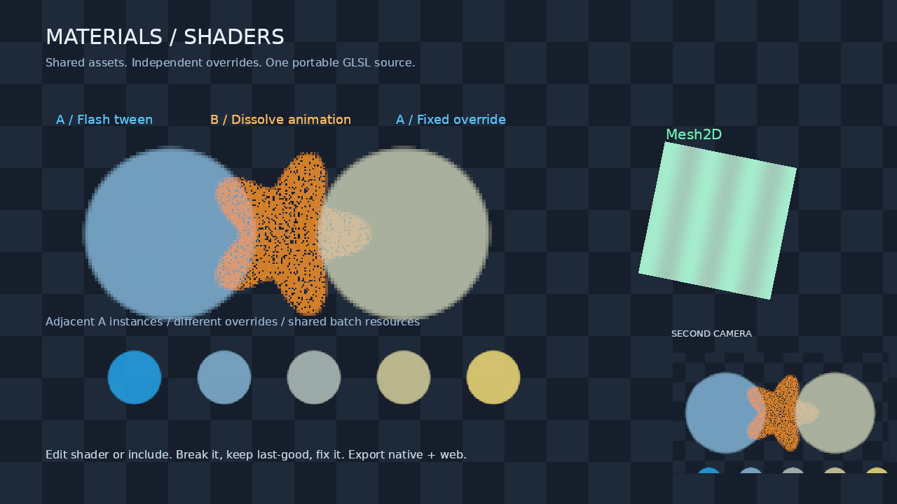

# Materials & Shaders

A complete editable Stage 12a project, using the same importer, material runtime and renderer as exported games. No native game module or renderer modification is needed.



## Run

From the engine repository:

```sh
aego check examples/materials
aego import examples/materials
aego edit examples/materials
```

Run the game directly with `aego run examples/materials`. For a deterministic CPU smoke check, use `aego run examples/materials --headless --frames 180`. Headless execution verifies loading and animation; it does not verify GPU compilation or image output.

## What the scene contains

| Scene item | Contract it demonstrates |
|---|---|
| `A — tween Flash` | A script animates `MaterialOverride.Flash` through the existing Tween propref. |
| `B — animation Dissolve` | An `.aeanim` track drives `MaterialOverride.Threshold` from 0 to 1 and back. The endpoints are fully visible and fully absent. |
| `A — explicit Flash` | The same material asset as the first A, with an independent explicit value. |
| Five `Shared A / override` nodes | Adjacent sprites with identical material, variant, atlas, sampler and pipeline; their instance values differ. |
| `Mesh2D — compatible domain` | A standard OBJ mesh uses a `mesh2d` shader and its own instance Pulse value. |
| Second camera | A smaller viewport draws the scene again with a different view matrix and viewport; its clear preserves the main camera. |
| Checkerboard | Translucent sprite overlap remains visible. The texture upload and shader follow the premultiplied contract. |

The transparent main sprites have painter order A/B/A. The material ID is not a sort key. The three small source masks share the `materials-demo` atlas. The magenta `neighbor.png` tile is deliberately packed beside them to make accidental atlas bleeding easy to spot. The noise texture uses `data=true`, `srgb=false` and no atlas. The mesh stays in a separate visible area, while the renderer's integration tests cover interleaved Sprite/Mesh2D painter order.

## Authoring and undo walkthrough

1. Open the searchable Create palette, choose **Shader**, and save the default `.aeshader` in `assets/shaders/`. In Assets, inspect it and choose **Create material from this shader**. Alternatively, **Create → Material** creates both source assets in one Assets undo transaction.
2. Select a new material in Assets. Set a numeric parameter, use the texture picker, inspect defaults and reset an explicit value. **Open material source** uses the same text document and undo log. One slider drag is one undo step.
3. Select `A — explicit Flash`. Its SpriteRenderer Material is `assets/materials/flash.aemat`. Open Material Override, drag Flash and undo/redo. The first A and the five lower instances keep their own effective values.
4. Start Play. The first A flashes; the B dissolves. Edit-mode serialized values and prefabs are unaffected by the play world's animation. Stop Play and check the Inspector value.
5. Select the material asset to see its independent offscreen preview over a checkerboard. If the session has no graphics device, the preview states that reason.
6. Use Assets Undo/Redo for source creation, source/Inspector undo for shared material edits, and scene History Undo/Redo for node overrides. Creation undo refuses to delete a source with newer saved or unsaved edits. Redo retains the same `.meta` AssetID.

## Successful, broken and recovered reload

The source shader `assets/shaders/flash.aeshader` includes `assets/shaders/include/flash_color.glsl`.

1. Edit the include's `mix` expression, for example change `amount` to `amount * amount`, and save. All consumers of the shared shader receive a candidate generation. The parameter schema, values and GPU program commit together at a frame boundary.
2. Introduce an actual GLSL error, for example replace `return mix(...)` with `return no_such_function(...)`, and save. The running scene keeps its last-good generation. Problems points to the include and its known line. Export must report the invalid current source.
3. Fix the expression and save. The new generation becomes visible; existing explicit node/material values survive. An incompatible type change with an explicit value is rejected until the value or source is corrected. Removed fields remain unknown semantic data.
4. Change a default of an inherited field and compare with an explicitly set value. Only inheritance follows the new default.

The Inspector can inspect dirty shader/schema candidates while the running scene continues to display the committed generation. Save every shader/material/include document before export.

## Native and Web export

```sh
aego export examples/materials --target host --development --check
aego export examples/materials --target web --release --check
aego export examples/materials --target host --release
aego export examples/materials --target web --release
```

The current export manifest/directory contains prepared AESH/AEMT shader and material artifacts and texture dependencies. A player performs driver compilation; it does not parse `.aemat`, resolve GLSL includes or run glslang. A broken current source blocks strict export even if last-good is still visible in the editor.

Serve the exported web directory over HTTP. Test context restore with the browser's `WEBGL_lose_context` extension and wait for `webglcontextrestored`; the engine's browser tests also exercise loss during pending shader compilation. One browser succeeding is not proof that a skipped browser or GPU check passed.

## Script and SDK entry points

The demonstration script is `scripts/demo/flash.aes`:

```aes
node.Get<MaterialOverride>().SetFloat("Flash", 0)
flash = tween.ToFloat(node, "MaterialOverride.Flash", 1, 0.9, curve.InOutSine).PingPong(-1)
```

The standalone Animation clip is `assets/anim/dissolve.aeanim`. Neither path changes the shared material asset. `MaterialOverride` has typed Set/Get methods for float, exact int32, bool, vec2, vec3, ordinary vec4 and color, plus Reset. Ordinary vec4 values use `material.Vec4`; color parameters use linear `Color`.

For built-ins, import `aego/material` and call `material.Assign(node, material.Builtin("Flash"))`. Built-in names are Unlit/Default, Additive, Flash, Dissolve, Outline and PixelSnap. Lit is not registered by Stage 12a. Native modules use `sdk.BuiltinMaterialNamed`, `sdk.AssignMaterial` and `sdk.SetMaterialParameter` / `GetMaterialParameter` / `ResetMaterialParameter`.

## Profiler and verification

The Profiler's Materials and shaders section shows material/program/variant/pending counts, per-frame frame/view/material UBO bytes, instance bytes, pipeline switches, concrete batch split reasons and cumulative compile failure/reload counts. Multiple cameras legitimately cause multiple view uploads.

The committed preview above was captured on Mesa llvmpipe, OpenGL 3.3, 1280 × 720, DPR 1. At the captured frame the scene submitted 19 sprite instances across two views, one visible mesh, nine sprite batches and ten draw calls. These numbers describe this fixed scene and buffer capacity; they are not a promise of one draw call for arbitrary materials or layouts. Tests under `tests/materials` cover actual Tween/Animation binding refresh, exact integer keys and EditScene isolation. Native and browser material integration tests cover shader output, layouts, transparency, reload and resource lifetimes.
